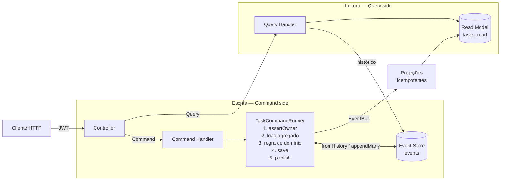
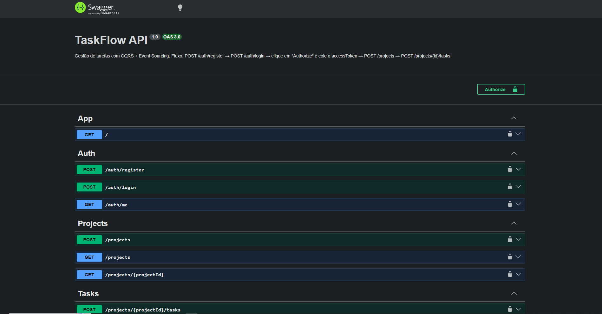

# TaskFlow

[](https://github.com/cassiocidrini/TaskFlow/actions/workflows/ci.yml)


API de gestão de tarefas em **NestJS + TypeScript** com **CQRS + Event Sourcing**: o estado de cada tarefa é
**derivado de eventos imutáveis**, o que dá histórico completo, auditoria e projeções reconstruíveis.

É o projeto prático de uma trilha de estudos de engenharia backend. Cada decisão abaixo tem um arquivo ou um
teste que a comprova; o que **não** está implementado aparece em [Limitações conhecidas](#-limitações-conhecidas).

---

## 🏆 Destaques (com evidência)

| Tema | O que foi feito | Onde ver |
|---|---|---|
| **Event Sourcing de verdade** | Agregado `Task` reconstruído dos eventos, com invariantes (tarefa concluída é imutável) e histórico consultável pela API | [`task.aggregate.ts`](src/modules/tasks/domain/task.aggregate.ts) · `GET …/tasks/:id/history` |
| **Concorrência otimista** | `UNIQUE (aggregate_id, version)` + `expectedVersion`: de 10 escritas simultâneas na mesma versão, **exatamente 1 vence** e as outras recebem `409` | [`event-store.spec.ts`](test/integration/event-store.spec.ts) |
| **Autorização (OWASP A01)** | Toda rota de tarefa exige JWT e posse do projeto; recurso alheio responde `404` (anti-enumeration) e há proteção anti-IDOR em rotas aninhadas | [`tasks.e2e-spec.ts`](test/e2e/tasks.e2e-spec.ts) |
| **Projeções idempotentes** | `INSERT … ON CONFLICT DO NOTHING` e `UPDATE … SET`: entrega duplicada, 5 entregas simultâneas e replay completo resultam no mesmo estado | [`projections.spec.ts`](test/integration/projections.spec.ts) |
| **Fail-fast de configuração** | Variáveis de ambiente validadas com `zod` no boot: configuração inválida impede a app de subir | [`env.schema.ts`](src/config/env.schema.ts) |
| **Testes com infraestrutura real** | 104 unitários · 20 de integração e 29 E2E contra **PostgreSQL real** via Testcontainers | [Testes](#-testes) |
| **Observabilidade** | OpenTelemetry → Jaeger (traces) e Prometheus (métricas p50/p95/p99) | [`tracing.ts`](src/tracing.ts) |
| **IaC** | Terraform (S3, SQS, SNS, IAM de menor privilégio) com backend remoto, sobre LocalStack | [`terraform/`](terraform/) |

---

## 🏗️ Arquitetura



- **Escrita:** cada comando carrega o agregado a partir dos eventos, valida a regra de negócio e grava os eventos novos com **concorrência otimista**. Um conflito de versão responde `409`.
- **Leitura:** listagens vêm do Read Model `tasks_read`, uma projeção desnormalizada e paginada por cursor. O histórico vem direto do Event Store.
- **Projeções** rodam depois da resposta HTTP (**consistência eventual**) e são idempotentes, o que torna seguro reprocessá-las.

### Event Sourcing na prática

`GET /projects/:projectId/tasks/:taskId/history` devolve a linha do tempo completa **e** o estado atual
reconstruído dos próprios eventos:

```json
{
  "current": { "title": "Tarefa do ciclo de vida", "status": "DONE", "version": 4, "...": "..." },
  "history": [
    { "version": 1, "type": "TaskCreated",       "occurredAt": "2026-10-18T05:43:16.244Z" },
    { "version": 2, "type": "TaskAssigned",      "occurredAt": "2026-10-18T05:43:16.278Z" },
    { "version": 3, "type": "TaskStatusChanged", "data": { "from": "PENDING", "to": "IN_PROGRESS" } },
    { "version": 4, "type": "TaskCompleted",     "occurredAt": "2026-10-18T05:43:16.306Z" }
  ]
}
```

**Por que isso importa:** durante o desenvolvimento, um bug fez a projeção gravar `priority = MEDIUM` para uma
tarefa cujo evento dizia `HIGH`. Num CRUD, o valor original estaria perdido. Aqui o histórico continuou
respondendo `HIGH`, porque **os eventos são a fonte da verdade** e a projeção é descartável e reconstruível.

### Padrões de projeto aplicados

| Padrão | Onde |
|---|---|
| **CQRS** | `commands/` × `queries/` em [`modules/tasks`](src/modules/tasks) |
| **Event Sourcing** | [`event-store.service.ts`](src/events/event-store.service.ts) + [`task.aggregate.ts`](src/modules/tasks/domain/task.aggregate.ts) |
| **Repository** | [`task.repository.ts`](src/modules/tasks/domain/task.repository.ts) (contrato) → [`event-sourced-task.repository.ts`](src/modules/tasks/infrastructure/event-sourced-task.repository.ts) |
| **Template Method** (funcional) | [`task-command.runner.ts`](src/modules/tasks/commands/task-command.runner.ts): roteiro fixo, passo variável injetado |
| **Strategy** | [`task-priority.strategy.ts`](src/modules/tasks/strategies/task-priority.strategy.ts): cálculo de prioridade |
| **Observer** | `EventBus` do `@nestjs/cqrs` → projeções |

---

## ⚡ Quickstart (≈ 5 min)

**Pré-requisitos:** Node.js 24+ e Docker (com Compose v2).

```bash
git clone https://github.com/cassiocidrini/TaskFlow.git && cd TaskFlow
cp .env.example .env                 # Windows (PowerShell): copy .env.example .env
docker compose up -d postgres jaeger
npm ci
npx prisma generate
npx prisma migrate deploy
npm run start:dev
```

Abra **http://localhost:3000/docs**: a documentação interativa (Swagger) é gerada a partir do código.



**Fluxo no Swagger:** `POST /auth/register` → `POST /auth/login` → **Authorize** (cole o `accessToken`) →
`POST /projects` → `POST /projects/{projectId}/tasks`.

<details>
<summary>Prefere o terminal? Fluxo completo com <code>curl</code> (bash)</summary>

```bash
API=http://localhost:3000
curl -s -X POST $API/auth/register -H 'Content-Type: application/json' \
  -d '{"email":"demo@taskflow.dev","name":"Demo","password":"senha12345"}'
TOKEN=$(curl -s -X POST $API/auth/login -H 'Content-Type: application/json' \
  -d '{"email":"demo@taskflow.dev","password":"senha12345"}' | jq -r .accessToken)
AUTH="Authorization: Bearer $TOKEN"

PROJECT=$(curl -s -X POST $API/projects -H "$AUTH" -H 'Content-Type: application/json' \
  -d '{"name":"Meu projeto"}' | jq -r .id)
TASK=$(curl -s -X POST $API/projects/$PROJECT/tasks -H "$AUTH" -H 'Content-Type: application/json' \
  -d '{"title":"Corrigir bug urgente","dueDate":"2026-12-31T23:59:59Z"}' | jq -r .taskId)

curl -s -X PATCH $API/projects/$PROJECT/tasks/$TASK/status -H "$AUTH" -H 'Content-Type: application/json' \
  -d '{"status":"IN_PROGRESS"}'
curl -s -X POST  $API/projects/$PROJECT/tasks/$TASK/complete -H "$AUTH"
curl -s $API/projects/$PROJECT/tasks/$TASK/history -H "$AUTH" | jq
```
</details>

### Serviços locais (`docker compose up -d`)

| Serviço | URL | Credenciais |
|---|---|---|
| API + Swagger | http://localhost:3000/docs | — |
| Jaeger (traces) | http://localhost:16686 | — |
| Métricas (exporter OTel) | http://localhost:9464/metrics | — |
| Prometheus | http://localhost:9090 | — |
| Grafana | http://localhost:3001 | `admin` / `admin` |
| LocalStack (AWS) | http://localhost:4566 | `test` / `test` |

> No Windows, os scripts `setup.ps1`, `dev.ps1` e `stop.ps1` automatizam os mesmos passos.

---

## 📡 API

Todas as rotas, exceto `register` e `login`, exigem `Authorization: Bearer <token>`.

| Método | Rota | Descrição |
|---|---|---|
| `POST` | `/auth/register` · `/auth/login` | Cadastro e login (JWT) |
| `GET` | `/auth/me` | Usuário autenticado |
| `POST` · `GET` | `/projects` | Criar / listar **meus** projetos |
| `GET` | `/projects/:projectId` | Detalhe do projeto (404 se não for meu) |
| `POST` | `/projects/:projectId/tasks` | Criar tarefa (prioridade calculada automaticamente) |
| `GET` | `/projects/:projectId/tasks?limit=&cursor=` | Listar tarefas, paginação por cursor (máx. 100) |
| `PATCH` | `/projects/:projectId/tasks/:taskId/assignee` | Atribuir responsável |
| `PATCH` | `/projects/:projectId/tasks/:taskId/status` | `PENDING` ⇄ `IN_PROGRESS` |
| `POST` | `/projects/:projectId/tasks/:taskId/complete` | Concluir (terminal: depois disso, `409`) |
| `GET` | `/projects/:projectId/tasks/:taskId/history` | Linha do tempo de eventos + estado reconstruído |

**Códigos de resposta relevantes:** `400` entrada inválida · `401` sem token · `404` recurso inexistente **ou
de outro usuário** · `409` regra de negócio violada ou conflito de concorrência · `429` rate limit.

---

## 🧪 Testes

| Suíte | Qtd. | Infraestrutura | O que prova |
|---|---:|---|---|
| **Unitários** | 104 | Nenhuma (mocks) | Regras do agregado (sem mocks), handlers, autorização, ordem `save → publish` |
| **Integração** | 20 | PostgreSQL real (Testcontainers) | Concorrência otimista, atomicidade do `appendMany`, idempotência das projeções |
| **E2E** | 29 | HTTP + PostgreSQL real | 401/400/404/409, anti-IDOR, ciclo de vida, histórico, paginação, consistência eventual |

```bash
npm run test:unit          # ~3 s — use o tempo todo
npm run test:integration   # Docker necessário
npm run test:e2e           # Docker necessário
npm test                   # as três, em sequência
npx tsc --noEmit && npm run lint
```

> As suítes com Testcontainers rodam em fila (`--runInBand`): várias instâncias de PostgreSQL em paralelo
> esgotam a memória de máquinas de desenvolvimento modestas.

### CI

Cada PR para a `main` dispara [3 jobs paralelos](.github/workflows/ci.yml), e todos são obrigatórios para o merge:
**tipos + lint + unitários + build** · **integração** · **E2E**. O workflow roda com `permissions: contents: read`
e cancela execuções obsoletas do mesmo PR.

---

## 🧭 Decisões de design

| Decisão | Alternativa descartada | Por quê |
|---|---|---|
| PostgreSQL como Event Store | EventStoreDB, Kafka | Um banco só para operar; `UNIQUE` + transações atômicas bastam para a escala do projeto |
| Concorrência otimista (`expectedVersion`) | Locks pessimistas | Sem bloqueio na leitura; o conflito é raro e detectado atomicamente pelo banco |
| `404` para recurso de outro usuário | `403` | `403` confirmaria que o recurso existe (enumeration); mesmo padrão de GitHub e S3 |
| Paginação por cursor | Offset (`?page=`) | Estável sob inserções concorrentes e sem degradar em páginas profundas |
| Projetos como CRUD simples | Event Sourcing em tudo | Projeto não tem histórico relevante; ES onde agrega valor, não por padrão |
| Agregado sem dependências de framework | Regras nos handlers | Regras num único lugar, testáveis em milissegundos sem mocks |

---

## 🚧 Limitações conhecidas

Escolhas conscientes de escopo, com o próximo passo de cada uma:

- **Dual-write entre Event Store e EventBus:** se o processo cair entre gravar e publicar, a projeção não é atualizada. Próximo passo: *Transactional Outbox* + comando de **replay** das projeções.
- **EventBus em memória:** entrega em ordem dentro de um processo. Com um broker externo (SQS/SNS), as projeções precisariam guardar a versão do agregado para descartar eventos fora de ordem.
- **Logs:** ainda sem logger estruturado em JSON nem `correlationId` ponta a ponta.
- **Dockerfile:** usa `node:20` (o projeto exige 24) e não roda como usuário não-root. Dashboards do Grafana ainda não são provisionados por arquivo.
- **Rate limit em memória:** não é compartilhado entre réplicas (em produção, usaria Redis).
- **Terraform sem lock do state:** o backend S3 não tem `use_lockfile`; dois `apply` simultâneos poderiam corromper o state.
- **Strategy de prioridade incompleto:** a estratégia é instanciada no handler (não injetada) e a `DeadlinePriorityStrategy` não é usada.

---

## 📁 Estrutura

```text
src/
├── config/                 # env.schema.ts — validação do ambiente (zod)
├── common/dto/             # paginação por cursor
├── events/                 # EventStoreService (append atômico, concorrência otimista)
├── modules/
│   ├── auth/               # JWT + bcrypt, guards, @CurrentUser
│   ├── projects/           # CRUD de projetos + assertOwner (autorização)
│   └── tasks/
│       ├── domain/         # TaskAggregate + contrato TaskRepository (sem framework)
│       ├── infrastructure/ # EventSourcedTaskRepository
│       ├── commands/       # comandos + TaskCommandRunner
│       ├── queries/        # listagem (Read Model) e histórico (Event Store)
│       ├── events/         # eventos de domínio + projeções
│       └── strategies/     # Strategy de prioridade
├── dynamo/                 # scripts de estudo de modelagem DynamoDB (Módulo 4)
├── app.setup.ts            # Helmet, CORS, ValidationPipe, Swagger (compartilhado com o E2E)
├── tracing.ts              # OpenTelemetry (carregado antes do Nest)
└── main.ts
test/
├── unit/  ├── integration/  ├── e2e/   # pirâmide de testes
└── load/                               # k6 e experimentos de Node.js internals
terraform/                              # IaC (S3, SQS, SNS, IAM)
```

---

## 📚 Trilha de estudos

Este repositório é o laboratório de uma trilha de engenharia backend. Cada módulo documenta conceitos, como
reproduzir, **problemas reais encontrados** e onde o resultado vive no código. Índice completo em
[`docs/modules/`](docs/modules/README.md).

| Módulo | Tema | No projeto |
|:-:|---|---|
| [01](docs/modules/01-observabilidade.md) | Observabilidade (OpenTelemetry, Jaeger, Prometheus, Grafana) | `tracing.ts`, `docker-compose.yml` |
| 02 | Orquestração com Kubernetes | 🔜 planejado para um ambiente Linux dedicado |
| [03](docs/modules/03-ci-cd-github-actions.md) | CI/CD com GitHub Actions | `.github/workflows/ci.yml` |
| [04](docs/modules/04-modelagem-nosql-dynamodb.md) | Modelagem NoSQL (DynamoDB, single-table, GSI) | `src/dynamo/` |
| [05](docs/modules/05-event-sourcing-cqrs.md) | Event Sourcing, CQRS e arquitetura | `src/modules/tasks/`, `src/events/` |
| [06](docs/modules/06-seguranca-owasp.md) | Segurança (OWASP Top 10) | `auth/`, `app.setup.ts`, autorização por projeto |
| [07](docs/modules/07-testes.md) | Testes (unitários, integração, E2E) | `test/` |
| [08](docs/modules/08-ia-no-desenvolvimento.md) | Engenharia assistida por IA | [`AGENTS.md`](AGENTS.md) |
| [09](docs/modules/09-infraestrutura-como-codigo.md) | Infraestrutura como Código (Terraform) | `terraform/` |
| [10](docs/modules/10-performance-load-testing.md) | Performance e load testing (k6) | `test/load/` |
| [11](docs/modules/11-nodejs-internals.md) | Node.js internals (event loop, thread pool, streams, leaks) | `test/load/` |
| [12](docs/modules/12-design-patterns.md) | Design patterns | ver [Padrões de projeto aplicados](#padrões-de-projeto-aplicados) |

---

## 📝 Licença

Projeto de estudo e portfólio. Todos os direitos reservados (`UNLICENSED`).
