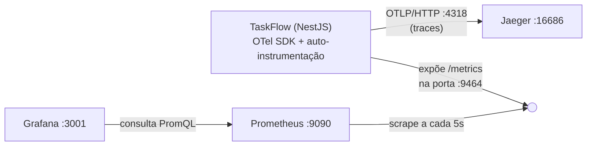

# Módulo 01 — Observabilidade (OpenTelemetry, Jaeger, Prometheus, Grafana)

> **Projeto:** TaskFlow · **Trilha:** Do Pleno ao Excelente · **Última revisão:** 18/10/2026
>
> **Onde vive no código:** [`src/tracing.ts`](../../src/tracing.ts) · [`src/env.ts`](../../src/env.ts) ·
> [`src/main.ts`](../../src/main.ts) · [`docker-compose.yml`](../../docker-compose.yml) · [`prometheus.yml`](../../prometheus.yml)

---

## 🎯 Objetivo

Instrumentar a API **NestJS** com **OpenTelemetry (OTel)** para coletar **traces** e **métricas**, e visualizá-los
em ferramentas de mercado:

| Ferramenta | Papel |
|---|---|
| **Jaeger** | Armazena e mostra traces (o caminho de cada requisição) |
| **Prometheus** | Armazena métricas como séries temporais |
| **Grafana** | Dashboards sobre o Prometheus (latência p50/p95/p99, taxa de requisições) |

**Por que importa:** sem observabilidade, um incidente em produção vira adivinhação. O OpenTelemetry é o padrão
aberto e *vendor-agnostic* do mercado: instrumenta-se uma vez e exporta-se para Jaeger, Datadog, New Relic,
Grafana Cloud ou AWS X-Ray, sem reescrever código.

---

## 🏗️ Arquitetura



1. Uma requisição HTTP chega ao NestJS.
2. A **auto-instrumentação** cria *spans* automaticamente (HTTP, Express, consultas ao PostgreSQL).
3. O **`OTLPTraceExporter`** envia os traces ao Jaeger via OTLP/HTTP.
4. O **`PrometheusExporter`** expõe as métricas em `http://localhost:9464/metrics`. Esse servidor é **do OTel**, e não a porta 3000 da API.
5. O **Prometheus** coleta (*scrape*) esse endpoint a cada 5 s, e o **Grafana** monta os dashboards a partir dele.

---

## 🧠 Conceitos

### Os três pilares

| Pilar | Responde | No TaskFlow |
|---|---|---|
| **Métricas** | *O quê* está acontecendo? (req/s, latência, erros) | ✅ Prometheus |
| **Traces** | *Onde* está o problema? (qual etapa da requisição demorou) | ✅ Jaeger |
| **Logs** | *Por quê* aconteceu? (detalhe de um evento específico) | 🟡 `Logger` do Nest em texto; logs estruturados em JSON com `correlationId` ainda **não implementados** |

### Span, trace e contexto

- **Span:** uma unidade de trabalho com início e fim (ex.: "requisição HTTP", "query SQL").
- **Trace:** a árvore de spans de uma operação completa, que mostra o que chamou o quê e quanto tempo cada parte levou.
- **Propagação de contexto:** em sistemas distribuídos, o ID do trace viaja entre serviços em headers HTTP (`traceparent`), costurando um único trace através de vários processos.

### Resource e `service.name`

O *resource* descreve **quem** emite a telemetria. Sem `service.name`, o Jaeger lista o serviço como
`unknown_service:node` (problema nº 7 da tabela abaixo).

### Exporters

| Exporter | Modelo | Destino |
|---|---|---|
| `OTLPTraceExporter` | **push**: a app envia | Jaeger (`/v1/traces`) |
| `PrometheusExporter` | **pull**: o Prometheus vem buscar | `:9464/metrics` |

### Auto-instrumentação

`getNodeAutoInstrumentations()` aplica *patches* em bibliotecas conhecidas (`http`, `express`, `pg`…) **no momento
em que elas são carregadas**. Daí a regra mais importante deste módulo: **o tracing precisa ser inicializado antes
de qualquer outra importação**. Se o `express` ou o `pg` forem carregados primeiro, eles escapam da instrumentação.

### Percentis: p50, p95, p99

| Percentil | Significado |
|---|---|
| **p50** (mediana) | Metade das requisições é mais rápida que isso |
| **p95** | 95% são mais rápidas; 1 em cada 20 usuários espera mais |
| **p99** | 99% são mais rápidas; é a "cauda" da distribuição |

**A média mente:** se 99 requisições levam 5 ms e 1 leva 5 s, a média é ~55 ms (parece ótimo), mas o p99 é 5 s.
É por isso que SLOs são definidos em percentis (ex.: *p95 < 500 ms*) e não em médias.

---

## 📋 Como reproduzir (estado atual do projeto)

### 1. Dependências

```bash
npm install @opentelemetry/sdk-node @opentelemetry/auto-instrumentations-node \
  @opentelemetry/exporter-trace-otlp-proto @opentelemetry/exporter-prometheus \
  @opentelemetry/sdk-metrics @opentelemetry/resources @opentelemetry/semantic-conventions
```

### 2. Infraestrutura local

Os serviços estão no [`docker-compose.yml`](../../docker-compose.yml):

| Serviço | Portas | Observação |
|---|---|---|
| `jaeger` (all-in-one) | `16686` UI · `4318` OTLP/HTTP · `4317` OTLP/gRPC | `COLLECTOR_OTLP_ENABLED=true` |
| `prometheus` | `9090` | Lê o [`prometheus.yml`](../../prometheus.yml) |
| `grafana` | `3001` → 3000 | Porta 3001 para não colidir com a API · `admin` / `admin` |

```yaml
# prometheus.yml — o Prometheus roda num container e "olha para fora" para achar a app
scrape_configs:
  - job_name: 'taskflow'
    static_configs:
      - targets: ['host.docker.internal:9464']
```

```bash
docker compose up -d postgres jaeger prometheus grafana
```

> `host.docker.internal` é o nome que o Docker Desktop dá à máquina hospedeira. É assim que um container
> enxerga a app rodando **fora** do Docker (`npm run start:dev`).

### 3. `src/tracing.ts`

```ts
import { NodeSDK } from '@opentelemetry/sdk-node';
import { getNodeAutoInstrumentations } from '@opentelemetry/auto-instrumentations-node';
import { OTLPTraceExporter } from '@opentelemetry/exporter-trace-otlp-proto';
import { PrometheusExporter } from '@opentelemetry/exporter-prometheus';
import { resourceFromAttributes } from '@opentelemetry/resources';
import { ATTR_SERVICE_NAME } from '@opentelemetry/semantic-conventions';
import { envSchema } from './config/env.schema';

// O tracing sobe ANTES do Nest, então ainda não existe ConfigService.
// Reaproveitamos o MESMO schema zod para validar só este campo (mesma regra, mesmo default).
const otlpEndpoint = envSchema.shape.OTEL_EXPORTER_OTLP_ENDPOINT.parse(process.env.OTEL_EXPORTER_OTLP_ENDPOINT);

const sdk = new NodeSDK({
  resource: resourceFromAttributes({ [ATTR_SERVICE_NAME]: 'taskflow' }),
  traceExporter: new OTLPTraceExporter({ url: `${otlpEndpoint}/v1/traces` }),
  metricReader: new PrometheusExporter({ port: 9464, host: '0.0.0.0' }),
  instrumentations: [getNodeAutoInstrumentations()],
});

sdk.start();
```

O endpoint do Jaeger vem da variável **`OTEL_EXPORTER_OTLP_ENDPOINT`** (default `http://localhost:4318`), validada
pelo schema de ambiente do projeto ([`env.schema.ts`](../../src/config/env.schema.ts)). Dentro de um container,
`localhost` não é o Jaeger, e por isso o endereço **não pode** ficar fixo no código.

### 4. A ordem dos imports no `src/main.ts`

```ts
import './env';      // 1º: carrega o .env (dotenv)
import './tracing';  // 2º: OTel instrumenta http/express/pg ANTES de eles serem carregados
import { NestFactory } from '@nestjs/core';
// ...
```

Trocar a ordem não quebra nada visivelmente: a app sobe normalmente, mas **parte dos spans simplesmente não
aparece**. É o tipo de bug silencioso que justifica um comentário no código e uma regra no
[`AGENTS.md`](../../AGENTS.md).

### 5. Rodar e gerar tráfego

```bash
cp .env.example .env       # Windows: copy .env.example .env
npm ci && npx prisma generate && npx prisma migrate deploy
npm run start:dev
```

```powershell
# PowerShell: 100 requisições
1..100 | ForEach-Object { curl.exe -s http://localhost:3000 | Out-Null }
```

### 6. Onde olhar

| Ferramenta | URL | O que ver |
|---|---|---|
| Jaeger | http://localhost:16686 | *Service:* `taskflow` → *Find Traces* → abrir um trace e ver os spans |
| Métricas cruas | http://localhost:9464/metrics | O texto que o Prometheus coleta |
| Prometheus | http://localhost:9090/targets | Target `taskflow` deve estar **UP** |
| Grafana | http://localhost:3001 (`admin` / `admin`) | Dashboard com p50/p95/p99 |

Consulta PromQL do **p95** usada no painel de latência:

```promql
histogram_quantile(0.95, sum by (le) (rate(http_server_request_duration_bucket[1m])))
```

---

## ⚠️ Problemas encontrados e soluções

Problemas **reais**, na ordem em que apareceram:

| # | Problema | Causa | Solução |
|---:|---|---|---|
| 1 | Prisma 8 (RC) instalado por padrão | Versão pré-lançamento com comandos novos | Fixar `prisma@7` |
| 2 | `migrate dev` não reconhecido | O Prisma 8 renomeou comandos | Voltar para o 7 |
| 3 | `url` não aceito no `schema.prisma` | O Prisma 7 moveu a URL para o `prisma.config.ts` | Criar o `prisma.config.ts` |
| 4 | `PrismaClient` "não exportado" no editor | O servidor TypeScript do VS Code ficou com tipos antigos | `F1` → *TypeScript: Restart TS Server* |
| 5 | Erros de compilação com arquivos fora de `src/` | `prisma.service.ts` estava em `prisma/` | Mover para `src/prisma/` (tudo sob o `rootDir`) |
| 6 | Nest não sobe: `DATABASE_URL` undefined | `.env` não carregado | `src/env.ts` com `import 'dotenv/config'`, importado primeiro |
| 7 | Jaeger mostra `unknown_service:node` | Faltava o `service.name` no resource | `resourceFromAttributes({ [ATTR_SERVICE_NAME]: 'taskflow' })` |
| 8 | Painel do Grafana com "No data" | Nome de métrica errado na consulta | Usar `http_server_request_duration_bucket` |
| 9 | Porta 3000 em conflito (API × Grafana) | Os dois usavam a 3000 | Grafana exposto na 3001 |
| 10 | Fluxo de criação de dashboard confuso no Grafana 12 | A UI mudou | Importar o dashboard via JSON |
| 11 | Tipos do Prisma desatualizados depois de uma migração | No Prisma 7, o `migrate dev` **não** roda mais o `prisma generate` | Sempre `npx prisma migrate dev` → `npx prisma generate` |

---

## 📊 Resultados obtidos

Medição com **100 requisições** a `GET /` (versão inicial do projeto, máquina local):

| Latência HTTP | Média | Máxima | Última |
|---|---:|---:|---:|
| **p50** | 4,71 ms | 6,21 ms | 2,69 ms |
| **p95** | 12,0 ms | 17,6 ms | 6,54 ms |
| **p99** | 19,2 ms | 23,5 ms | 9,31 ms |

| Taxa de requisições | |
|---|---:|
| Pico | 3,84 req/s |
| Média | 0,499 req/s |

O Jaeger registrou **20 traces**, com duração entre **1,93 ms** e **9,28 ms**. Repare como o **p99 (19,2 ms) é
quatro vezes o p50 (4,71 ms)** mesmo num endpoint trivial: é a cauda que a média esconderia.

---

## 🔄 Como este módulo evoluiu com o projeto

A primeira versão funcionava, mas tinha atalhos que os blocos de correção seguintes eliminaram:

| Primeira versão | Hoje | Por quê |
|---|---|---|
| Endpoint do Jaeger fixo no código | `OTEL_EXPORTER_OTLP_ENDPOINT`, validado com `zod` | Configuração pertence ao ambiente (12-Factor); em container, `localhost` é outro lugar |
| `process.env.DATABASE_URL!` no `PrismaService` | `ConfigService<Env, true>` | O `!` só calava o compilador; agora a app **recusa subir** se o valor faltar |
| `.env` com uma variável | [`.env.example`](../../.env.example) completo e documentado | Um clone novo sobe com `cp .env.example .env` |
| `console.log` no `main.ts` | `Logger` do Nest | Primeiro passo rumo a logs estruturados |

---

## 🚧 Limitações e próximos passos

- **Logs estruturados:** o terceiro pilar ainda é texto simples. O próximo passo é um logger JSON (ex.: `nestjs-pino`) com o **trace ID** em cada linha, para pular do log direto ao trace no Jaeger.
- **Dashboards como código:** o dashboard do Grafana foi importado manualmente. O ideal é provisioná-lo por arquivo (`grafana/provisioning/`), para que suba pronto com o `docker compose up`.
- **Imagens `:latest`** no `docker-compose.yml`: fixar versões garante que o ambiente de amanhã seja igual ao de hoje.
- **Amostragem (*sampling*):** hoje 100% das requisições geram trace. Em produção com alto volume, amostra-se (ex.: 10%, ou 100% só das que têm erro) para controlar custo.

---

## ✅ Checklist

- [x] OpenTelemetry SDK com auto-instrumentação, inicializado **antes** do Nest
- [x] `service.name = taskflow` visível no Jaeger
- [x] Endpoint OTLP configurável por variável de ambiente (validada)
- [x] Métricas expostas em `:9464/metrics` e coletadas pelo Prometheus
- [x] Dashboard no Grafana com p50/p95/p99 e taxa de requisições
- [ ] Logs estruturados com trace ID
- [ ] Dashboards provisionados por arquivo

---

**Próximo:** [Módulo 03 — CI/CD com GitHub Actions](03-ci-cd-github-actions.md) ·
O Módulo 02 (Kubernetes) está planejado para um ambiente Linux dedicado.
