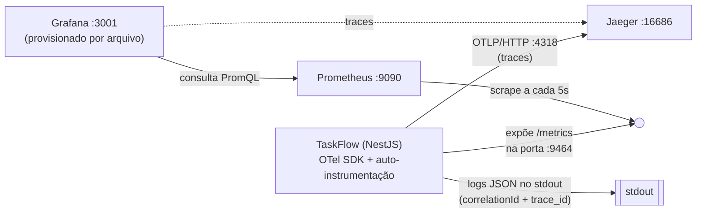

# Módulo 01 — Observabilidade (OpenTelemetry, Jaeger, Prometheus, Grafana)

> **Projeto:** TaskFlow · **Trilha:** Do Pleno ao Excelente · **Última revisão:** 10/11/2026
>
> **Onde vive no código:** [`src/tracing.ts`](../../src/tracing.ts) ·
> [`src/common/telemetry/start-telemetry.ts`](../../src/common/telemetry/start-telemetry.ts) · [`src/env.ts`](../../src/env.ts) ·
> [`src/main.ts`](../../src/main.ts) · [`src/common/logging/`](../../src/common/logging/logger.options.ts) ·
> [`src/common/correlation/`](../../src/common/correlation/correlation-id.middleware.ts) ·
> [`src/health/`](../../src/health/health.controller.ts) ·
> [`src/common/lifecycle/`](../../src/common/lifecycle/telemetry-shutdown.ts) ·
> [`src/common/telemetry/`](../../src/common/telemetry/route-telemetry.guard.ts) ·
> [`grafana/`](../../grafana/dashboards/taskflow-api.json) ·
> [`docker-compose.yml`](../../docker-compose.yml) · [`prometheus.yml`](../../prometheus.yml)

---

## 🎯 Objetivo

Instrumentar a API **NestJS** com **OpenTelemetry (OTel)** para coletar **traces** e **métricas**, emitir **logs
estruturados em JSON** ligados aos traces por `trace_id` e por um `correlationId` de negócio, e visualizar tudo em
ferramentas de mercado:

| Ferramenta | Papel |
|---|---|
| **Jaeger** | Armazena e mostra traces (o caminho de cada requisição) |
| **Prometheus** | Armazena métricas como séries temporais |
| **Grafana** | Dashboards sobre o Prometheus (latência p50/p95/p99, taxa de requisições) |

**Por que importa:** sem observabilidade, um incidente em produção vira adivinhação. O OpenTelemetry é o padrão
aberto e *vendor-agnostic* do mercado: instrumenta-se uma vez e exporta-se para Jaeger, Datadog, New Relic,
Grafana Cloud ou AWS X-Ray, sem reescrever código.

---

## 🏗️ Arquitetura



1. Uma requisição HTTP chega ao NestJS.
2. A **auto-instrumentação** cria *spans* automaticamente (HTTP, Express, consultas ao PostgreSQL).
3. O **`OTLPTraceExporter`** envia os traces ao Jaeger via OTLP/HTTP.
4. O **`PrometheusExporter`** expõe as métricas em `http://localhost:9464/metrics`. Esse servidor é **do OTel**, e não a porta 3000 da API.
5. O **Prometheus** coleta (*scrape*) esse endpoint a cada 5 s, e o **Grafana** monta os dashboards a partir dele.
   Datasources e dashboard vêm de arquivos versionados em [`grafana/`](../../grafana/): o Grafana sobe pronto.
6. Cada linha de log sai em **JSON no stdout** (`nestjs-pino`), com `correlationId`, `trace_id` e `span_id`. Quem
   coleta o stdout é a plataforma (Docker, Kubernetes, CloudWatch), não a aplicação (12-Factor, fator XI).

---

## 🧠 Conceitos

### Os três pilares

| Pilar | Responde | No TaskFlow |
|---|---|---|
| **Métricas** | *O quê* está acontecendo? (req/s, latência, erros) | ✅ Prometheus |
| **Traces** | *Onde* está o problema? (qual etapa da requisição demorou) | ✅ Jaeger |
| **Logs** | *Por quê* aconteceu? (detalhe de um evento específico) | ✅ JSON (`nestjs-pino`) com `correlationId`, `trace_id` e `span_id` em cada linha |

### Span, trace e contexto

- **Span:** uma unidade de trabalho com início e fim (ex.: "requisição HTTP", "query SQL").
- **Trace:** a árvore de spans de uma operação completa, que mostra o que chamou o quê e quanto tempo cada parte levou.
- **Propagação de contexto:** em sistemas distribuídos, o ID do trace viaja entre serviços em headers HTTP (`traceparent`), costurando um único trace através de vários processos.
- **Fronteira assíncrona:** fila, tópico ou tabela de outbox. Nenhuma auto-instrumentação atravessa uma linha parada no banco: o contexto precisa ser gravado como dado (`propagation.inject`) e restaurado do outro lado (`propagation.extract`). No TaskFlow, o `traceparent` vai na coluna `outbox.trace_context` e depois no header da mensagem do Kafka ([`trace-context.ts`](../../src/common/telemetry/trace-context.ts); desenho completo no [Módulo 13](13-mensageria-kafka.md#um-trace-só-através-da-outbox-traceparent)).

### Resource e `service.name`

O *resource* descreve **quem** emite a telemetria. Sem `service.name`, o Jaeger lista o serviço como
`unknown_service:node` (problema nº 7 da tabela abaixo).

### Exporters

| Exporter | Modelo | Destino |
|---|---|---|
| `OTLPTraceExporter` | **push**: a app envia | Jaeger (`/v1/traces`) |
| `PrometheusExporter` | **pull**: o Prometheus vem buscar | `:9464/metrics` |

### Auto-instrumentação

`getNodeAutoInstrumentations()` aplica *patches* em bibliotecas conhecidas (`http`, `express`, `pg`…) **no momento
em que elas são carregadas**. Daí a regra mais importante deste módulo: **o tracing precisa ser inicializado antes
de qualquer outra importação**. Se o `express` ou o `pg` forem carregados primeiro, eles escapam da instrumentação.

### Logs estruturados (JSON)

Log em texto livre (`Tarefa criada para o projeto X`) só se pesquisa com regex. Em JSON, cada informação é um
**campo**, e o agregador (Loki, CloudWatch Logs Insights, Datadog) filtra e agrega por ele:
`level >= 50 and req.url like '/projects%'`. Uma linha por evento, sempre no stdout.

```json
{"level":30,"time":1794257381012,"correlationId":"demo-task-001",
 "req":{"method":"POST","url":"/projects/5b23…/tasks"},
 "trace_id":"9192a6fa8a9bdbb28c4ea32e902ccb2d","span_id":"2ea7d713c26e56b4","trace_flags":"01",
 "res":{"statusCode":201},"responseTime":10,"msg":"request completed"}
```

| Decisão | Por quê |
|---|---|
| **JSON por padrão**, `LOG_PRETTY=true` só em dev | O caminho padrão é o de produção. O pino-pretty é devDependency, e o schema de ambiente **recusa o boot** com `LOG_PRETTY=true` + `NODE_ENV=production` |
| **Serializers por allowlist** (método, url, status) | O log de acesso nunca contém headers: `Authorization` e cookies não vazam (OWASP A09). Allowlist vence uma lista de `redact`, porque um header sensível novo não precisa ser lembrado |
| **Nível pelo status**: 5xx = `error`, 4xx = `warn` | `level >= 50` mostra só falha nossa; 404 e 401 são erro do cliente e não devem acordar ninguém |
| **`bufferLogs` + `app.useLogger`** | Os logs do boot também saem em JSON, e todo `new Logger(...)` do Nest passa pelo pino **sem mudar nenhum call site** |
| **`trace_id` sem código** | A instrumentação do pino já vem no `getNodeAutoInstrumentations()` e injeta `trace_id`/`span_id` em toda linha emitida dentro de um span. Exige o pino carregado **depois** do `tracing` (a ordem do `main.ts` garante) |

### `correlationId` × `trace_id`

| | `trace_id` (OTel) | `correlationId` (`X-Correlation-Id`) |
|---|---|---|
| Quem cria | A infraestrutura de tracing | O cliente (front, app mobile) ou, na falta dele, a API |
| Natureza | Técnica: amostrável, some se um salto não propagar `traceparent` | De negócio: o app pode exibi-lo na tela de erro e o usuário cita no chamado |
| Onde aparece | Logs e Jaeger | Logs, header de resposta e atributo `correlation.id` no span |

Logar os dois liga o **chamado do suporte** ao **trace no Jaeger**. O `correlationId` também é gravado no envelope
de metadados de cada evento (`events.metadata`, ver [Módulo 05](05-event-sourcing-cqrs.md#o-envelope-de-metadados))
e aparece no histórico da tarefa: dá para ir do evento à requisição que o gerou. Nas mensagens do Kafka, os dois
viajam em headers separados (`correlation-id` e `traceparent`): o relay e o consumer aparecem no **mesmo trace** do
request, e o `correlationId` continua nos logs e nos atributos dos spans deles ([Módulo 13](13-mensageria-kafka.md)).

Como funciona no TaskFlow ([`correlation-id.middleware.ts`](../../src/common/correlation/correlation-id.middleware.ts)):

1. É o **primeiro** middleware (`configureApp()`), antes do Helmet e do log de acesso. Vale igual no E2E.
2. Aceita o header só se casar com `^[A-Za-z0-9._-]{1,64}$`. Ausente ou inválido → **gera um UUID e segue**
   (correlação é diagnóstico, nunca vira 400). A regex barra *log injection* (quebra de linha forjando outra
   linha de log) e ids de 10 KB repetidos em cada linha.
3. Devolve o id no header da resposta (inclusive em erros) e o expõe via CORS (`Access-Control-Expose-Headers`).
4. Roda o resto da requisição dentro de um **`AsyncLocalStorage`**
   ([`correlation-context.ts`](../../src/common/correlation/correlation-context.ts)): qualquer código chamado
   durante a requisição lê o id com `currentCorrelationId()`, sem parâmetro, e duas requisições simultâneas nunca
   veem o id uma da outra.
5. O `pino-http` usa esse mesmo id como id da requisição, gravado com o nome `correlationId`.

**Por que um ALS próprio, e não o do `nestjs-pino`:** o de lá guarda o *logger* e só existe numa requisição HTTP.
O id também será lido por código sem HTTP (gravação de eventos, worker, consumers), que não deve depender da
biblioteca de log.

### Percentis: p50, p95, p99

| Percentil | Significado |
|---|---|
| **p50** (mediana) | Metade das requisições é mais rápida que isso |
| **p95** | 95% são mais rápidas; 1 em cada 20 usuários espera mais |
| **p99** | 99% são mais rápidas; é a "cauda" da distribuição |

**A média mente:** se 99 requisições levam 5 ms e 1 leva 5 s, a média é ~55 ms (parece ótimo), mas o p99 é 5 s.
É por isso que SLOs são definidos em percentis (ex.: *p95 < 500 ms*) e não em médias.

---

## 📋 Como reproduzir (estado atual do projeto)

### 1. Dependências

```bash
npm install @opentelemetry/sdk-node @opentelemetry/auto-instrumentations-node \
  @opentelemetry/exporter-trace-otlp-proto @opentelemetry/exporter-prometheus \
  @opentelemetry/sdk-metrics @opentelemetry/resources @opentelemetry/semantic-conventions

# Logs JSON (o @opentelemetry/api é usado direto pelo middleware de correlação)
npm install nestjs-pino pino pino-http @opentelemetry/api
npm install -D pino-pretty
```

### 2. Infraestrutura local

Os serviços estão no [`docker-compose.yml`](../../docker-compose.yml):

| Serviço | Portas | Observação |
|---|---|---|
| `jaeger` (all-in-one) | `16686` UI · `4318` OTLP/HTTP · `4317` OTLP/gRPC | `COLLECTOR_OTLP_ENABLED=true` |
| `prometheus` | `9090` | Lê o [`prometheus.yml`](../../prometheus.yml) |
| `grafana` | `3001` → 3000 | Porta 3001 para não colidir com a API · `admin` / `admin` · datasources e dashboard provisionados de `grafana/` |

```yaml
# prometheus.yml — o Prometheus roda num container e "olha para fora" para achar a app
scrape_configs:
  - job_name: 'taskflow'
    static_configs:
      - targets: ['host.docker.internal:9464']
  - job_name: 'taskflow-relay'          # relay da outbox (Módulo 13.3), processo separado
    static_configs:
      - targets: ['host.docker.internal:9465']
  - job_name: 'taskflow-notifications'  # consumer group notifications (Módulo 13.4)
    static_configs:
      - targets: ['host.docker.internal:9467']
  - job_name: 'taskflow-reports'        # consumer group reports (Módulo 13.6a)
    static_configs:
      - targets: ['host.docker.internal:9468']
```

```bash
docker compose up -d postgres jaeger prometheus grafana
```

> `host.docker.internal` é o nome da máquina hospedeira visto de dentro do container. É assim que o
> Prometheus enxerga a app rodando **fora** do Docker (`npm run start:dev`).
>
> O Docker Desktop (macOS/Windows) cria esse nome sozinho; o **Docker Engine do Linux não**. Sem ajuda, o
> alvo fica `down` com `lookup host.docker.internal: no such host`. Por isso o serviço `prometheus` declara:
>
> ```yaml
> extra_hosts:
>   - "host.docker.internal:host-gateway"   # host-gateway = IP do host na rede bridge do Docker
> ```
>
> Alternativas descartadas: `network_mode: host` (não funciona igual no Docker Desktop e tira o container da
> rede do compose) e IP fixo como `172.17.0.1` (depende da sub-rede configurada em cada máquina).
> Com firewall ativo no Linux (`ufw`), pode ser preciso liberar a porta `9464` vinda da bridge do Docker.

### 3. `startTelemetry` e os arquivos de bootstrap (`src/tracing.ts`, `src/relay-tracing.ts`)

O SDK sobe numa função parametrizada,
[`startTelemetry`](../../src/common/telemetry/start-telemetry.ts), chamada por um arquivo de bootstrap **por
processo**. São dois processos desde o [Módulo 13.3](13-mensageria-kafka.md): a API e o relay da outbox.

```ts
// src/tracing.ts — 2º import do main.ts
startTelemetry({ serviceName: 'taskflow', metricsPort: 9464 });

// src/relay-tracing.ts — 2º import do relay.ts
startTelemetry({ serviceName: 'taskflow-relay', metricsPort: 9465 /* RELAY_METRICS_PORT */ });
```

```ts
// src/common/telemetry/start-telemetry.ts (resumido)
export function startTelemetry({ serviceName, metricsPort }: TelemetryOptions): void {
  // O tracing sobe ANTES do Nest, então ainda não existe ConfigService.
  // Reaproveitamos o MESMO schema zod para validar só este campo (mesma regra, mesmo default).
  const otlpEndpoint = envSchema.shape.OTEL_EXPORTER_OTLP_ENDPOINT.parse(process.env.OTEL_EXPORTER_OTLP_ENDPOINT);

  const sdk = new NodeSDK({
    resource: resourceFromAttributes({ [ATTR_SERVICE_NAME]: serviceName }),
    traceExporter: new OTLPTraceExporter({ url: `${otlpEndpoint}/v1/traces` }),
    metricReader: new PrometheusExporter({ port: metricsPort, host: '0.0.0.0' }),
    instrumentations: [
      getNodeAutoInstrumentations({
        '@opentelemetry/instrumentation-http': { ignoreIncomingRequestHook: (req) => isHealthCheck(req.url) },
        '@opentelemetry/instrumentation-pg': { requireParentSpan: true }, // ver problema 20
      }),
    ],
  });

  sdk.start();
  // Sem handler de SIGTERM aqui: o encerramento do SDK é o último passo do graceful shutdown do Nest
  registerTelemetryShutdown(() => sdk.shutdown());
}
```

**Por que um arquivo de bootstrap por processo, e não a chamada direto no `main.ts`:** `import` é içado
(*hoisted*). Uma chamada no corpo do `main.ts` rodaria **depois** de o Nest e o `pg` já terem sido carregados, e a
auto-instrumentação não os alcançaria. O arquivo de efeito colateral importado em 2º lugar garante a ordem.

**Por que cada processo tem o seu `service.name` e a sua porta:** no Jaeger, `taskflow` e `taskflow-relay` aparecem
separados (dá para filtrar os spans de publicação do relay). E duas instâncias do exporter na mesma porta não
convivem: a segunda **perde as métricas em silêncio** (problema 21).

O endpoint do Jaeger vem da variável **`OTEL_EXPORTER_OTLP_ENDPOINT`** (default `http://localhost:4318`), validada
pelo schema de ambiente do projeto ([`env.schema.ts`](../../src/config/env.schema.ts)). Dentro de um container,
`localhost` não é o Jaeger, e por isso o endereço **não pode** ficar fixo no código.

### 4. A ordem dos imports no `src/main.ts`

```ts
import './env';      // 1º: carrega o .env (dotenv)
import './tracing';  // 2º: OTel instrumenta http/express/pg ANTES de eles serem carregados
import { NestFactory } from '@nestjs/core';
// ...
```

Trocar a ordem não quebra nada visivelmente: a app sobe normalmente, mas **parte dos spans simplesmente não
aparece**. É o tipo de bug silencioso que justifica um comentário no código e uma regra no
[`AGENTS.md`](../../AGENTS.md).

### 5. Rodar e gerar tráfego

```bash
cp .env.example .env       # Windows: copy .env.example .env
npm ci && npx prisma generate && npx prisma migrate deploy
npm run start:dev
```

```bash
# 100 requisições
for i in $(seq 1 100); do curl -s -o /dev/null http://localhost:3000; done
```

### 6. Logs e correlação

| Variável | Default | Uso |
|---|---|---|
| `LOG_LEVEL` | `info` | `fatal` · `error` · `warn` · `info` · `debug` · `trace` · `silent` (os E2E usam `silent`) |
| `LOG_PRETTY` | `false` | `true` = legível no terminal (o `.env.example` liga em dev). Proibido com `NODE_ENV=production` |

```bash
# Com LOG_PRETTY=false para ver o JSON cru:
curl -i -H 'X-Correlation-Id: chamado-1234' http://localhost:3000   # a resposta traz X-Correlation-Id: chamado-1234
curl -i -H 'X-Correlation-Id: a b<script>' http://localhost:3000   # inválido → a resposta traz um UUID novo
```

Do log ao trace: copie o `trace_id` da linha e abra `http://localhost:16686/trace/<trace_id>`. Do chamado ao
trace: no Jaeger, *Search* → *Tags* `correlation.id=chamado-1234`.

> O atributo `correlation.id` fica no span `middleware - correlationIdMiddleware` (é o span ativo quando o
> middleware roda), não no span raiz do HTTP. A busca por tag encontra o trace inteiro do mesmo jeito.

### 7. Onde olhar

| Ferramenta | URL | O que ver |
|---|---|---|
| Jaeger | http://localhost:16686 | *Service:* `taskflow` → *Find Traces* → abrir um trace e ver os spans |
| Logs | terminal do `npm run start:dev` | Uma linha JSON por evento; `correlationId` e `trace_id` em cada uma |
| Métricas cruas | http://localhost:9464/metrics | O texto que o Prometheus coleta |
| Prometheus | http://localhost:9090/targets | Target `taskflow` deve estar **UP** |
| Grafana | http://localhost:3001 (`admin` / `admin`) | *Dashboards* → pasta **TaskFlow** → **TaskFlow API** (provisionado) |

Consulta PromQL do **p95** usada no painel de latência:

```promql
histogram_quantile(0.95, sum by (le) (rate(http_server_request_duration_bucket[1m])))
```

---

## 📈 Dashboard como código

O primeiro dashboard deste módulo foi importado **à mão** (problema 10), e ficou na máquina onde foi importado: o
Grafana de um clone novo subia vazio, sem datasource. Agora tudo vem de arquivos versionados:

```text
grafana/
├── provisioning/
│   ├── datasources/datasources.yml   # Prometheus + Jaeger, com uid FIXO
│   └── dashboards/dashboards.yml     # provider: carrega grafana/dashboards/*.json
└── dashboards/taskflow-api.json      # o dashboard "TaskFlow API"
```

| Decisão | Por quê |
|---|---|
| `uid` fixo nos datasources (`taskflow-prometheus`) | O JSON do dashboard referencia o datasource pelo uid. Gerado pelo Grafana, seria diferente em cada ambiente e o JSON versionado quebraria |
| `allowUiUpdates: false` e `editable: false` | O arquivo é a fonte da verdade: mudança de dashboard passa por PR, revisada como código |
| Montar só `provisioning/datasources` e `provisioning/dashboards` | Montar a pasta `provisioning/` inteira esconde as subpastas vazias da imagem (`plugins/`, `alerting/`), e o Grafana registra erro no boot |
| Teste do JSON no CI ([`grafana-dashboard.spec.ts`](../../test/unit/grafana-dashboard.spec.ts)) | Garante que toda consulta usa uma métrica que a API expõe e todo painel aponta para um datasource provisionado. O "No data" do problema 8 vira teste vermelho, e não descoberta ao abrir o painel |

### Os painéis (12)

| Linha | Painéis | Para responder |
|---|---|---|
| **Tráfego HTTP (RED)** | req/s por rota (404 aparece como "(sem rota)") · respostas por status · latência p50/p95/p99 · p95 por rota · % de 5xx | Quanto, quantos erros, quão rápido, e **qual endpoint** |
| **Banco** | p95 das queries por operação · conexões do pool (em uso × ociosas × máximo) · requisições esperando conexão | O gargalo é o banco? |
| **Runtime Node** | event loop delay p99 · utilização do event loop · heap usado · tempo em GC | O gargalo é o próprio processo (CPU, memória)? |

As consultas usam `$__rate_interval`, e não `[1m]` fixo. O Grafana ajusta a janela ao zoom e ao intervalo de
coleta (`timeInterval: 5s` no datasource).

### Antes do dashboard: higiene das métricas

Ao levantar as métricas para os painéis, apareceram dois problemas que tornariam qualquer dashboard enganoso:

1. **Probes contados como tráfego** (problema 16). Das 61 requisições `200` medidas, 31 eram `/health/*`. Os
   probes respondem em ~1 ms, a cada 5 s, por réplica: puxam o p50 para baixo e inflam o req/s. Agora o
   `ignoreIncomingRequestHook` do `instrumentation-http` ([`tracing.ts`](../../src/tracing.ts)) os deixa fora dos
   traces e das métricas. O predicado está em [`health-paths.ts`](../../src/health/health-paths.ts), um arquivo
   sem imports, porque o `tracing.ts` não pode carregar bibliotecas antes do `sdk.start()`.
2. **Sem o label `http_route`** (problema 17). A métrica e o span raiz não sabiam a rota (`GET` em vez de
   `GET /projects/:projectId`), então não dava para ver **qual endpoint** estava lento.

**Por que não havia rota, e a correção.** O `instrumentation-http` grava a rota que encontra no `rpcMetadata` do
contexto OTel, e quem a preenche é o `instrumentation-express`. Com Express 5 + Nest, ela ficava vazia. A
correção é o [`RouteTelemetryGuard`](../../src/common/telemetry/route-telemetry.guard.ts): grava
`req.route.path` (o **padrão** da rota, nunca a URL) no `rpcMetadata` e devolve `true` sempre.

| Onde preencher a rota | Problema |
|---|---|
| Middleware | Roda **antes** do roteamento: ainda não existe rota |
| Interceptor (testado num experimento) | Roda **depois** dos guards: um 401 do JWT ou um 429 do throttler saía **sem rota**, justamente os erros que mais interessa ver por endpoint |
| **Primeiro `APP_GUARD`** ✅ | O ponto mais cedo com a rota resolvida. Não é controle de acesso (sempre `true`) |

Resultado na métrica, com a correção:

| Requisição | `http_route` |
|---|---|
| `GET /` | `/` |
| `GET /projects/3f2a…` **sem token** (401 do JWT) | `/projects/:projectId` |
| `POST /auth/login` com senha errada (401) | `/auth/login` |
| Rota inexistente (404) | *(ausente, como pede a semântica do OTel)* |
| `/health/*` | *(fora da métrica)* |

**Cardinalidade:** cada combinação de labels é uma série no Prometheus. `http_route` tem ~15 valores; a URL teria
um por UUID. O teste do dashboard também recusa agrupamento por `url`, `user_id` ou `correlation_id`.

### O que o dashboard mostrou na primeira carga

`autocannon` por 25 s em `GET /projects` (autenticado e sem token) e `GET /`, com `DISABLE_THROTTLE=true`:

| Sinal | Pico |
|---|---|
| req/s em `/projects` · em `/` | ~1.290 · ~990 |
| Latência p95 em `/projects` · em `/` | 9 ms · 5 ms |
| Conexões do pool em uso | **2 de 10**, com **0** requisições esperando conexão |
| Utilização do event loop | **100%** |

A leitura que o dashboard permite de relance: com essa carga, o limite **não é o banco** (pool folgado, nenhuma
espera), é a **CPU do processo único**. O próximo passo de capacidade seria escalar horizontalmente (mais
réplicas) ou usar `cluster`, e não aumentar o pool (ver [Módulo 10](10-performance-load-testing.md) e
[Módulo 11](11-nodejs-internals.md)).

---

## 🩺 Operação: health checks e graceful shutdown

Observabilidade responde "o que está acontecendo". Um orquestrador (Kubernetes, ECS, um load balancer) precisa
de duas respostas mais simples, a cada poucos segundos: **reinicio esta réplica?** e **mando tráfego para ela?**
E, quando ela vai sair (deploy, *scale-in*), de um encerramento que não derrube requisições.

### Liveness × readiness

| Rota | Pergunta | Verifica | Falha significa |
|---|---|---|---|
| `GET /health/live` | O processo está vivo? | Nada externo | O orquestrador **reinicia** o container |
| `GET /health/ready` | Posso receber tráfego agora? | `SELECT 1` no Postgres (até 1 s) + "não estou encerrando" | A réplica **sai do balanceador**, mas continua viva |

**Por que o liveness não olha o banco:** com o Postgres fora do ar, todas as réplicas falhariam o liveness ao mesmo
tempo e seriam reiniciadas em massa (*restart storm*). Reiniciar a API não conserta o banco, e o tráfego de boot
de todas as réplicas juntas ainda pesa no banco quando ele voltar. O readiness tira as réplicas da rotação e
as devolve sozinho quando o banco volta.

Outras decisões ([`health.controller.ts`](../../src/health/health.controller.ts)):

- **Públicos, sem JWT:** probe não autentica. O guard fica nos controllers de negócio, não global.
- **`@SkipThrottle()`:** o probe não pode tomar 429.
- **Fora do log de acesso:** um probe a cada 5 s daria ~17 mil linhas/dia por réplica sem informação. A falha
  continua no log (warn do indicador + erro do terminus em JSON).
- **Sem detalhe de infraestrutura na resposta:** o indicador próprio ([`database.health.ts`](../../src/health/database.health.ts))
  devolve só `up`/`down`. O `PrismaHealthIndicator` pronto do terminus devolveria a mensagem crua do driver
  (`connect ECONNREFUSED 10.0.3.7:5432`) numa rota pública (OWASP A05).
- **Timeout de 1 s:** um banco que *trava* é pior que um que recusa. Sem timeout, o probe ficaria pendurado.

```bash
curl -s localhost:3000/health/live    # {"status":"ok","info":{},"error":{},"details":{}}
curl -s localhost:3000/health/ready   # {"status":"ok","info":{"shutdown":{"status":"up"},"database":{"status":"up"}},…}
```

### A sequência do graceful shutdown

`app.enableShutdownHooks(['SIGTERM', 'SIGINT'])` faz o Nest rodar `app.close()` no sinal. A ordem do `close()`
está no código do Nest (`nest-application-context.js`): `onModuleDestroy` → `beforeApplicationShutdown` →
fecha o HTTP → `onApplicationShutdown`. O TaskFlow encaixa cada passo onde ele faz sentido:

```text
SIGTERM
 1. onModuleDestroy            (nada)
 2. beforeApplicationShutdown  ShutdownState: draining = true → /health/ready = 503, respostas com Connection: close
                               espera SHUTDOWN_DRAIN_MS, ainda atendendo normalmente
 3. HTTP fecha                 para de aceitar conexões e ESPERA as requisições em andamento
 4. onApplicationShutdown      Prisma desconecta → OpenTelemetry envia os spans finais
    (watchdog: se tudo isso passar de SHUTDOWN_TIMEOUT_MS, saída forçada com código 1 e log do motivo)
```

| Peça | Por quê |
|---|---|
| **Drenagem** (`SHUTDOWN_DRAIN_MS`, 0 em dev; ~5000 em Kubernetes) | O SIGTERM e a remoção do pod dos endpoints do Service acontecem **em paralelo**. Sem a janela, requisições roteadas nesse meio-tempo encontram o servidor fechado. A opção `gracefulShutdownTimeoutMs` do terminus só espera; ela não faz o readiness falhar |
| **`Connection: close` durante a drenagem** ([`draining-connection.middleware.ts`](../../src/health/draining-connection.middleware.ts)) | Proxies (ALB, nginx) mantêm um *pool* keep-alive com a réplica. O header faz o proxy descartar essas conexões em vez de reutilizá-las até o fechamento |
| **Prisma no `onApplicationShutdown`** (antes: `onModuleDestroy`) | Ver o problema 14: desconectar antes de o HTTP fechar deixava uma conexão órfã |
| **OTel pelo ciclo de vida do Nest** ([`telemetry-shutdown.ts`](../../src/common/lifecycle/telemetry-shutdown.ts)) | Antes, o `tracing.ts` tinha o próprio `process.on('SIGTERM')` com `process.exit(0)`: saía sem esperar o Nest. Agora o `tracing.ts` só **registra** `sdk.shutdown` num arquivo sem imports ([`telemetry-registry.ts`](../../src/common/lifecycle/telemetry-registry.ts)), para não carregar o `@nestjs/common` antes do `sdk.start()` |
| **Watchdog** (`SHUTDOWN_TIMEOUT_MS`, 8 s) | Abaixo dos 10 s do `docker stop`: a app sai sozinha, com log do motivo, em vez de levar `SIGKILL` em silêncio. O schema exige `DRAIN < TIMEOUT` |

### Prova: SIGTERM sob carga

Script com 20 conexões keep-alive em `GET /projects` (rota que consulta o banco), SIGTERM aos 2 s, drenagem de
2 s, polling do `/health/ready` a cada 100 ms. Cada requisição foi classificada como OK, **cortada** (`ECONNRESET`
ou 5xx: estava em andamento e morreu) ou **recusada** (`ECONNREFUSED`: chegou depois de o servidor fechar).

| Cliente | OK | Cortadas | Recusadas | Readiness |
|---|---:|---:|---:|---|
| **Como um balanceador** (para de mandar tráfego ao ver 503) | 2.872 | **0** | **0** | 200 → **503 no SIGTERM** (t=2,0 s) → fechado 2 s depois (t=4,1 s) |
| Cru (ignora o readiness e insiste na réplica) | 5.874 | 17 | 1.908 | idem |

Com um cliente que respeita o readiness, o encerramento é limpo. As 17 cortadas do cliente cru são conexões
abertas no instante do `close()`, que o Node fecha como ociosas porque ainda não tinham uma requisição lida. É o
tráfego que a drenagem existe para desviar, e nenhum balanceador o mandaria. O processo terminou com
**exit 143** (SIGTERM tratado), com os logs na ordem `ShutdownState` → `Telemetry`.

---

## ⚠️ Problemas encontrados e soluções

Problemas **reais**, na ordem em que apareceram:

| # | Problema | Causa | Solução |
|---:|---|---|---|
| 1 | Prisma 8 (RC) instalado por padrão | Versão pré-lançamento com comandos novos | Fixar `prisma@7` |
| 2 | `migrate dev` não reconhecido | O Prisma 8 renomeou comandos | Voltar para o 7 |
| 3 | `url` não aceito no `schema.prisma` | O Prisma 7 moveu a URL para o `prisma.config.ts` | Criar o `prisma.config.ts` |
| 4 | `PrismaClient` "não exportado" no editor | O servidor TypeScript do VS Code ficou com tipos antigos | `F1` → *TypeScript: Restart TS Server* |
| 5 | Erros de compilação com arquivos fora de `src/` | `prisma.service.ts` estava em `prisma/` | Mover para `src/prisma/` (tudo sob o `rootDir`) |
| 6 | Nest não sobe: `DATABASE_URL` undefined | `.env` não carregado | `src/env.ts` com `import 'dotenv/config'`, importado primeiro |
| 7 | Jaeger mostra `unknown_service:node` | Faltava o `service.name` no resource | `resourceFromAttributes({ [ATTR_SERVICE_NAME]: 'taskflow' })` |
| 8 | Painel do Grafana com "No data" | Nome de métrica errado na consulta | Usar `http_server_request_duration_bucket` |
| 9 | Porta 3000 em conflito (API × Grafana) | Os dois usavam a 3000 | Grafana exposto na 3001 |
| 10 | Fluxo de criação de dashboard confuso no Grafana 12 | A UI mudou | Importar o dashboard via JSON |
| 11 | Tipos do Prisma desatualizados depois de uma migração | No Prisma 7, o `migrate dev` **não** roda mais o `prisma generate` | Sempre `npx prisma migrate dev` → `npx prisma generate` |
| 12 | No Linux, alvo `taskflow` `down` no Prometheus (`lookup host.docker.internal: no such host`) | Só o Docker Desktop cria `host.docker.internal`; o Docker Engine não | `extra_hosts: host.docker.internal:host-gateway` no serviço `prometheus` (ver item 2) |
| 13 | Ao testar os logs, a API nova falhou com `EADDRINUSE :3000` (o erro, ao menos, já saiu em JSON) | Encerrar o `nest start --watch` com `pkill` deixou o processo filho `node dist/main` órfão, segurando a porta | Matar o órfão (`ss -ltnp \| grep 3000`). A causa de fundo, sinais de encerramento sem tratamento, é assunto do graceful shutdown |
| 14 | O Prisma desconectava **antes** de o HTTP fechar | `$disconnect` no `onModuleDestroy`, o 1º passo do `app.close()` | Mover para o `onApplicationShutdown`. A hipótese inicial ("a requisição em andamento falha com 500") estava **errada**: o teste passou na ordem antiga, porque o Prisma reconecta sozinho. O efeito real, medido no `pg_stat_activity`: a query tardia **reabria** o pool e deixava **1 conexão** aberta até o processo morrer (0 na ordem nova). O teste `graceful-shutdown.spec.ts` falha na ordem antiga |
| 15 | No primeiro teste de SIGTERM sob carga, 20 requisições "cortadas" | O script batia direto na réplica ignorando o readiness: conexões abertas no instante do `close()` levam reset | Medir com um cliente que se comporta como balanceador (0 cortadas). O `Connection: close` na drenagem cuida dos pools keep-alive de proxies |
| 16 | Metade das requisições "200" da métrica eram probes `/health/*` | A instrumentação HTTP mede toda requisição, inclusive as do orquestrador | `ignoreIncomingRequestHook` para `/health/*` no `tracing.ts` |
| 17 | Métrica sem `http_route` e span raiz chamado só `GET` | Com Express 5 + Nest, o `instrumentation-express` não preenche a rota no `rpcMetadata` | `RouteTelemetryGuard` como primeiro guard global. Um interceptor foi testado antes e descartado: perdia a rota dos 401/429 |
| 18 | Grafana registrando erro no boot após o provisionamento | Montar `provisioning/` inteira escondeu as pastas vazias `plugins/` e `alerting/` da imagem | Montar só as subpastas usadas |
| 19 | No navegador: legenda "Value" no painel de req/s e URL `taskflow-e28094-api` | A série dos 404 não tem `http_route` (o Grafana mostra "Value"); o "—" do título virou `e28094` no slug. A verificação pela API do Grafana conferia só se havia dados, não como apareciam | `label_replace(…, "http_route", "(sem rota)", "http_route", "")` e título "TaskFlow API". Lição: um dashboard também se revisa **olhando** |
| 20 | **(Módulo 13.3)** O relay da outbox, parado, gerava um trace a cada 500 ms no Jaeger (`pg.query:BEGIN`, `SELECT`…), cerca de 7 mil por hora sem informação | O polling roda fora de qualquer requisição: cada query virava um trace raiz | `'@opentelemetry/instrumentation-pg': { requireParentSpan: true }`. Conferido no Jaeger: o relay ocioso não gera traces de query, e o `POST /tasks` da API continua com os 9 spans de query dentro do span HTTP |
| 21 | **(Módulo 13.3)** Uma 2ª réplica do relay no mesmo host subia normalmente, mas sem métricas | A porta de métricas já estava em uso, e o `PrometheusExporter` **não** falha nem avisa | Porta configurável (`RELAY_METRICS_PORT`). Em produção, cada réplica tem o seu IP e o padrão basta. E `up{job="taskflow-relay"}` acusa uma réplica sem coleta |

---

## 📊 Resultados obtidos

Medição com **100 requisições** a `GET /` (versão inicial do projeto, máquina local):

| Latência HTTP | Média | Máxima | Última |
|---|---:|---:|---:|
| **p50** | 4,71 ms | 6,21 ms | 2,69 ms |
| **p95** | 12,0 ms | 17,6 ms | 6,54 ms |
| **p99** | 19,2 ms | 23,5 ms | 9,31 ms |

| Taxa de requisições | |
|---|---:|
| Pico | 3,84 req/s |
| Média | 0,499 req/s |

O Jaeger registrou **20 traces**, com duração entre **1,93 ms** e **9,28 ms**. Repare como o **p99 (19,2 ms) é
quatro vezes o p50 (4,71 ms)** mesmo num endpoint trivial: é a cauda que a média esconderia.

---

## 🔄 Como este módulo evoluiu com o projeto

A primeira versão funcionava, mas tinha atalhos que os blocos de correção seguintes eliminaram:

| Primeira versão | Hoje | Por quê |
|---|---|---|
| Endpoint do Jaeger fixo no código | `OTEL_EXPORTER_OTLP_ENDPOINT`, validado com `zod` | Configuração pertence ao ambiente (12-Factor); em container, `localhost` é outro lugar |
| `process.env.DATABASE_URL!` no `PrismaService` | `ConfigService<Env, true>` | O `!` só calava o compilador; agora a app **recusa subir** se o valor faltar |
| `.env` com uma variável | [`.env.example`](../../.env.example) completo e documentado | Um clone novo sobe com `cp .env.example .env` |
| `console.log` no `main.ts` | `Logger` do Nest | Primeiro passo rumo a logs estruturados |
| `Logger` do Nest em texto colorido | JSON via `nestjs-pino`, com `correlationId`, `trace_id` e `span_id` | Logs pesquisáveis por campo e ligados ao trace; os call sites do `Logger` não mudaram |
| `X-Correlation-Id` só listado no CORS (ninguém lia nem devolvia) | Middleware que valida, gera, devolve, expõe via CORS e propaga por `AsyncLocalStorage` | O cliente sempre tem um id para citar; o código lê o id sem recebê-lo por parâmetro |
| Dashboard importado à mão (só existia na máquina onde foi importado) | Datasources e dashboard provisionados de `grafana/`, com teste no CI | Um ambiente novo nasce observável; mudança de dashboard é PR |
| Métrica HTTP sem rota e contando probes | `http_route` em toda rota conhecida (inclusive 401/429); probes fora | Dá para ver qual endpoint degrada, sem a média diluída pelos probes |
| Sem health check; `process.exit(0)` no SIGTERM do `tracing.ts` | `/health/live` + `/health/ready` e graceful shutdown pelo ciclo de vida do Nest | O orquestrador sabe quando reiniciar e quando tirar a réplica do balanceador; deploy sem cortar requisições |
| Trace terminando no INSERT da outbox; relay e consumer em traces soltos | Contexto W3C gravado na outbox e propagado no header do Kafka: request, relay e consumer num trace só | O trace mostra onde o tempo de um evento é gasto entre processos (medido: na outbox, não no Kafka; [Módulo 13](13-mensageria-kafka.md)) |
| Um processo, `service.name` e porta fixos no `tracing.ts` | `startTelemetry({ serviceName, metricsPort })` chamado pela API (`taskflow`, 9464) e pelo relay da outbox (`taskflow-relay`, 9465); queries sem span pai fora dos traces | O relay do [Módulo 13.3](13-mensageria-kafka.md) é outro processo: precisa aparecer separado no Jaeger e no Prometheus, sem o ruído do polling |

---

## 🚧 Limitações e próximos passos

- **Probes ainda sem consumidor:** não há manifesto Kubernetes nem `HEALTHCHECK` no Dockerfile. Os probes existem e foram testados, mas nada os chama automaticamente (Módulo 02 e a troca do Dockerfile para `node:24` não-root).
- **Coleta de logs:** os logs saem em JSON no stdout, mas nenhum agregador os coleta localmente (ex.: Loki + Promtail no compose). Hoje se lê com `docker logs`/terminal.
- **`correlationId` fora do HTTP:** um log emitido fora de uma requisição (boot, script) sai sem `correlationId`, e um evento gravado fora dela fica sem o campo no envelope.
- **Sem alertas:** o dashboard mostra, mas ninguém é avisado. O próximo passo são regras de alerta (ex.: 5xx > 1% por 5 min, p95 acima do SLO) provisionadas também por arquivo.
- **Jaeger v1:** as imagens do compose têm versão fixa (nunca `:latest`, para o ambiente de amanhã ser igual ao de hoje), mas o `jaegertracing/all-in-one:1.76.0` é a última linha do **v1**, já descontinuado. O próximo passo é migrar para o Jaeger v2 (`jaegertracing/jaeger`), que é construído sobre o OpenTelemetry Collector.
- **Amostragem (*sampling*):** hoje 100% das requisições geram trace. Em produção com alto volume, amostra-se (ex.: 10%, ou 100% só das que têm erro) para controlar custo. Com a outbox, a decisão é tomada **na API** e vale para o relay e o consumer: o *flag* `sampled` viaja no `traceparent` gravado ([Módulo 13](13-mensageria-kafka.md)).

---

## ✅ Checklist

- [x] OpenTelemetry SDK com auto-instrumentação, inicializado **antes** do Nest
- [x] `service.name = taskflow` visível no Jaeger
- [x] Endpoint OTLP configurável por variável de ambiente (validada)
- [x] Métricas expostas em `:9464/metrics` e coletadas pelo Prometheus
- [x] Dashboard no Grafana com p50/p95/p99 e taxa de requisições
- [x] Logs estruturados em JSON com `trace_id`, `span_id` e `correlationId`
- [x] `X-Correlation-Id` validado, gerado, devolvido e propagado por `AsyncLocalStorage`
- [x] Trace propagado através de uma fronteira assíncrona (outbox → Kafka → consumer)
- [x] Liveness e readiness separados, sem vazar detalhes de infraestrutura
- [x] Graceful shutdown: drenagem com readiness 503, HTTP antes do banco, OTel por último, watchdog
- [x] Datasources e dashboard provisionados por arquivo, validados no CI
- [x] `http_route` nas métricas e probes fora da telemetria
- [ ] Alertas

---

**Próximo:** [Módulo 03 — CI/CD com GitHub Actions](03-ci-cd-github-actions.md) ·
O Módulo 02 (Kubernetes) está planejado para um ambiente Linux dedicado.
