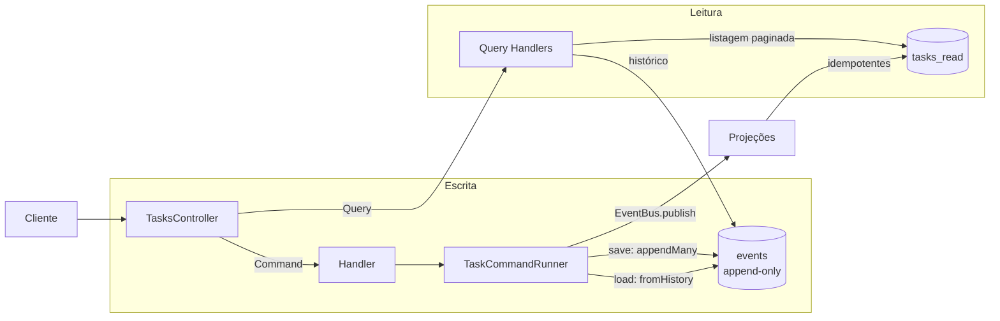

# Módulo 05 — Event Sourcing, CQRS e Arquitetura de Software

> **Projeto:** TaskFlow · **Trilha:** Do Pleno ao Excelente · **Última revisão:** 18/10/2026
>
> **Onde vive no código:** [`src/modules/tasks/`](../../src/modules/tasks/) ·
> [`src/events/event-store.service.ts`](../../src/events/event-store.service.ts) ·
> [`prisma/schema.prisma`](../../prisma/schema.prisma) (tabelas `events` e `tasks_read`)

---

## 🎯 Objetivo

1. Conhecer os principais estilos de arquitetura (MVC, Layered, Clean, Hexagonal, DDD) e **quando usar cada um**.
2. Implementar **CQRS + Event Sourcing** de verdade: o estado de uma tarefa é **derivado de eventos imutáveis**, com
   regras de negócio protegidas, concorrência controlada e histórico consultável.

**Por que importa:** esses padrões sustentam sistemas financeiros, ERPs e plataformas que precisam de auditoria.
O que separa quem "usou" de quem **domina** é saber o custo de cada um e onde **não** aplicá-los.

---

# Parte 1 — Estilos de arquitetura

| Estilo | Ideia central | Quando usar | No TaskFlow |
|---|---|---|---|
| **MVC** | Model (dados), View (apresentação), Controller (orquestração) | CRUDs e sites tradicionais | Base do NestJS: controllers + DTOs |
| **Layered** | Camadas com responsabilidades fixas; cada uma chama a de baixo | A maioria dos projetos; bom ponto de partida | `auth/` e `projects/`: controller → service → Prisma |
| **Clean Architecture** | Dependências apontam **para dentro**: o domínio não conhece framework nem banco | Domínio rico, vida longa, possível troca de infraestrutura | `modules/tasks/domain/` **não importa** Nest nem Prisma |
| **Hexagonal** (Ports & Adapters) | O domínio define **portas** (interfaces); **adaptadores** as implementam | Várias entradas (HTTP, fila, CLI) ou saídas (bancos) | Porta `TaskRepository` → adaptador `EventSourcedTaskRepository` |
| **DDD** (tático) | Modelar o código na linguagem do negócio: agregados, eventos, invariantes | Domínios complexos; não vale para CRUD | `TaskAggregate`, eventos de domínio, Repository |

### Layered × Clean, na prática

```text
Layered:  Controller → Service → Repository → Prisma           (o domínio depende da infraestrutura)
Clean:    Controller → Handler → TaskAggregate ← TaskRepository ← EventSourcedTaskRepository → Prisma
                                     (domínio)        (porta)            (adaptador)
          a seta para o domínio: é a INFRAESTRUTURA que depende dele, e não o contrário
```

O TaskFlow usa **os dois estilos de propósito**: Clean/Hexagonal onde há domínio rico (tarefas) e Layered onde há
CRUD simples (projetos, usuários). Aplicar a mesma cerimônia em tudo seria o anti-pattern *golden hammer*.

### DDD: o que foi aplicado (e o que não foi)

| Conceito | O que é | No TaskFlow |
|---|---|---|
| **Aggregate / Aggregate Root** | Unidade de consistência que protege as próprias regras | ✅ [`TaskAggregate`](../../src/modules/tasks/domain/task.aggregate.ts) |
| **Domain Event** | Fato de negócio que aconteceu | ✅ `TaskCreated`, `TaskAssigned`, `TaskStatusChanged`, `TaskCompleted` |
| **Invariante** | Regra que nunca pode ser violada | ✅ "Tarefa concluída é imutável" |
| **Repository** | Abstração de coleção de agregados | ✅ [`TaskRepository`](../../src/modules/tasks/domain/task.repository.ts) |
| **Bounded Context** | Fronteira de um modelo | 🟡 Os módulos Nest `auth`, `projects` e `tasks` fazem esse papel, de forma simplificada |
| **Value Object** | Objeto imutável definido pelo valor (`Email`, `Money`) | ❌ Não aplicado (os IDs e o e-mail são `string`) |
| **Ubiquitous Language** | Mesmo vocabulário no código e no negócio | 🟡 Nomes do domínio (`assign`, `complete`), sem um glossário formal |

---

# Parte 2 — CQRS + Event Sourcing no TaskFlow

## 2.1 Os dois conceitos

- **CQRS** (*Command Query Responsibility Segregation*): o caminho de **escrita** (commands) é separado do de **leitura** (queries), e cada um pode usar o modelo de dados mais adequado.
- **Event Sourcing:** em vez de gravar o estado atual (`status = 'DONE'`), grava-se **a sequência de fatos** que levou a ele. O estado é **calculado** aplicando os eventos em ordem.



## 2.2 O Event Store

Uma tabela **append-only**: linhas só são inseridas, nunca alteradas nem apagadas.

| Coluna | Papel |
|---|---|
| `aggregate_id` | De qual tarefa é o evento |
| `event_type` | `TaskCreated`, `TaskAssigned`… |
| `payload` (JSONB) | Os dados do fato |
| `version` | Posição do evento no histórico daquela tarefa (1, 2, 3…) |
| `created_at` | Quando aconteceu |

**`@@unique([aggregateId, version])`** é a peça mais importante da tabela, e a próxima seção explica por quê.

### Concorrência otimista

Duas requisições leem a mesma tarefa na versão 3 e tentam gravar ao mesmo tempo. Sem proteção, as duas gravam a
versão 4 (*lost update*) e o histórico fica ambíguo. A solução tem duas partes:

1. Quem grava informa a versão que **leu** (`expectedVersion`), e o evento entra em `expectedVersion + 1`.
2. O `UNIQUE (aggregate_id, version)` faz o **próprio Postgres** rejeitar a segunda gravação, de forma **atômica**. Nenhum código em JavaScript consegue fechar essa janela sozinho, porque com várias instâncias da API não existe "lock em memória" compartilhado.

```ts
// src/events/event-store.service.ts (resumido)
async appendMany(events: readonly DomainEvent[], expectedVersion: number): Promise<number> {
  try {
    // UM único INSERT com N linhas: atômico (todas entram ou nenhuma)
    await this.prisma.event.createMany({
      data: events.map((e, i) => ({ ...e, version: expectedVersion + 1 + i })),
    });
  } catch (error) {
    if (error instanceof Prisma.PrismaClientKnownRequestError && error.code === 'P2002') {
      throw new ConcurrencyConflictError(); // estende ConflictException → HTTP 409
    }
    throw error;
  }
  return expectedVersion + events.length;
}
```

> **Evidência:** o teste de integração [`event-store.spec.ts`](../../test/integration/event-store.spec.ts) dispara
> **10 `append` simultâneos** na mesma versão contra um PostgreSQL real. Resultado: **exatamente 1 sucesso e 9
> `ConcurrencyConflictError`**, sem nenhuma versão duplicada. Outro teste prova que, se uma versão do lote
> conflitar, **nenhum** evento do lote é gravado.

## 2.3 O agregado `TaskAggregate`

O coração do domínio: uma classe **pura**, sem Nest, Prisma ou banco, que:

- **se reconstrói** aplicando os eventos em ordem (`fromHistory`);
- expõe **comandos de domínio** (`assign`, `changeStatus`, `complete`) que validam as regras antes de gerar eventos;
- **só muda de estado via `apply(evento)`**, tanto no replay quanto ao executar um comando.

```ts
// src/modules/tasks/domain/task.aggregate.ts (resumido)
complete(now: Date): void {
  this.ensureNotDone('concluir');          // invariante: DONE é terminal → TaskInvariantError
  this.raise({ type: 'TaskCompleted', data: { taskId: this._id, completedAt: now.toISOString() } });
}

private raise(event: TaskDomainEvent): void {
  this.apply(event);                       // o estado em memória já reflete o fato
  this._pendingEvents.push(event);         // e o repositório vai persisti-lo
}

private apply(event: TaskDomainEvent): void {
  switch (event.type) {
    case 'TaskCreated':       /* ... */ return;
    case 'TaskAssigned':      this._assigneeId = event.data.assigneeId; return;
    case 'TaskStatusChanged': this._status = event.data.to; return;
    case 'TaskCompleted':     this._status = 'DONE'; this._completedAt = event.data.completedAt; return;
    default: { const _exhaustive: never = event; throw new Error(/* ... */); }
  }
}
```

| Detalhe | Por quê |
|---|---|
| `TaskInvariantError` sem HTTP | O domínio diz "regra violada"; quem traduz para `409` é a borda. A mesma regra funcionaria num consumidor de fila |
| `complete(now)` recebe a data | O relógio é dependência externa: lido no handler, e o agregado fica determinístico e testável |
| Comandos idempotentes | Atribuir ao mesmo responsável **não gera evento**: o histórico registra fatos que mudaram algo |
| `never` no `default` | Um evento novo sem `case` **não compila** |
| `version` = eventos **persistidos** | É o `expectedVersion` do próximo `save` |

O agregado tem **16 testes unitários sem nenhum mock** ([`task.aggregate.spec.ts`](../../test/unit/task.aggregate.spec.ts)):
entram eventos, saem eventos.

## 2.4 O Repository (porta e adaptador)

```ts
// domain/task.repository.ts — a PORTA (abstract class: existe em runtime e serve de token de DI)
export abstract class TaskRepository {
  abstract load(taskId: string): Promise<TaskAggregate | null>;
  abstract save(task: TaskAggregate): Promise<TaskDomainEvent[]>;
}

// tasks.module.ts — quem pede o contrato recebe a implementação event-sourced
{ provide: TaskRepository, useClass: EventSourcedTaskRepository }
```

- **`load`**: lê os eventos e chama `TaskAggregate.fromHistory()`. Um tipo de evento desconhecido no stream **falha alto**, em vez de produzir um agregado silenciosamente errado.
- **`save`**: pega os eventos pendentes e chama `appendMany(eventos, task.version)`. Um comando sem efeito não toca no banco.

## 2.5 O lado de escrita: um roteiro, várias regras

Todo comando que altera uma tarefa existente segue o **mesmo roteiro**, escrito uma única vez no
[`TaskCommandRunner`](../../src/modules/tasks/commands/task-command.runner.ts) (Template Method funcional):

```text
1. projects.assertOwner(projectId, userId)   → 404 se o projeto não for do usuário
2. repository.load(taskId)                   → reidrata o agregado
   tarefa de OUTRO projeto                   → o MESMO 404 (anti-IDOR)
3. mutate(task)                              → a regra; TaskInvariantError vira 409
4. repository.save(task)                     → appendMany atômico; conflito de versão → 409
5. eventBus.publish(eventos gravados)        → nunca publica o que não foi persistido
```

Com isso, cada handler tem **uma linha**:

```ts
execute({ target, assigneeId }: AssignTaskCommand) {
  return this.runner.run(target, (task) => task.assign(assigneeId));
}
```

## 2.6 Projeções e consistência eventual

As projeções (`@EventsHandler`) mantêm o `tasks_read` atualizado e rodam **depois** da resposta HTTP: é a
**consistência eventual**. Elas precisam ser **idempotentes**, porque eventos são entregues *pelo menos uma vez*
(retry, replay):

| Evento | Operação | Por que é idempotente |
|---|---|---|
| `TaskCreated` | `createMany({ skipDuplicates: true })` → `INSERT … ON CONFLICT DO NOTHING` | A 2ª entrega vira no-op, de forma atômica |
| `TaskAssigned` / `StatusChanged` / `Completed` | `updateMany(… SET coluna = valor)` | Aplicar duas vezes dá o mesmo resultado |

> **Evidência:** [`projections.spec.ts`](../../test/integration/projections.spec.ts) prova contra o PostgreSQL real
> que a entrega duplicada resulta em 1 linha, que **5 entregas simultâneas** resultam em 1 linha sem erro, e que
> **reaplicar todo o histórico** produz o mesmo estado final.

Nos testes E2E, a leitura do Read Model usa `eventually()` (repete a asserção até passar), e não um `sleep` fixo,
que seria lento quando sobra tempo e instável quando falta.

## 2.7 O lado de leitura

| Rota | Fonte | Por quê |
|---|---|---|
| `GET /projects/:id/tasks?limit=&cursor=` | `tasks_read` | Rápido, desnormalizado, paginado por cursor |
| `GET /projects/:id/tasks/:taskId/history` | `events` | A linha do tempo **é** o dado; o estado atual é reconstruído na hora |

```json
{
  "current": { "status": "DONE", "assigneeId": "c5af…", "version": 4 },
  "history": [
    { "version": 1, "type": "TaskCreated" },
    { "version": 2, "type": "TaskAssigned" },
    { "version": 3, "type": "TaskStatusChanged", "data": { "from": "PENDING", "to": "IN_PROGRESS" } },
    { "version": 4, "type": "TaskCompleted" }
  ]
}
```

### A prova de que os eventos são a fonte da verdade

Uma tarefa criada **antes** de a prioridade chegar ao Read Model ficou assim:

| Fonte | `priority` |
|---|---|
| `GET …/history` → `current.priority` (reconstruído dos eventos) | **`HIGH`** ✅ |
| `tasks_read.priority` (projeção antiga) | `MEDIUM` ❌ |

Num CRUD, o valor original estaria perdido. Aqui, a projeção errada é **recuperável por replay**: as projeções são
descartáveis, os eventos não.

## 2.8 Estendendo o domínio

Adicionar um evento novo exige mexer em **5 lugares** (união de tipos, `apply` do agregado, `toBusEvent`, lista de
tipos conhecidos do repositório e projeção). Dois deles o compilador cobra sozinho (`never`); os outros exigem
teste. A receita completa está no [`AGENTS.md`](../../AGENTS.md#adicionar-um-evento-novo-ao-ciclo-de-vida-da-tarefa-5-lugares).

---

# Parte 3 — Estrutura de pastas

```text
src/
├── config/                 # schema de ambiente (zod)
├── common/dto/             # paginação por cursor
├── events/                 # EventStoreService — compartilhado por qualquer agregado event-sourced
├── prisma/                 # PrismaService (infraestrutura)
└── modules/
    ├── auth/               # Layered: JWT, guards, @CurrentUser
    ├── projects/           # Layered: CRUD + assertOwner
    └── tasks/              # Clean/Hexagonal + CQRS + ES
        ├── domain/         #   agregado + porta TaskRepository (zero framework)
        ├── infrastructure/ #   adaptador EventSourcedTaskRepository
        ├── commands/       #   commands, handlers, TaskCommandRunner
        ├── queries/        #   listagem (Read Model) e histórico (Event Store)
        ├── events/         #   eventos de domínio + projeções
        └── strategies/     #   Strategy de prioridade
```

A regra que a estrutura comunica: **`domain/` não importa nada de `infrastructure/`**. A dependência só vai no
sentido inverso.

---

# Parte 4 — Analogias com AWS

| No TaskFlow | Na AWS | Observação |
|---|---|---|
| Event Store (`events`, PostgreSQL) | Kinesis Data Streams, EventBridge Archive | O Kinesis retém por tempo configurável (24 h por padrão, até 365 dias); um Event Store guarda **para sempre**, e é isso que permite auditoria e replay |
| `EventBus.publish` + `@EventsHandler` | SNS / EventBridge → Lambda ou SQS | No AWS a entrega é *at-least-once* e pode vir fora de ordem: as projeções precisariam guardar a versão |
| `CommandBus` + `@CommandHandler` | SQS FIFO com `MessageGroupId = aggregateId` | Ordem garantida por agregado |
| Read Model (`tasks_read`) | Tabela DynamoDB desnormalizada | Ver o [Módulo 04](04-modelagem-nosql-dynamodb.md) |
| Concorrência otimista (`UNIQUE`) | `ConditionExpression` no DynamoDB | Mesmo princípio: o banco rejeita a escrita desatualizada |

---

## 🎯 Quando usar cada padrão

| Cenário | Recomendação |
|---|---|
| CRUD simples | MVC / Layered |
| API média, sem regras complexas | Layered + Repository |
| Domínio rico, vida longa | Clean Architecture + DDD tático |
| Várias entradas (HTTP + fila + CLI) | Hexagonal |
| Auditoria obrigatória, histórico, "o que aconteceu e quando" | **Event Sourcing** + CQRS |
| Leitura muito maior que escrita, sem necessidade de histórico | **CQRS sem ES** (projeções a partir de um CRUD) |

**Custos do Event Sourcing** que não aparecem nos tutoriais: consistência eventual, projeções que precisam ser
idempotentes e reconstruíveis, versionamento do formato dos eventos ao longo dos anos e uma curva de aprendizado
real para o time.

---

## ⚠️ Problemas encontrados e soluções

| # | Problema | Causa | Solução |
|---:|---|---|---|
| 1 | Duas escritas simultâneas gravavam a **mesma versão** | `append` lia a última versão e somava 1 (*read-then-write*), e o índice não era único | `@@unique([aggregateId, version])` + `expectedVersion` → 409 |
| 2 | Um comando com vários eventos poderia salvar "pela metade" | `append` em loop: o 1º entra, o 2º conflita | `appendMany` com **um único `INSERT`** (atômico) |
| 3 | Projeção quebrava ao receber o mesmo evento duas vezes | `INSERT` simples violava a PK | `ON CONFLICT DO NOTHING` (`skipDuplicates`) |
| 4 | Falha de projeção era **invisível** | O `publish` é fire-and-forget: o cliente já recebeu 201 | Log com `taskId` + relançar o erro |
| 5 | `priority` e `dueDate` sumiam no caminho | O evento gravado e o publicado eram montados separadamente | **Um** objeto alimenta o Event Store e o EventBus |
| 6 | Uma tarefa no banco de desenvolvimento tem o título `"HIGH"` | Construtor com parâmetros posicionais do mesmo tipo: argumentos trocados | Eventos e commands com **parâmetros nomeados** |
| 7 | Read Model com `priority` errada para tarefas antigas | Default da migração não sabe o que o evento dizia | Registrado: replay das projeções (roadmap) |
| 8 | Migração do `status` para enum **apagaria os dados** | O Prisma gerou `DROP COLUMN` + `ADD COLUMN` | `--create-only` e SQL reescrito com `ALTER COLUMN … USING` |
| 9 | Teste passava e o `tsc` falhava | `ts-jest` só transpila; o cast `JsonValue → TaskDomainEvent` era inválido | *Type guard* + um único `as unknown as`, documentado |

---

## 🔄 Como este módulo evoluiu

| Primeira versão | Hoje |
|---|---|
| `CreateTask` + `GetTasks`; a tarefa nunca mudava | Ciclo de vida completo + histórico |
| Handler gerava UUID e gravava; nenhum agregado | `TaskAggregate` com invariantes, reconstruído dos eventos |
| `append` com *race condition* | Concorrência otimista garantida pelo banco, provada com teste concorrente |
| Projeção não idempotente e falha silenciosa | Idempotente, com log, testada contra o banco real |
| Handlers usavam o `PrismaService` direto | Porta `TaskRepository` + adaptador event-sourced |
| Rotas de tarefa sem autenticação | Autorização por dono do projeto + anti-IDOR |
| `TaskCompletedEvent` declarado e nunca usado | Usado pelo comando `complete` |

---

## 🚧 Limitações e próximos passos

- **Dual-write:** se o processo cair entre gravar no Event Store e publicar no EventBus, a projeção não é atualizada. Próximo passo: **Transactional Outbox**, com um *projector* lendo a tabela `events` por posição e guardando um *checkpoint*.
- **Replay das projeções:** falta o comando `projections:rebuild`, que esvaziaria o `tasks_read` e reaplicaria todos os eventos (e corrigiria as prioridades antigas).
- **Snapshots:** agregados com milhares de eventos ficariam lentos para carregar; um snapshot a cada N versões resolveria.
- **Versionamento de eventos:** o formato do payload vai mudar com o tempo; seria preciso *upcasting* (converter eventos antigos para o formato novo na leitura).
- **EventBus em memória:** entrega em ordem dentro de um processo. Com um broker externo, as projeções teriam de guardar a versão do agregado e descartar eventos fora de ordem.

---

## ✅ Checklist

- [x] Event Store append-only com versão por agregado
- [x] Concorrência otimista garantida pelo banco (`UNIQUE` + `expectedVersion`), com teste concorrente
- [x] Agregado com invariantes, reconstruído dos eventos, sem dependência de framework
- [x] Repository como porta + adaptador
- [x] Roteiro único dos comandos (autorização, regra, persistência, publicação)
- [x] Projeções idempotentes, testadas contra o banco real
- [x] Histórico consultável pela API, com estado reconstruído
- [ ] Transactional Outbox e replay das projeções
- [ ] Snapshots e versionamento de eventos

---

**Anterior:** [Módulo 04 — Modelagem NoSQL com DynamoDB](04-modelagem-nosql-dynamodb.md) ·
**Próximo:** [Módulo 06 — Segurança (OWASP Top 10)](06-seguranca-owasp.md)
