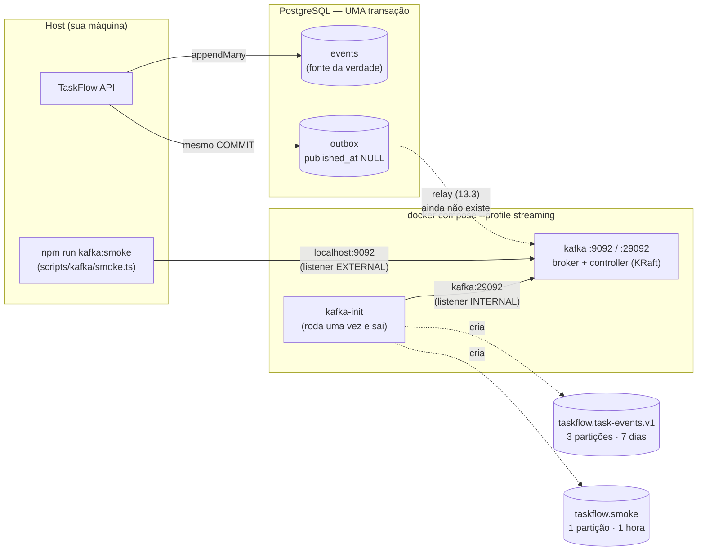

# Módulo 13 — Mensageria e streaming de eventos com Kafka

> **Projeto:** TaskFlow · **Trilha:** Do Pleno ao Excelente · **Última revisão:** 10/11/2026
>
> **Status:** 🚧 em construção, etapa **13.2 de 13.8** (Transactional Outbox). Cada etapa acrescenta a sua parte a
> este documento; o mapa completo está na seção "Roteiro do módulo", logo abaixo.
>
> **Onde vive no código:** [`docker-compose.yml`](../../docker-compose.yml) (serviços `kafka` e `kafka-init`, profile
> `streaming`) · [`scripts/kafka/smoke.ts`](../../scripts/kafka/smoke.ts) ·
> [`event-store.service.ts`](../../src/events/event-store.service.ts) (`appendMany` com outbox) ·
> [`outbox.ts`](../../src/events/outbox.ts) ·
> [`task.integration-events.ts`](../../src/modules/tasks/events/task.integration-events.ts) (o contrato público) ·
> tabela `outbox` em [`schema.prisma`](../../prisma/schema.prisma)

---

## 🎯 Objetivo

Levar os eventos de tarefa para **fora do processo**, num broker que vários consumidores independentes possam ler,
cada um no seu ritmo, com a possibilidade de **reler o histórico** (*replay*). Tudo isso sem perder a garantia que o
TaskFlow já tem hoje: o que foi gravado no Event Store é o que foi publicado.

**Por que importa:** hoje o `EventBus` é **em memória**. Se o processo cair entre gravar o evento e publicá-lo, a
projeção não é atualizada (o *dual-write* das limitações do [Módulo 05](05-event-sourcing-cqrs.md)). E só quem está
dentro do mesmo processo consegue reagir a um evento. Um sistema de verdade tem outros serviços interessados no mesmo
fato: notificação, relatório, auditoria, antifraude. Cada um precisa receber o evento **pelo menos uma vez**, tratá-lo
**exatamente uma vez** e poder ser reconstruído do zero.

---

## 🗺️ Roteiro do módulo

| Etapa | O que entrega | Status |
|---|---|:-:|
| **13.1** | Broker Kafka 4 (KRaft) no compose, tópico `taskflow.task-events.v1`, smoke test do cliente | ✅ |
| **13.2** | **Transactional Outbox**: o evento de integração gravado na **mesma transação** do Event Store | ✅ |
| 13.3 | **Relay**: processo *worker* que publica o outbox no Kafka (produtor idempotente, chave = `aggregateId`) | 🔜 |
| 13.4 | Consumer group `notifications` com **idempotência** (`processed_events` na mesma transação do efeito) | 🔜 |
| 13.5 | **Retry com backoff** e **dead-letter topic** | 🔜 |
| 13.6 | Consumer group `reports` (projeção `project_stats`), **replay** e painel de **lag** | 🔜 |
| 13.7 | *(opcional)* Kafka (fato) × **SQS** (trabalho): envio de push por SQS + Lambda | 🔜 |
| 13.8 | ADRs e o diagrama final | 🔜 |

---

## 🏗️ Arquitetura (estado atual: 13.2)



Hoje a API já grava, a cada comando, o evento de integração na outbox. Ninguém lê essa tabela ainda: o relay que
publica no Kafka é a etapa 13.3. Ao fim do módulo: `API → (mesma transação) events + outbox → relay → Kafka →
consumer groups`.

---

## 🧠 Conceitos

### O vocabulário, com um paralelo para quem vem de SQS/SNS

| Kafka | O que é | Paralelo AWS (aproximado) |
|---|---|---|
| **Broker** | Servidor que guarda e serve as mensagens | O serviço SQS/SNS em si |
| **Tópico** | Nome lógico de um fluxo de mensagens | Um tópico SNS |
| **Partição** | Pedaço do tópico: um **log append-only e ordenado**. Unidade de paralelismo **e** de ordem | Um *message group* de uma fila SQS FIFO |
| **Offset** | Posição de uma mensagem dentro da partição (0, 1, 2…) | Não existe: o SQS apaga a mensagem ao processá-la |
| **Chave (*key*)** | Define a partição: mesma chave → mesma partição → **mesma ordem** | `MessageGroupId` do SQS FIFO |
| **Consumer group** | Conjunto de consumidores que **dividem** as partições de um tópico; cada grupo lê **tudo**, independente dos outros | Cada fila SQS assinando o mesmo tópico SNS (*fan-out*) |
| **Offset commitado** | "Até onde este grupo já processou", guardado pelo próprio Kafka | O *delete* da mensagem no SQS |
| **Lag** | Mensagens ainda não processadas por um grupo (`log-end-offset − offset commitado`) | `ApproximateNumberOfMessagesVisible` |
| **Retenção** | Por quanto tempo o log é guardado, **processado ou não** | Retenção da fila (só até ser consumida, no máx. 14 dias) |

**A diferença que muda o desenho:** no SQS, consumir **apaga**. No Kafka, consumir só **move o offset do grupo**;
a mensagem continua no log até a retenção vencer. Por isso, no Kafka:

- um consumidor novo pode ler o histórico desde o início (`fromBeginning`);
- um consumidor com bug pode **voltar o offset** e reprocessar (*replay*, etapa 13.6);
- vários grupos leem o mesmo fato sem que o broker precise copiar a mensagem para cada um.

### Partições: paralelismo e ordem são a mesma decisão

- A ordem só é garantida **dentro** de uma partição. Entre partições, não há ordem.
- A chave decide a partição (`hash(chave) % nº de partições`). No TaskFlow a chave será o `aggregateId` (etapa 13.3):
  todos os eventos de **uma tarefa** caem na mesma partição, em ordem. Tarefas diferentes se espalham pelas 3.
- Num consumer group, cada partição é lida por **no máximo um** consumidor do grupo. Com 3 partições, até 3
  consumidores trabalham em paralelo; um 4º ficaria ocioso.
- Aumentar partições depois **muda o mapeamento chave → partição** e quebra a ordem durante a transição. Por isso o
  número entra no contrato do tópico desde o início.

### KRaft (sem ZooKeeper)

Até o Kafka 3.x, os metadados do cluster (quais tópicos existem, quem é líder de cada partição) ficavam num
ZooKeeper separado. No **KRaft**, um quórum de *controllers* do próprio Kafka guarda esses metadados num log Raft.
O Kafka 4 **só** funciona assim. Aqui, o único nó é **broker e controller** ao mesmo tempo (`KAFKA_PROCESS_ROLES:
broker,controller`); em produção, os controllers costumam ficar em nós dedicados (3, para tolerar a perda de 1).

### Replicação, ISR e `acks` (o que este ambiente NÃO tem)

Em produção, cada partição tem réplicas em brokers diferentes (fator de replicação **3**). O **ISR** (*in-sync
replicas*) é o conjunto de réplicas em dia com o líder. Com `acks=all` no produtor e `min.insync.replicas=2` no
tópico, uma escrita só é confirmada quando **2 réplicas** a têm: um broker pode morrer sem perder mensagem
confirmada. Com **1 nó** isso é impossível (RF 1), e este ambiente existe para desenvolvimento.

### Por que Kafka (e não SNS+SQS ou Redpanda) neste projeto

| Opção | A favor | Contra | Decisão |
|---|---|---|---|
| **Kafka** | Log retido e **relível** (replay); ordem por chave; vários grupos lendo o mesmo fato; padrão de mercado para *event streaming* | Operar um cluster (aqui, só 1 nó local) | ✅ **Escolhido**: o módulo existe para cobrir event streaming com replay |
| **SNS + SQS** | Gerenciado na AWS, zero operação; DLQ nativa; ótimo para **distribuir trabalho** | Sem replay (consumir apaga); ordem só com FIFO e com limite de vazão | Fica para o que ele faz melhor: **fila de trabalho** (etapa 13.7) |
| **Redpanda** | Mesmo protocolo do Kafka, um binário só, menos memória | Menos comum em vaga; o objetivo é o Kafka em si | Plano B se faltar RAM: o código não mudaria |

O critério que vai para o ADR (13.8): **Kafka para fatos** (algo aconteceu, e quem quiser reage, inclusive no
futuro); **SQS para trabalho** (alguém precisa fazer isto uma vez).

### Dual-write: o problema que a outbox resolve (13.2)

Publicar um evento "logo depois de gravar" parece simples:

```ts
await eventStore.appendMany(events, version, ctx); // COMMIT no Postgres
await producer.send({ topic, messages });           // Kafka
```

São **duas escritas em dois sistemas**, sem transação que cubra as duas (*dual-write*). Toda ordem falha de algum
jeito:

| Ordem | O que dá errado |
|---|---|
| Grava, depois publica | O processo cai (deploy, OOM, SIGKILL) entre o COMMIT e o `send`, ou o broker está fora: o evento existe e **nunca é publicado**. Perda silenciosa |
| Publica, depois grava | O INSERT falha (o 409 de concorrência, por exemplo): os consumers recebem um evento que **nunca aconteceu** |
| "Faz retry do `send`" | Resolve a falha passageira do broker, não o crash do processo: o retry morre junto |

**Transactional Outbox:** em vez de publicar, a aplicação **grava a mensagem numa tabela `outbox` na mesma
transação** dos eventos. O banco garante: ou os dois existem, ou nenhum. Um processo separado (o *relay*, 13.3) lê a
outbox e publica, marcando o que já saiu. Se o relay cair no meio, ele publica de novo ao voltar.

O resultado é **at-least-once**: nunca se perde, mas **pode duplicar** (o relay publicou e caiu antes de marcar).
Por isso cada mensagem leva o `eventId`, e os consumers deduplicam por ele (13.4). "Exactly-once" de ponta a ponta,
na prática, é **at-least-once + consumer idempotente**.

### Evento de domínio × evento de integração

| | Evento de domínio (`task.events.ts`) | Evento de integração (`task.integration-events.ts`) |
|---|---|---|
| Quem lê | Só este serviço: o agregado o reaplica no replay | Outros serviços, pelo tópico |
| Onde vive | `events.payload` (Event Store) | `outbox.payload` → `value` da mensagem no Kafka |
| Como evolui | `schemaVersion` + *upcaster* na leitura; nada externo quebra | Contrato público: mudança compatível mantém a versão, incompatível incrementa `eventVersion` ou vira `taskflow.task-events.v2` |
| Conteúdo | O mínimo para reconstruir o estado | O que um consumer precisa **sem consultar o nosso banco** |

Publicar o payload de domínio direto seria transformar um detalhe interno em contrato: qualquer refatoração do
agregado quebraria quem consome. Por isso o mapeamento é **explícito, campo a campo** (sem `...spread`) e com
`switch` exaustivo: um campo novo no domínio não vaza para o tópico sozinho, e um evento novo sem contrato não
compila.

O formato publicado (envelope + `data`), real, tirado da outbox:

```json
{
  "eventId": "24dd5249-4eda-4246-a1fc-65bad9635c83",
  "eventType": "TaskCompleted",
  "eventVersion": 1,
  "occurredAt": "2026-11-10T10:42:47.567Z",
  "aggregateId": "0ade7afd-eb89-4f81-976f-f32b35004ee6",
  "aggregateVersion": 3,
  "projectId": "6a06bac1-8e24-43b0-9522-da0602ccdfa3",
  "actorId": "73e214eb-d13c-47b6-9b0c-1173b9efbb69",
  "correlationId": "fef54fb5-9717-4289-a0d6-105b096f5056",
  "data": { "completedAt": "2026-11-10T10:42:47.567Z" }
}
```

| Campo | Para que o consumer usa |
|---|---|
| `eventId` | Chave de idempotência: "já processei este?" (13.4). É o mesmo `metadata.eventId` do Event Store |
| `eventType` + `eventVersion` | Rotear e escolher como ler o `data`. `eventVersion` é do **contrato**, independente do `schemaVersion` interno |
| `aggregateId` + `aggregateVersion` | Ordem: o consumer detecta evento repetido ou atrasado ("já estou na versão 3, ignoro a 2") — 13.6 |
| `projectId` | Contexto. O `TaskCompleted` de domínio **não tem** `projectId`; sem ele, um consumer de relatório por projeto teria que consultar a nossa API para cada evento |
| `actorId`, `correlationId` | Auditoria e rastreio da requisição de origem (Módulo 01) nos logs do consumer |
| `occurredAt` | Quando foi gravado. É o **mesmo instante** de `events.created_at` (um `new Date()` só, explícito, para os dois) |

`taskId` não se repete no `data`: é o `aggregateId`. Os nomes seguem os conceitos do **CloudEvents** (`id`, `type`,
`time`, `subject`) sem adotar a especificação inteira; adotá-la é uma evolução possível se houver integração com
ferramentas que a falem.

### Por que a ordem por tarefa se mantém com um `BIGSERIAL`

O relay vai ler `WHERE published_at IS NULL ORDER BY id`. Ids de sequência **não** seguem a ordem de commit entre
transações concorrentes: a transação A pega o id 10, a B pega o 11, e a B commita primeiro. Para tarefas
**diferentes**, isso não importa (não há ordem entre elas, e elas caem em partições diferentes).

Para a **mesma** tarefa, isso não acontece: a gravação da versão 3 só passa no `UNIQUE (aggregate_id, version)`
se a versão 2 já estiver commitada, e o comando só calculou "versão 3" porque **leu** a 2. Então o `nextval` da v3
acontece depois do commit da v2, e o id da v3 é maior. A concorrência otimista, que já existia, é o que garante a
ordem da outbox por chave, sem lock extra.

### Alternativas à outbox, e por que não aqui

| Alternativa | Como funciona | Por que não (agora) |
|---|---|---|
| **Event Store como outbox** | O relay lê a própria tabela `events` com um cursor | Marcar o que já foi publicado exigiria `UPDATE` numa tabela **append-only**; um cursor por `created_at`/`id` (UUID) **pula** eventos que commitam fora de ordem; e o formato interno viraria contrato público |
| **CDC (Debezium)** | Lê o WAL do Postgres e publica cada INSERT na outbox (ou em `events`) | Sem polling e com latência menor: é o padrão em escala. Custa mais um sistema para operar (Kafka Connect + Debezium) e slot de replicação para vigiar. A tabela `outbox` continua igual: CDC troca só o **relay** |
| **Transação distribuída (XA/2PC)** | Postgres e Kafka na mesma transação | O Kafka não participa de XA; e 2PC acopla a disponibilidade dos dois sistemas |
| **Listen/Notify** | `NOTIFY` no commit acorda o relay | Otimização de latência do polling, não substituto: notificação se perde com o relay fora do ar. Pode entrar junto do polling |

---

## 📋 Como reproduzir

### 1. Subir o broker

```bash
npm run streaming:up      # sobe o kafka (espera o healthcheck) e roda o kafka-init (cria os tópicos)
npm run streaming:topics  # descreve os tópicos
npm run streaming:down    # para e remove SÓ o container do kafka; o volume kafka_data (o log) continua
```

`npm run dev` e os testes **não** sobem o Kafka: ele está no profile `streaming` do compose. Quem não está
trabalhando com mensageria não paga ~300 MB de RAM nem os ~15 s de boot.

### 2. As decisões do `docker-compose.yml`

| Configuração | Valor | Por quê |
|---|---|---|
| Imagem | `apache/kafka:4.3.2` | Imagem oficial; versão fixa, como todo o compose. Patch maduro da linha 4.3 em vez do `4.4.0`, recém-saído na época |
| `KAFKA_PROCESS_ROLES` | `broker,controller` | KRaft com 1 nó |
| **Listeners** | `EXTERNAL://localhost:9092` (host) e `INTERNAL://kafka:29092` (containers) | Ver "Os dois listeners" abaixo |
| `KAFKA_AUTO_CREATE_TOPICS_ENABLE` | `false` | Tópico é **contrato**: com autocriação, um nome digitado errado no produtor cria outro tópico e o consumidor espera no certo, em silêncio |
| Replicação dos tópicos internos | `1` | Só há 1 broker. Em produção: 3 |
| `KAFKA_HEAP_OPTS` | `-Xms384m -Xmx384m` | O padrão da imagem reserva 1 GB |
| Volume `kafka_data` | `/var/lib/kafka/data` | O log sobrevive a `streaming:down`/`up` (verificado: offsets mantidos) |
| Healthcheck | `kafka-broker-api-versions.sh` | "Container de pé" não é "broker aceitando clientes" |

**Os dois listeners.** O cliente faz a 1ª conexão no endereço que você configurou (*bootstrap*), mas depois usa o
endereço que o **broker anuncia**. Se o broker anunciasse `kafka:29092`, a API rodando no host não resolveria esse
nome; se anunciasse `localhost:9092`, um container receberia "localhost", que dentro dele é o próprio container. Daí
um listener por "lugar de onde o cliente vem". É o erro número 1 de quem sobe Kafka em Docker.

### 3. O contrato do tópico (`kafka-init`)

```bash
kafka-topics.sh --create --if-not-exists --topic taskflow.task-events.v1 \
  --partitions 3 --replication-factor 1 --config retention.ms=604800000 --config cleanup.policy=delete
```

| Item | Valor | Por quê |
|---|---|---|
| Nome | `taskflow.task-events.v1` | `<sistema>.<assunto>.<versão>`. Uma mudança **incompatível** vira `v2`, publicada em paralelo enquanto os consumidores migram. Só `.` e `-`, nunca `_`: o Kafka troca `.` por `_` nos nomes de métrica, e misturar os dois pode colidir |
| Partições | 3 | Até 3 consumidores em paralelo por grupo; ordem garantida por tarefa (chave) |
| Retenção | 7 dias, `delete` | O Kafka **não** é a fonte da verdade, o Event Store é. Reconstruir uma projeção nova do zero = republicar a partir da tabela `events`, não depender do tópico guardar tudo para sempre |
| `--if-not-exists` | — | Idempotente: `streaming:up` pode rodar quantas vezes quiser |

Existe também o tópico `taskflow.smoke` (1 partição, 1 hora), só para o smoke test: mensagem de teste nunca vai
para o tópico de eventos, que os consumers reais vão ler.

### 4. Smoke test do cliente

```bash
npm run kafka:smoke
# [OK] taskflow.task-events.v1: 3 partições
# [OK] produzida em taskflow.smoke (partição 0, offset 1)
# [OK] consumida pelo grupo taskflow.smoke (partição 0, offset 1)
# [OK] Kafka respondendo em localhost:9092 — ida e volta em 336 ms
```

O que ele prova ([`smoke.ts`](../../scripts/kafka/smoke.ts)): o cliente instala e carrega o binding nativo, o
tópico de eventos tem o contrato esperado, e uma mensagem faz a ida e volta (producer idempotente → consumer group)
com chave, valor e header intactos.

**Cliente: `@confluentinc/kafka-javascript`.** O KafkaJS, que foi o cliente Node mais popular, está sem manutenção.
O cliente da Confluent embute a **librdkafka** (o mesmo núcleo em C dos clientes oficiais de Go, Python e .NET) e
oferece uma API compatível com KafkaJS (`KafkaJS.Kafka`), que é a usada aqui.

### 5. Ferramentas de linha de comando (dentro do container)

```bash
K="docker compose --profile streaming exec kafka /opt/kafka/bin"

$K/kafka-topics.sh --bootstrap-server localhost:9092 --list
$K/kafka-get-offsets.sh --bootstrap-server localhost:9092 --topic taskflow.smoke          # ponta do log por partição
$K/kafka-consumer-groups.sh --bootstrap-server localhost:9092 --describe --group taskflow.smoke   # offset e LAG
$K/kafka-console-consumer.sh --bootstrap-server localhost:9092 --topic taskflow.smoke --from-beginning \
  --property print.key=true --property print.headers=true
```

Exemplo real do `--describe` depois de duas execuções do smoke test:

```text
GROUP           TOPIC           PARTITION  CURRENT-OFFSET  LOG-END-OFFSET  LAG
taskflow.smoke  taskflow.smoke  0          2               2               0
```

`CURRENT-OFFSET = 2` com a última mensagem no offset 1: o offset commitado é o **próximo a ler**, não o último lido.

### 6. A outbox (13.2)

Não precisa de Kafka: a outbox é gravada no Postgres a cada comando, com o broker de pé ou não.

```bash
npm run dev    # ou: npm run build && node dist/main
# crie, mova e conclua uma tarefa pela API (Swagger em /docs), e então:
docker exec taskflow-postgres psql -U <usuario-do-.env> -d taskflow_db \
  -c "SELECT id, event_type, message_key, published_at FROM outbox ORDER BY id;"
```

```text
 id |    event_type     |             message_key              | published_at
----+-------------------+--------------------------------------+--------------
  1 | TaskCreated       | 0ade7afd-eb89-4f81-976f-f32b35004ee6 |
  2 | TaskStatusChanged | 0ade7afd-eb89-4f81-976f-f32b35004ee6 |
  3 | TaskCompleted     | 0ade7afd-eb89-4f81-976f-f32b35004ee6 |
```

Um segundo `POST /complete` na mesma tarefa recebe 409 e **não** cria linha: a regra recusou o comando antes de
gravar. Um conflito de concorrência também não cria (a transação inteira é desfeita; provado no teste de
integração com 10 gravações simultâneas).

**A tabela** ([`schema.prisma`](../../prisma/schema.prisma), migração `20261110103709_add_outbox`):

| Coluna | Por quê |
|---|---|
| `id BIGSERIAL` | Ordem de leitura do relay (ver "Por que a ordem por tarefa se mantém") |
| `event_id UUID UNIQUE` | O `metadata.eventId` do Event Store. Liga a mensagem ao evento e impede duas mensagens para o mesmo evento |
| `topic`, `message_key` | Destino e chave resolvidos na gravação: o relay é genérico, não conhece Task |
| `event_type` | Vai virar header da mensagem: o consumer filtra sem fazer parse do corpo |
| `payload JSONB` | O evento de **integração** (o contrato público), não o payload do Event Store |
| `published_at` | `NULL` = pendente. A outbox é **mutável**: é fila de trabalho, não histórico |
| `attempts`, `last_error` | Diagnóstico de uma linha que o relay não consegue publicar (13.3) |
| Índice parcial `outbox_pending_idx (id) WHERE published_at IS NULL` | A consulta do relay toca só as pendentes, e o índice não cresce com o que já foi publicado. O `EXPLAIN` confirma: `Bitmap Index Scan on outbox_pending_idx` |

**Onde a outbox é ligada.** O `EventStoreService` é compartilhado e não conhece Task. Quem sabe traduzir um evento
de tarefa no contrato público é o módulo de tarefas, então ele entrega ao store uma função (`OutboxMapper`):

```ts
await eventStore.appendMany(stored, task.version, { actorId }, {
  toOutbox: ({ event, ...recorded }) => toTaskOutboxMessage(typed(event), recorded, task.projectId),
});
```

O store monta o envelope (`eventId`, autor, correlação), chama o mapper e grava `events` + `outbox` numa
`prisma.$transaction([...])` em lote. É em lote, e não interativa, porque não há leitura entre as duas escritas. O
`eventId` da linha vem **do envelope**, nunca do mapper: não há como gravar uma mensagem com identidade diferente da
do evento que a originou. Os dois pontos que gravam eventos de tarefa ligam o mapper: o
`EventSourcedTaskRepository` (ciclo de vida) e o `CreateTaskHandler` (criação, que grava sem passar pelo
repositório; ver problema 6).

---

## ⚠️ Problemas encontrados e soluções

| # | Problema | Causa | Solução |
|---:|---|---|---|
| 1 | Aviso `topics with a period ('.') or underscore ('_') could collide` ao criar o tópico | O Kafka troca `.` por `_` nos nomes de métrica; dois tópicos que só diferem nisso colidiriam | Convenção: só `.` e `-` nos nomes. O aviso aparece para qualquer nome com `.`, e é esperado |
| 2 | npm 11 avisa que o pacote tem script de instalação "não coberto por `allowScripts`" | O cliente baixa o **binário pré-compilado** da librdkafka das *releases* do GitHub no `install` (`node-pre-gyp`) | Hoje o npm só avisa e o binário é baixado. Fica registrado: o `npm ci` do CI precisa de acesso ao GitHub, e é uma dependência de cadeia de suprimentos a acompanhar |
| 3 | `Failed to acquire idempotence PID … Coordinator load in progress: retrying` no 1º produtor | Logo após o boot, o coordenador de transações ainda está carregando; o produtor **idempotente** precisa dele para obter um *producer id* | Benigno: o cliente tenta de novo sozinho, e a mensagem foi entregue. Só acontece no primeiro produtor depois do boot |
| 4 | 1ª execução do smoke em 3,8 s; a 2ª em 336 ms | O *join* de um consumer group novo (descoberta do coordenador, rebalance, atribuição) levou ~2,9 s | Esperado, e documentado. Num consumer de longa duração isso acontece uma vez, na subida |
| 5 | O cliente imprimia cada conexão e rebalance como um objeto no console | O `logLevel` padrão do cliente é INFO | `logLevel: KafkaJS.logLevel.WARN` |
| 6 | **(13.2)** O primeiro desenho ligava a outbox só no repositório, e a criação de tarefa teria ficado de fora do Kafka | O `CreateTaskHandler` grava o `TaskCreated` direto no Event Store (não há agregado para carregar), sem passar pelo `EventSourcedTaskRepository` | Mapper ligado também no handler. Um E2E percorre a API (criar → atribuir → concluir) e exige uma linha na outbox por evento do histórico, com os mesmos `eventId`. Conferido: sem a linha no handler, esse E2E falha apontando o `TaskCreated` ausente |
| 7 | **(13.2)** Índice parcial não existe no schema do Prisma por padrão | Criado só no SQL da migração, o `migrate dev` o veria como *drift* e geraria um `DROP INDEX` na migração seguinte | Preview feature `partialIndexes` do Prisma 7 e `@@index(..., where: raw("published_at IS NULL"))`. Conferido: um `migrate dev --create-only` depois da migração gera uma migração **vazia** (sem drift) |
| 8 | **(13.2)** Na outbox, as chaves do JSON aparecem em outra ordem (`data` primeiro) | O JSONB guarda o objeto normalizado, sem a ordem de inserção das chaves | Nenhuma: JSON não tem ordem de campos, e o consumer não pode depender dela. Fica como regra do contrato |
| 9 | **(13.2)** `events.created_at` e o `occurredAt` publicado divergiriam por milissegundos | O `created_at` vinha do `DEFAULT now()` do banco, e o evento de integração usaria o relógio da aplicação | Um instante só (`recordedAt`), gerado no `appendMany` e gravado explicitamente nos dois. Coberto por teste de integração |

---

## 📊 Resultados obtidos

**13.1 — broker**

| Medida | Valor |
|---|---|
| `npm run streaming:up` (do zero até o tópico criado) | ~16 s |
| Memória do container `kafka` em repouso | ~280 MiB (heap limitado a 384 MiB) |
| Smoke test, 1ª execução (grupo novo) | 3,8 s, dos quais ~2,9 s no join do grupo |
| Smoke test, execuções seguintes | 336 ms a 864 ms |
| Persistência | Após `streaming:down` + `streaming:up`, tópicos e offsets mantidos |

**13.2 — outbox**

| Medida | Valor |
|---|---|
| Testes novos | 9 unitários (contrato campo a campo, sem vazamento, opcionais ausentes; mapper no repositório e no handler), 7 de integração (atomicidade, 10 gravações concorrentes, mesmo instante, índice parcial), 1 E2E (API → outbox) |
| Suítes | 175 unitários · 34 integração · 39 E2E, todos verdes |
| Conflito de versão (409) | 0 linhas em `events` **e** em `outbox` para o lote recusado |
| 10 gravações simultâneas na mesma versão | 1 mensagem na outbox, com o `eventId` da vencedora |
| Demo pela API (criar → iniciar → concluir → concluir de novo) | 3 linhas, chave = `taskId`, `aggregateVersion` 1, 2, 3; o 2º concluir (409) não gerou linha |
| Consulta do relay (`WHERE published_at IS NULL ORDER BY id`) | Usa o `outbox_pending_idx` |

---

## 🔄 Como este módulo evoluiu com o projeto

| Antes | Hoje (13.1) | Por quê |
|---|---|---|
| `EventBus` em memória como único meio de entregar eventos | Broker Kafka disponível no compose, ainda **não** usado pela API | A infraestrutura entra e é validada antes do código que depende dela |
| SQS/SNS provisionados no Terraform e sem uso | Inalterado | O papel do SQS (fila de trabalho) entra na etapa 13.7 |
| Nenhum registro do que deveria sair do serviço | **(13.2)** Tabela `outbox` gravada na mesma transação dos eventos, com o contrato público `taskflow.task-events.v1` | Sem dual-write: o que for publicado será exatamente o que foi gravado |
| Payload do Event Store como único formato de evento | **(13.2)** Evento de domínio (interno) × evento de integração (público), com mapeamento explícito | O agregado pode evoluir sem quebrar consumers |

---

## 🚧 Limitações e próximos passos

- **A API ainda não publica nada no Kafka.** A outbox é gravada (13.2), mas ninguém a lê: as linhas acumulam com
  `published_at NULL` até o relay da etapa 13.3. A limpeza das linhas já publicadas também entra na 13.3.
- **As projeções internas continuam no `EventBus` em memória**, depois do commit. Se o processo cair entre o commit e
  a projeção, o read model fica desatualizado (o dual-write do [Módulo 05](05-event-sourcing-cqrs.md)). A outbox
  resolve o caminho do **Kafka**, não esse. O caminho natural seria a projeção consumir do tópico, como os consumer
  groups das etapas 13.4 e 13.6.
- **Eventos gravados antes da 13.2 não estão na outbox.** Publicá-los é um replay a partir da tabela `events`
  (etapa 13.6).
- **`partialIndexes` é preview feature do Prisma.** Se mudar de forma numa versão futura, o índice vai para o SQL da
  migração com uma exceção documentada para o drift.
- **Um nó só:** RF 1, sem ISR; perder o broker é perder o log. É ambiente de desenvolvimento.
- **Sem segurança no broker:** `PLAINTEXT`, sem TLS nem SASL. Em produção: TLS + autenticação (SASL/SCRAM ou mTLS)
  e ACL por tópico e grupo.
- **Sem schema registry:** o formato da mensagem é um contrato TypeScript versionado no código
  ([`task.integration-events.ts`](../../src/modules/tasks/events/task.integration-events.ts)), protegido por testes
  unitários. Um registry (Avro/Protobuf/JSON Schema) validaria a compatibilidade no próprio broker, para qualquer
  produtor.
- **Tópicos criados pelo compose:** em produção, o contrato do tópico ficaria em IaC (ex.: provider Kafka do
  Terraform), revisado em PR como o resto da infraestrutura.

---

## ✅ Checklist

- [x] Kafka 4 em KRaft no compose (profile `streaming`), com healthcheck e volume
- [x] Listeners separados para host e containers
- [x] Tópico de eventos criado explicitamente (sem autocriação), com partições e retenção no contrato
- [x] Smoke test do cliente (admin, producer idempotente, consumer group)
- [x] Transactional Outbox na mesma transação do Event Store (13.2)
- [x] Evento de integração separado do evento de domínio, com contrato versionado (13.2)
- [ ] Relay para o Kafka (13.3)
- [ ] Consumer idempotente (13.4)
- [ ] Retry e dead-letter topic (13.5)
- [ ] Replay e painel de lag (13.6)
- [ ] Kafka × SQS no mesmo sistema (13.7, opcional)
- [ ] ADRs (13.8)

---

**Anterior:** [Módulo 12 — Design Patterns](12-design-patterns.md) ·
**Índice:** [Trilha de estudos](README.md)
