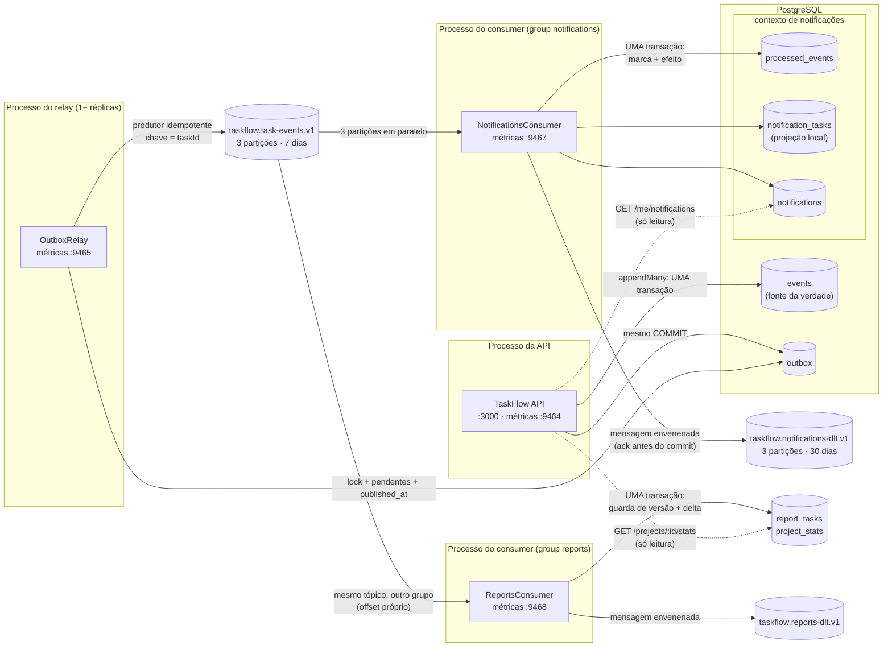

# Módulo 13 — Mensageria e streaming de eventos com Kafka

> **Projeto:** TaskFlow · **Trilha:** Do Pleno ao Excelente · **Última revisão:** 10/11/2026
>
> **Status:** 🚧 em construção, etapa **13.6b de 13.8** (replay do Event Store pela outbox, e reconstrução de
> projeção). Cada etapa acrescenta a sua parte a
> este documento; o mapa completo está na seção "Roteiro do módulo", logo abaixo.
>
> **Onde vive no código:** [`docker-compose.yml`](../../docker-compose.yml) (serviços `kafka` e `kafka-init`, profile
> `streaming`) · [`scripts/kafka/smoke.ts`](../../scripts/kafka/smoke.ts) ·
> [`event-store.service.ts`](../../src/events/event-store.service.ts) (`appendMany` com outbox) ·
> [`outbox.ts`](../../src/events/outbox.ts) ·
> [`task.integration-events.ts`](../../src/modules/tasks/events/task.integration-events.ts) (o contrato público) ·
> tabela `outbox` em [`schema.prisma`](../../prisma/schema.prisma) ·
> relay em [`src/relay.ts`](../../src/relay.ts) e [`src/outbox-relay/`](../../src/outbox-relay/outbox-relay.service.ts) ·
> consumer em [`src/notifications-consumer.ts`](../../src/notifications-consumer.ts),
> [`kafka-consumer.runner.ts`](../../src/common/messaging/kafka-consumer.runner.ts) e
> [`modules/notifications/`](../../src/modules/notifications/consumer/notifications.handler.ts) ·
> contexto de trace em [`trace-context.ts`](../../src/common/telemetry/trace-context.ts) ·
> classificação de falhas e DLT em [`consumer-errors.ts`](../../src/common/messaging/consumer-errors.ts) ·
> relatórios em [`src/reports-consumer.ts`](../../src/reports-consumer.ts) e
> [`modules/reports/`](../../src/modules/reports/consumer/reports.handler.ts) ·
> replay em [`src/replay.ts`](../../src/replay.ts), [`src/replay/`](../../src/replay/task-event-replayer.ts) e
> [`aggregate-lock.ts`](../../src/events/aggregate-lock.ts)

---

## 🎯 Objetivo

Levar os eventos de tarefa para **fora do processo**, num broker que vários consumidores independentes possam ler,
cada um no seu ritmo, com a possibilidade de **reler o histórico** (*replay*). Tudo isso sem perder a garantia que o
TaskFlow já tem hoje: o que foi gravado no Event Store é o que foi publicado.

**Por que importa:** hoje o `EventBus` é **em memória**. Se o processo cair entre gravar o evento e publicá-lo, a
projeção não é atualizada (o *dual-write* das limitações do [Módulo 05](05-event-sourcing-cqrs.md)). E só quem está
dentro do mesmo processo consegue reagir a um evento. Um sistema de verdade tem outros serviços interessados no mesmo
fato: notificação, relatório, auditoria, antifraude. Cada um precisa receber o evento **pelo menos uma vez**, tratá-lo
**exatamente uma vez** e poder ser reconstruído do zero.

---

## 🗺️ Roteiro do módulo

| Etapa | O que entrega | Status |
|---|---|:-:|
| **13.1** | Broker Kafka 4 (KRaft) no compose, tópico `taskflow.task-events.v1`, smoke test do cliente | ✅ |
| **13.2** | **Transactional Outbox**: o evento de integração gravado na **mesma transação** do Event Store | ✅ |
| **13.3** | **Relay**: processo *worker* que publica a outbox no Kafka (produtor idempotente, chave = `aggregateId`) | ✅ |
| **13.4** | Consumer group `notifications` com **idempotência** (`processed_events` na mesma transação do efeito) | ✅ |
| 13.4 + | **Um trace só** do request ao consumer: `traceparent` gravado na outbox e propagado no header do Kafka | ✅ |
| **13.5** | **Retry classificado** (banco fora nunca vai ao DLT) e **dead-letter topic** por consumer group | ✅ |
| **13.6a** | Consumer group `reports` (projeção `project_stats`) com **idempotência pela versão** do agregado, e `GET /projects/:projectId/stats` | ✅ |
| **13.6b** | **Replay** do Event Store pela outbox (lock por agregado, header `replay`) e runbook de reconstrução de projeção | ✅ |
| 13.6c | *Redrive* do DLT e limpeza de `processed_events` | 🔜 |
| 13.6d | `kafka-exporter`, painel de **lag** e regras de alerta | 🔜 |
| 13.7 | *(opcional)* Kafka (fato) × **SQS** (trabalho): envio de push por SQS + Lambda | 🔜 |
| 13.8 | ADRs e o diagrama final | 🔜 |

---

## 🏗️ Arquitetura (estado atual: 13.6a)



A API **não fala com o Kafka** em nenhuma direção: grava evento e outbox na mesma transação, e lê as notificações
que o consumer gravou. Relay e consumer são processos separados, cada um com a sua porta de métricas e o seu
`service.name` no Jaeger, mas **um trace só** liga os três: o contexto do request vai gravado na outbox e segue no
header `traceparent` da mensagem (ver "Um trace só através da outbox"). As tabelas do contexto de notificações só são escritas pelo consumer, e o consumer não lê
as tabelas da API (fronteira por convenção; ver "Limitações").

---

## 🧠 Conceitos

### O vocabulário, com um paralelo para quem vem de SQS/SNS

| Kafka | O que é | Paralelo AWS (aproximado) |
|---|---|---|
| **Broker** | Servidor que guarda e serve as mensagens | O serviço SQS/SNS em si |
| **Tópico** | Nome lógico de um fluxo de mensagens | Um tópico SNS |
| **Partição** | Pedaço do tópico: um **log append-only e ordenado**. Unidade de paralelismo **e** de ordem | Um *message group* de uma fila SQS FIFO |
| **Offset** | Posição de uma mensagem dentro da partição (0, 1, 2…) | Não existe: o SQS apaga a mensagem ao processá-la |
| **Chave (*key*)** | Define a partição: mesma chave → mesma partição → **mesma ordem** | `MessageGroupId` do SQS FIFO |
| **Consumer group** | Conjunto de consumidores que **dividem** as partições de um tópico; cada grupo lê **tudo**, independente dos outros | Cada fila SQS assinando o mesmo tópico SNS (*fan-out*) |
| **Offset commitado** | "Até onde este grupo já processou", guardado pelo próprio Kafka | O *delete* da mensagem no SQS |
| **Lag** | Mensagens ainda não processadas por um grupo (`log-end-offset − offset commitado`) | `ApproximateNumberOfMessagesVisible` |
| **Retenção** | Por quanto tempo o log é guardado, **processado ou não** | Retenção da fila (só até ser consumida, no máx. 14 dias) |

**A diferença que muda o desenho:** no SQS, consumir **apaga**. No Kafka, consumir só **move o offset do grupo**;
a mensagem continua no log até a retenção vencer. Por isso, no Kafka:

- um consumidor novo pode ler o histórico desde o início (`fromBeginning`);
- um consumidor com bug pode **voltar o offset** e reprocessar (*replay*; o item 11 de "Como reproduzir" refaz o
  grupo `reports` do início);
- vários grupos leem o mesmo fato sem que o broker precise copiar a mensagem para cada um.

### Partições: paralelismo e ordem são a mesma decisão

- A ordem só é garantida **dentro** de uma partição. Entre partições, não há ordem.
- A chave decide a partição (`hash(chave) % nº de partições`). No TaskFlow a chave será o `aggregateId` (etapa 13.3):
  todos os eventos de **uma tarefa** caem na mesma partição, em ordem. Tarefas diferentes se espalham pelas 3.
- Num consumer group, cada partição é lida por **no máximo um** consumidor do grupo. Com 3 partições, até 3
  consumidores trabalham em paralelo; um 4º ficaria ocioso.
- Aumentar partições depois **muda o mapeamento chave → partição** e quebra a ordem durante a transição. Por isso o
  número entra no contrato do tópico desde o início.

### KRaft (sem ZooKeeper)

Até o Kafka 3.x, os metadados do cluster (quais tópicos existem, quem é líder de cada partição) ficavam num
ZooKeeper separado. No **KRaft**, um quórum de *controllers* do próprio Kafka guarda esses metadados num log Raft.
O Kafka 4 **só** funciona assim. Aqui, o único nó é **broker e controller** ao mesmo tempo (`KAFKA_PROCESS_ROLES:
broker,controller`); em produção, os controllers costumam ficar em nós dedicados (3, para tolerar a perda de 1).

### Replicação, ISR e `acks` (o que este ambiente NÃO tem)

Em produção, cada partição tem réplicas em brokers diferentes (fator de replicação **3**). O **ISR** (*in-sync
replicas*) é o conjunto de réplicas em dia com o líder. Com `acks=all` no produtor e `min.insync.replicas=2` no
tópico, uma escrita só é confirmada quando **2 réplicas** a têm: um broker pode morrer sem perder mensagem
confirmada. Com **1 nó** isso é impossível (RF 1), e este ambiente existe para desenvolvimento.

### Por que Kafka (e não SNS+SQS ou Redpanda) neste projeto

| Opção | A favor | Contra | Decisão |
|---|---|---|---|
| **Kafka** | Log retido e **relível** (replay); ordem por chave; vários grupos lendo o mesmo fato; padrão de mercado para *event streaming* | Operar um cluster (aqui, só 1 nó local) | ✅ **Escolhido**: o módulo existe para cobrir event streaming com replay |
| **SNS + SQS** | Gerenciado na AWS, zero operação; DLQ nativa; ótimo para **distribuir trabalho** | Sem replay (consumir apaga); ordem só com FIFO e com limite de vazão | Fica para o que ele faz melhor: **fila de trabalho** (etapa 13.7) |
| **Redpanda** | Mesmo protocolo do Kafka, um binário só, menos memória | Menos comum em vaga; o objetivo é o Kafka em si | Plano B se faltar RAM: o código não mudaria |

O critério que vai para o ADR (13.8): **Kafka para fatos** (algo aconteceu, e quem quiser reage, inclusive no
futuro); **SQS para trabalho** (alguém precisa fazer isto uma vez).

### Dual-write: o problema que a outbox resolve (13.2)

Publicar um evento "logo depois de gravar" parece simples:

```ts
await eventStore.appendMany(events, version, ctx); // COMMIT no Postgres
await producer.send({ topic, messages });           // Kafka
```

São **duas escritas em dois sistemas**, sem transação que cubra as duas (*dual-write*). Toda ordem falha de algum
jeito:

| Ordem | O que dá errado |
|---|---|
| Grava, depois publica | O processo cai (deploy, OOM, SIGKILL) entre o COMMIT e o `send`, ou o broker está fora: o evento existe e **nunca é publicado**. Perda silenciosa |
| Publica, depois grava | O INSERT falha (o 409 de concorrência, por exemplo): os consumers recebem um evento que **nunca aconteceu** |
| "Faz retry do `send`" | Resolve a falha passageira do broker, não o crash do processo: o retry morre junto |

**Transactional Outbox:** em vez de publicar, a aplicação **grava a mensagem numa tabela `outbox` na mesma
transação** dos eventos. O banco garante: ou os dois existem, ou nenhum. Um processo separado (o *relay*, 13.3) lê a
outbox e publica, marcando o que já saiu. Se o relay cair no meio, ele publica de novo ao voltar.

O resultado é **at-least-once**: nunca se perde, mas **pode duplicar** (o relay publicou e caiu antes de marcar).
Por isso cada mensagem leva o `eventId`, e os consumers deduplicam por ele (13.4). "Exactly-once" de ponta a ponta,
na prática, é **at-least-once + consumer idempotente**.

### Evento de domínio × evento de integração

| | Evento de domínio (`task.events.ts`) | Evento de integração (`task.integration-events.ts`) |
|---|---|---|
| Quem lê | Só este serviço: o agregado o reaplica no replay | Outros serviços, pelo tópico |
| Onde vive | `events.payload` (Event Store) | `outbox.payload` → `value` da mensagem no Kafka |
| Como evolui | `schemaVersion` + *upcaster* na leitura; nada externo quebra | Contrato público: mudança compatível mantém a versão, incompatível incrementa `eventVersion` ou vira `taskflow.task-events.v2` |
| Conteúdo | O mínimo para reconstruir o estado | O que um consumer precisa **sem consultar o nosso banco** |

Publicar o payload de domínio direto seria transformar um detalhe interno em contrato: qualquer refatoração do
agregado quebraria quem consome. Por isso o mapeamento é **explícito, campo a campo** (sem `...spread`) e com
`switch` exaustivo: um campo novo no domínio não vaza para o tópico sozinho, e um evento novo sem contrato não
compila.

O formato publicado (envelope + `data`), real, tirado da outbox:

```json
{
  "eventId": "24dd5249-4eda-4246-a1fc-65bad9635c83",
  "eventType": "TaskCompleted",
  "eventVersion": 1,
  "occurredAt": "2026-11-10T10:42:47.567Z",
  "aggregateId": "0ade7afd-eb89-4f81-976f-f32b35004ee6",
  "aggregateVersion": 3,
  "projectId": "6a06bac1-8e24-43b0-9522-da0602ccdfa3",
  "actorId": "73e214eb-d13c-47b6-9b0c-1173b9efbb69",
  "correlationId": "fef54fb5-9717-4289-a0d6-105b096f5056",
  "data": { "completedAt": "2026-11-10T10:42:47.567Z" }
}
```

| Campo | Para que o consumer usa |
|---|---|
| `eventId` | Chave de idempotência: "já processei este?" (13.4). É o mesmo `metadata.eventId` do Event Store |
| `eventType` + `eventVersion` | Rotear e escolher como ler o `data`. `eventVersion` é do **contrato**, independente do `schemaVersion` interno |
| `aggregateId` + `aggregateVersion` | Ordem: o consumer detecta evento repetido ou atrasado ("já estou na versão 3, ignoro a 2"). É a idempotência do `reports` (13.6a) |
| `projectId` | Contexto. O `TaskCompleted` de domínio **não tem** `projectId`; sem ele, um consumer de relatório por projeto teria que consultar a nossa API para cada evento |
| `actorId`, `correlationId` | Auditoria e rastreio da requisição de origem (Módulo 01) nos logs do consumer |
| `occurredAt` | Quando foi gravado. É o **mesmo instante** de `events.created_at` (um `new Date()` só, explícito, para os dois) |

`taskId` não se repete no `data`: é o `aggregateId`. Os nomes seguem os conceitos do **CloudEvents** (`id`, `type`,
`time`, `subject`) sem adotar a especificação inteira; adotá-la é uma evolução possível se houver integração com
ferramentas que a falem.

### Por que a ordem por tarefa se mantém com um `BIGSERIAL`

O relay vai ler `WHERE published_at IS NULL ORDER BY id`. Ids de sequência **não** seguem a ordem de commit entre
transações concorrentes: a transação A pega o id 10, a B pega o 11, e a B commita primeiro. Para tarefas
**diferentes**, isso não importa (não há ordem entre elas, e elas caem em partições diferentes).

Para a **mesma** tarefa, isso não acontece: a gravação da versão 3 só passa no `UNIQUE (aggregate_id, version)`
se a versão 2 já estiver commitada, e o comando só calculou "versão 3" porque **leu** a 2. Então o `nextval` da v3
acontece depois do commit da v2, e o id da v3 é maior. A concorrência otimista, que já existia, é o que garante a
ordem da outbox por chave, sem lock extra.

> **Atualização (13.6b):** isso vale enquanto a API é o **único** escritor da outbox. Com o replay, um segundo
> escritor que não passa pela versão, a premissa caiu, e a ordem passou a ser garantida por um advisory lock por
> agregado que os dois pegam (ver "Replay do Event Store").

### Alternativas à outbox, e por que não aqui

| Alternativa | Como funciona | Por que não (agora) |
|---|---|---|
| **Event Store como outbox** | O relay lê a própria tabela `events` com um cursor | Marcar o que já foi publicado exigiria `UPDATE` numa tabela **append-only**; um cursor por `created_at`/`id` (UUID) **pula** eventos que commitam fora de ordem; e o formato interno viraria contrato público |
| **CDC (Debezium)** | Lê o WAL do Postgres e publica cada INSERT na outbox (ou em `events`) | Sem polling e com latência menor: é o padrão em escala. Custa mais um sistema para operar (Kafka Connect + Debezium) e slot de replicação para vigiar. A tabela `outbox` continua igual: CDC troca só o **relay** |
| **Transação distribuída (XA/2PC)** | Postgres e Kafka na mesma transação | O Kafka não participa de XA; e 2PC acopla a disponibilidade dos dois sistemas |
| **Listen/Notify** | `NOTIFY` no commit acorda o relay | Otimização de latência do polling, não substituto: notificação se perde com o relay fora do ar. Pode entrar junto do polling |

### O relay: um processo separado, um lote por vez (13.3)

**Por que um processo separado, e não um `setInterval` dentro da API.** Cada réplica da API seria também um relay;
ele escalaria com o tráfego HTTP (que não tem relação com o volume de eventos) e um lote travado no Kafka disputaria
o event loop com as requisições. Separado, ele escala, cai e é implantado sozinho: mesma imagem, outro comando
(`node dist/relay`), com `NestFactory.createApplicationContext` (Nest sem servidor HTTP: injeção de dependência,
config, logs e ciclo de vida).

**Menor privilégio.** O relay tem schema de ambiente **próprio**
([`relay-env.schema.ts`](../../src/config/relay-env.schema.ts)): não recebe `JWT_SECRET` nem as variáveis HTTP. Se o
worker vazar o ambiente, não vaza o segredo que assina tokens.

**A rodada**, numa transação só ([`outbox.store.ts`](../../src/outbox-relay/outbox.store.ts)):

```sql
BEGIN;
SELECT pg_try_advisory_xact_lock(hashtext('taskflow.outbox-relay'));  -- false? COMMIT e dorme
SELECT * FROM outbox WHERE published_at IS NULL ORDER BY id LIMIT 100;
-- producer.sendBatch(lote) → espera o ack de TODAS as mensagens (acks=all)
UPDATE outbox SET published_at = now() WHERE id IN (...);
COMMIT;
```

Lote cheio: roda de novo na hora (há fila). Lote incompleto ou vazio: espera `OUTBOX_POLL_INTERVAL_MS` (500 ms).

**Por que um lote por vez, e não réplicas em paralelo com `FOR UPDATE SKIP LOCKED`.** O `SKIP LOCKED` é o jeito
clássico de paralelizar uma fila no Postgres, mas **quebra a ordem por tarefa**. A réplica A pega um lote com a v1
de uma tarefa, a B pega o lote seguinte com a v2, e se a B publicar primeiro, a v2 chega antes da v1. Com o advisory
lock, as réplicas **revezam**: cada lote só é lido depois do COMMIT do anterior. Prova: o teste de integração com duas
réplicas sobre 200 mensagens passa (cada uma publicou parte, nenhuma duplicata, ordem por tarefa intacta); trocando o
lock por `SELECT true`, as mesmas 200 mensagens viram **400 envios**.

Consequência que precisa ser dita numa entrevista: **mais réplicas dão disponibilidade, não vazão.** Se uma cair
(até com `kill -9`), a outra pega o lock na rodada seguinte, sem eleição de líder. Para ganhar vazão mantendo ordem
por chave, o caminho seria particionar a outbox (um lock por faixa de `hash(message_key)`, como as partições do
próprio Kafka), complexidade que este volume não justifica.

**Por que `pg_try_advisory_xact_lock` (de transação) e não `pg_advisory_lock` (de sessão).** O lock de sessão
pertence a **uma conexão**, e o pool do Prisma entrega uma conexão qualquer a cada query: o lock e o unlock cairiam
em conexões diferentes (lock preso, ou solto por engano). O de transação vive dentro da `$transaction` interativa
(uma conexão só) e o Postgres o solta sozinho no COMMIT/ROLLBACK, inclusive se o processo morrer no meio.

O custo: a transação fica aberta durante o envio ao Kafka. Por isso o produtor tem `message.timeout.ms` de 10 s (o
padrão da librdkafka é **5 minutos**) e a transação, 20 s: uma falha do Kafka chega como erro de envio registrável,
e não como transação abortada.

**At-least-once, onde a duplicata nasce.**

| Falha | O que acontece | Quem resolve |
|---|---|---|
| Rede oscila e a librdkafka reenvia uma mensagem | O broker descarta a cópia | **Produtor idempotente** (`acks=all` + número de sequência por partição); a ordem também se mantém |
| O relay cai **depois** do ack e **antes** do COMMIT | O lote volta a ficar pendente e sai de novo, com o **mesmo** `event-id` (provado no teste de streaming) | **Consumer**, deduplicando por `eventId` (13.4). O produtor idempotente não cobre: o processo novo é outro produtor |
| O envio falha (Kafka fora, timeout) | `attempts + 1` e `last_error` gravados (COMMIT, não rollback); nada marcado | O próprio relay, com backoff |

**Ordem acima de vazão (*head-of-line blocking*, consciente).** Se o lote falha, ele volta **inteiro**, e nada depois
dele sai antes. Pular a mensagem problemática publicaria a v2 de uma tarefa antes da v1. O custo: uma mensagem com
erro **permanente** (por exemplo, maior que o `message.max.bytes` do broker) trava a fila. Isso não passa em silêncio:
`outbox_oldest_pending_age_seconds` sobe sem parar e a linha mostra `attempts` e `last_error`. O tratamento (mover a
mensagem para uma DLQ do relay) foi avaliado na 13.5 e **recusado**; ver "Por que não há DLQ no relay".

**Backoff exponencial:** 500 ms, 1 s, 2 s… até 30 s, zerado no primeiro sucesso. Sem isso, um Kafka caindo seria
martelado a cada 500 ms.

### Polling, CDC ou LISTEN/NOTIFY para o relay

| Opção | Latência | Custo | Decisão |
|---|---|---|---|
| **Polling** (implementado) | Até `OUTBOX_POLL_INTERVAL_MS` (500 ms) com a fila vazia; zero com fila (lote cheio roda de novo) | Uma transação curta a cada 500 ms, coberta pelo índice parcial | ✅ Simples, robusto, sem componente novo |
| **LISTEN/NOTIFY** | Milissegundos | Notificação se perde com o relay fora do ar: só serve **junto** do polling | Otimização possível, não substituto |
| **CDC (Debezium)** | Milissegundos, sem polling | Kafka Connect + Debezium para operar, slot de replicação para vigiar | O padrão em escala; a tabela `outbox` continua a mesma (CDC troca só o relay) |

### O que observar no relay

| Sinal | Onde | Leitura |
|---|---|---|
| `outbox_oldest_pending_age_seconds` | Prometheus (job `taskflow-relay`) | **O** alerta do relay: há quanto tempo o evento mais antigo espera. Pega relay parado, Kafka fora e mensagem travada. Consultado **no banco** a cada coleta: se o loop travar, o número continua verdadeiro (cresce), em vez de congelar |
| `outbox_pending_messages` | Prometheus | Tamanho da fila |
| `outbox_relay_published_total` / `outbox_relay_failures_total` | Prometheus | Vazão e falhas |
| `up{job="taskflow-relay"}` | Prometheus | Relay sem processo nenhum não exporta métrica: este é o sinal |
| Span `create taskflow.task-events.v1` | Jaeger, **dentro do trace do request** que gravou o evento | Um por mensagem. O espaço entre o fim do request e este span é o tempo que o evento ficou parado na outbox |
| Span `publish taskflow.task-events.v1` | Jaeger (serviço `taskflow-relay`, trace próprio) | Um span `PRODUCER` por lote, com `messaging.batch.message_count` e links para os `create` |
| `attempts`, `last_error` | Tabela `outbox` | Diagnóstico da linha que não sai |

Regras de alerta sugeridas (o provisionamento de alertas é limitação do Módulo 01):
`outbox_oldest_pending_age_seconds > 60` por 2 min, `up{job="taskflow-relay"} == 0` por 1 min e
`increase(outbox_relay_failures_total[5m]) > 0`. O painel no Grafana entra junto com o de lag dos consumers (13.6d).

### O consumer idempotente (13.4)

**At-least-once + consumer idempotente = efeito exatamente uma vez.** O Kafka entrega a mesma mensagem mais de uma
vez em situações normais: o relay republica depois de perder o COMMIT (13.3), um consumer cai depois do efeito e
antes de commitar o offset, um rebalance devolve a partição a outro membro no meio do processamento. Em vez de
tentar impedir a duplicata na entrega (impossível sem transação distribuída), o consumer a **reconhece**:

```sql
BEGIN;
INSERT INTO processed_events (consumer_group, event_id) VALUES ('notifications', $1)
  ON CONFLICT DO NOTHING;            -- 0 linhas = já processado: COMMIT e sai
-- o efeito: atualiza a projeção local e cria a notificação
COMMIT;
-- só agora: commit do offset no Kafka
```

| Escolha | Por quê |
|---|---|
| Marca e efeito na **mesma transação** | Marca sem efeito = notificação perdida para sempre; efeito sem marca = notificação duplicada na reentrega. É o dual-write da 13.2, agora do lado do consumer. Prova: com a marca fora da transação, o teste "efeito falhou" mostra o evento marcado e nenhuma notificação |
| PK `(consumer_group, event_id)` | Cada grupo deduplica sozinho. (O `reports`, 13.6a, acabou usando outra forma de idempotência: a versão do agregado) |
| Duas entregas **simultâneas** | O 2º `INSERT` espera o lock da PK até o 1º COMMIT e então não insere nada. Testado com 5 entregas paralelas: 1 `processed`, 4 `duplicate` |
| Offset commitado **depois** do COMMIT | Crash no meio = reentrega, que a marca absorve. Commitar **antes** seria *at-most-once*: um crash perderia o evento sem ninguém saber |
| `processed_events` em vez de um `UNIQUE` na tabela de efeito | Quando o efeito é um INSERT, um `UNIQUE(event_id)` também deduplicaria. A tabela de marcas generaliza para efeitos que não são INSERT (atualizar um saldo, chamar uma API externa com chave de idempotência) |

**Semânticas de entrega, para fixar:**

| Semântica | Como se obtém | Risco |
|---|---|---|
| At-most-once | Commitar o offset antes de processar | Perde mensagens num crash |
| At-least-once | Commitar o offset depois de processar | Duplica numa reentrega |
| "Exactly-once" de ponta a ponta | At-least-once + efeito idempotente (o que está aqui) | Nenhum, se a marca e o efeito forem atômicos |
| Transações do Kafka (EOS) | `transactional.id` + `read_committed` | Só vale de Kafka para Kafka (*consume-transform-produce*); um efeito no Postgres continua precisando de idempotência |

**Leitor tolerante e contrato copiado.** O consumer **não importa** o contrato do produtor
(`task.integration-events.ts`): tem a própria cópia, validada com zod
([`task-event.message.ts`](../../src/modules/notifications/consumer/task-event.message.ts)). Um serviço consumidor de
verdade não depende do código de quem publica (mudar o produtor quebraria o build do consumer). Ele também valida só
o que usa:

| Mensagem | Tratamento |
|---|---|
| Campo novo no evento | Aceito e descartado |
| Tipo que não interessa (`TaskStatusChanged`) | `ignored`, offset commitado |
| `eventVersion` maior que o suportado | `ignored` com aviso: notificação perdida, mas a partição não trava. Para um consumer financeiro, a escolha certa seria o contrário |
| Malformada, de um tipo tratado | `InvalidMessageError`: não dá para ignorar em silêncio (seria perder a notificação). Vai ao DLT na 1ª falha (13.5) |

**Projeção local, em vez de perguntar ao produtor.** O `TaskAssigned` e o `TaskCompleted` não trazem o título nem
(no caso do `Completed`) o responsável. Consultar as tabelas da API acoplaria os dois contextos (e, entre serviços,
seria uma chamada síncrona a cada mensagem). O consumer guarda o que precisa em `notification_tasks`, alimentada pelos
próprios eventos. Funciona porque a **ordem por chave** garante o `TaskCreated` antes dos outros eventos da tarefa.

**Paralelismo e ordem.** As 3 partições são processadas em paralelo (`partitionsConsumedConcurrently: 3`); dentro de
cada uma, uma mensagem por vez. Mais de 3 réplicas do consumer ficariam ociosas: cada partição é lida por no máximo
um membro do grupo.

**Erro no processamento.** O cliente faz *seek* de volta para a mesma mensagem e a reentrega **imediatamente, em
loop** (comportamento da biblioteca, lido no código-fonte). Com o banco fora, isso martelaria o Postgres. O runner
espera um backoff exponencial (500 ms → 30 s) antes de devolver o erro: só aquela partição para. O que acontece
depois (tentar de novo ou desviar para o DLT) é a seção "Retry e dead-letter topic" (13.5).

**Crash × saída limpa: o `session.timeout.ms`.** Medido com 200 mensagens na fila:

| Como o consumer saiu | O que o broker sabe | Pausa no processamento |
|---|---|---|
| SIGTERM (deploy, Ctrl+C) | O consumer avisa ao sair (`LeaveGroup`) | **Nenhuma**: o substituto assumiu na hora |
| `kill -9` (crash, OOM) | Nada, até a sessão expirar sem heartbeat | **30,1 s**: as partições ficam com um membro morto |

O valor (30 s, o padrão da camada KafkaJS da Confluent; a librdkafka pura usa 45 s) está **explícito** no runner.
Menor = failover mais rápido, mas uma pausa longa de GC ou um processamento lento derrubariam um membro saudável e
causariam rebalances em cascata.

**Grupo novo começa do início** (`fromBeginning: true`): na primeira subida, o grupo lê tudo o que o tópico retém
(7 dias). Com idempotência, é seguro; para notificações, pode significar avisar algo de 6 dias atrás. É decisão de
produto, e fica registrada.

### Retry e dead-letter topic (13.5)

**O problema.** Até a 13.4, uma mensagem que sempre falha travava a sua partição **para sempre**: o consumer tentava
de novo a cada 30 s, e as tarefas daquela partição (~1/3) deixavam de gerar notificação. Uma *poison pill* parava um
terço do sistema.

**A ideia central: o DLT é para mensagem envenenada, não para instabilidade.** O desenho ingênuo ("N tentativas e
DLT") esvaziaria o tópico no DLT durante uma queda do Postgres, e a culpa não era de nenhuma mensagem. Medido com a
classificação desligada (mutação): **6 de 40 eventos legítimos no DLT em 45 s** de banco fora, e o número cresce com a
duração da queda. Por isso as falhas são classificadas
([`consumer-errors.ts`](../../src/common/messaging/consumer-errors.ts)):

| Classe | Como é reconhecida | O que acontece |
|---|---|---|
| `permanent` | O handler lança uma `NonRetryableError` (`InvalidMessageError` estende ela) | **DLT na 1ª falha**: tentar de novo dá o mesmo resultado |
| `infrastructure` | Códigos do Prisma de banco inalcançável e o SQLSTATE do Postgres (abaixo) | **Tenta para sempre**, backoff até 30 s. **Nunca** DLT |
| `unknown` | O resto (bug no handler, constraint inesperada) | **5 tentativas** (500 ms + 1 + 2 + 4 s de espera, ~7,5 s), depois DLT |

**Como o erro de banco é reconhecido: medido, não adivinhado.** Derrubei o Postgres de quatro jeitos e anotei o que
o Prisma 7 com adapter-pg devolve:

| Cenário | Erro observado |
|---|---|
| Porta fechada / `docker stop` | `P1001`, com `meta.driverAdapterError.cause.kind = DatabaseNotReachable` |
| Rede travada (`docker pause`) | `P2028` ("Unable to start a transaction in the given time") em **2 s**: não pendura |
| Conexão derrubada no meio (`pg_terminate_backend`, failover) | `P2010` (no SQL cru), com o SQLSTATE `57P01` em `meta.driverAdapterError.cause.originalCode` |

O código do Prisma muda com o **tipo** de query (P2010 só existe no SQL cru); o SQLSTATE do Postgres não. Por isso a
classificação olha os dois: códigos `P1001/P1002/P1008/P1017/P2024/P2028` **ou** SQLSTATE da classe `08` (connection
exception), `57P01-03` (servidor desligando ou reiniciando) e `53300` (conexões esgotadas). Os testes unitários usam
exatamente esses formatos.

**Retry bloqueante, e não tópicos de retry.** O padrão de tópicos de retry (`retry-5s`, `retry-1m`, popularizado pela
Uber) não trava a partição: a mensagem que falha vai para outro tópico e a fila anda. Mas **quebra a ordem por chave**:
o `TaskCompleted` passaria na frente do `TaskAssigned` que está esperando, e este consumer usa a ordem para saber a
quem notificar. Vale quando a ordem não importa; aqui, não.

**Um DLT por consumer group** (`taskflow.notifications-dlt.v1`), e não um `taskflow.task-events.v1.dlt` compartilhado.
A falha é do **consumer**, não do evento: o grupo `reports` (13.6a) pode processar normalmente a mesma mensagem. E
reprocessar a partir de um DLT compartilhado reentregaria a mensagem a todos os grupos. Retenção de **30 dias**, maior
que os 7 do tópico de origem: é o prazo para alguém investigar.

**A mensagem no DLT é a original, intacta**, com o diagnóstico em headers:

```text
event-id:8c48fc51-…  event-type:TaskAssigned  content-type:application/json     ← os originais
traceparent:00-ffe4f447…-01                                                      ← do span de envio ao DLT
dlt-original-topic:taskflow.task-events.v1  dlt-original-partition:0  dlt-original-offset:303
dlt-consumer-group:notifications  dlt-reason:permanent  dlt-attempts:1
dlt-error-message:TaskAssigned inválido: ✖ Invalid UUID → at data.assigneeId
dlt-failed-at:2026-11-10T18:30:02.440Z
```

`dlt-reason` é `permanent` (nenhuma tentativa resolveria) ou `exhausted` (esgotou as tentativas de uma falha
desconhecida). O `traceparent` passa a ser o do span `publish taskflow.notifications-dlt.v1`, filho do `process`: no
Jaeger, o desvio aparece no trace do request que gerou o evento, com `taskflow.consumer.failure_class` e
`taskflow.consumer.result = dead_lettered` no span.

**O ack do DLT vem ANTES do commit do offset**, a mesma regra da outbox:
- DLT fora (Kafka com problema, tópico ausente) = a mensagem **não sai da partição** e é tentada de novo. Commitar sem o
  ack a perderia. Provado no teste de streaming, e a mutação "commitar mesmo assim" é pega;
- crash entre o ack e o commit = ela vai ao DLT de novo (at-least-once; o `event-id` deduplica quem investigar).

**O trade-off honesto: o DLT troca ordem por disponibilidade.** Com um `TaskAssigned` no DLT, o `TaskCompleted`
seguinte da mesma tarefa passa sem ele, e ninguém é notificado da conclusão (o teste de streaming verifica exatamente
isso). Uma notificação perdida, visível no DLT, contra um terço do sistema parado. A alternativa, **estacionar a
chave** (segurar todas as mensagens seguintes da mesma tarefa até alguém resolver), fica registrada e não
implementada: complexidade sem caso real aqui.

**O que observar no consumer:**

| Sinal | Leitura |
|---|---|
| `kafka_consumer_messages_total{result="dead_lettered"}` | **O** alerta do DLT: `increase(...[5m]) > 0`. Cada uma é uma notificação que não aconteceu |
| `kafka_consumer_retries_total{error_class}` | `infrastructure` subindo = banco com problema (o DLT não vai acusar); `unknown` = bug |
| Lag do grupo | Partição parada em retry aparece como lag crescente |
| Span `process` com `failure_class` | Jaeger: o trace da mensagem que falhou, com a exceção |

Mudança na métrica da 13.4: `result="failed"` saiu de `kafka_consumer_messages_total`, que agora conta só desfechos
(uma mensagem que falha e depois passa contava duas vezes). Tentativas que falharam vão para
`kafka_consumer_retries_total`.

### Por que não há DLQ no relay (13.5)

O plano previa uma DLQ também no relay. Avaliada, foi **recusada**:
- **quem produz a mensagem é o nosso código**, com o contrato testado campo a campo e o título limitado a 200
  caracteres. Não há "mensagem de terceiro" para envenenar a fila;
- **as falhas possíveis na publicação são de infraestrutura** (Kafka fora, tópico inexistente, ACL) e atingem **todas**
  as mensagens. Uma DLQ estacionaria a outbox inteira e esconderia a falha atrás de "mensagens estacionadas";
- **mensagem maior que o limite do broker** (1 MB) é a única falha por mensagem, impossível com o contrato atual; o
  lugar de barrá-la é na origem.

Uma DLQ no lugar errado é pior que nenhuma. O que existe: o alerta `outbox_oldest_pending_age_seconds`, o `attempts` e
o `last_error` da linha, e o **runbook** abaixo. A decisão vira item do ADR na 13.8.

**Runbook: uma linha da outbox que não sai.**

```sql
-- 1. Qual linha, e por quê (a fila para na mais antiga)
SELECT id, event_id, event_type, attempts, left(last_error, 200) AS erro
  FROM outbox WHERE published_at IS NULL ORDER BY id LIMIT 5;
```

2. Se o erro é de infraestrutura (timeout, broker, ACL): **não mexa na linha**; corrija a infraestrutura e o relay
   segue sozinho.
3. Só se a linha for comprovadamente impublicável, estacione-a à mão, deixando rastro:

```sql
UPDATE outbox
   SET published_at = now(),
       last_error = 'ESTACIONADA À MÃO em ' || now() || ' por <quem>: ' || coalesce(last_error, '')
 WHERE id = <id>;
```

Nada se perde: o evento continua no Event Store (a fonte da verdade), e republicá-lo depois é o replay da 13.6b.

### Dois grupos, um tópico: o consumer `reports` (13.6a)

O grupo `reports` lê o **mesmo** `taskflow.task-events.v1` que o `notifications`, com **offset próprio**: cada grupo
recebe todas as mensagens, um não espera o outro, e o lag é medido por grupo. No trace de um request, o mesmo `create`
do relay tem dois filhos, um em cada processo, rodando em paralelo (medido: os dois `process` começaram 8 ms depois do
`create`). É o *fan-out* que no SNS+SQS exigiria uma fila por assinante.

Ele mantém, por projeto: tarefas por status, abertas sem responsável e lead time médio (criação → conclusão), lidos pela
API em `GET /projects/:projectId/stats`.

**Outra forma de idempotência: pela versão do agregado.** O `notifications` deduplica com uma tabela de marcas
(`processed_events`), porque o efeito dele (inserir uma notificação) não tem estado com o que comparar. O `reports`
mantém **estado com versão**: `report_tasks` guarda, por tarefa, a última `aggregateVersion` aplicada.

```text
BEGIN
  SELECT report_tasks WHERE task_id = X FOR UPDATE        versão guardada >= versão do evento → duplicata, sai
  UPDATE report_tasks (status, responsável, versão do evento)
  UPDATE project_stats SET pending = pending + $delta, …    incremento atômico
COMMIT
```

| | `notifications` (13.4) | `reports` (13.6a) |
|---|---|---|
| Idempotência | Tabela de marcas por `eventId` | Versão do agregado (monotônica) |
| Custo | Uma linha por evento, para sempre (a limpeza é a 13.6c) | Uma linha por **tarefa**, que não cresce com os eventos |
| Reconhece versão antiga chegando depois da nova | Não (o `eventId` é outro) | Sim |
| Serve quando | O efeito não tem estado para comparar | Há estado por chave e ordem por chave |

**Guarda `>=` (já aplicada), e não "tem que ser a versão seguinte".** Ser estrito detectaria buracos, mas o contrato
permite eventos internos que o mapper não publica (o `null` da 13.2): um buraco de versão pode ser legítimo.

**Concorrência, nos dois níveis:**
- **mesma tarefa:** sempre na mesma partição, mas um rebalance pode deixar dois consumers com a mesma mensagem por um
  instante. O `FOR UPDATE` serializa, e o segundo vê a versão já aplicada. Mutação: sem o `FOR UPDATE`, 5 entregas
  simultâneas aplicaram o `-1` de "sem responsável" duas vezes, e quem barrou foi o **CHECK** do banco;
- **mesmo projeto:** tarefas diferentes, em partições diferentes, atualizam a **mesma linha** de `project_stats` em
  paralelo. `SET done = done + $delta` é atômico no Postgres. Mutação: com "ler, somar no Node e gravar", **20
  conclusões em paralelo viraram `done = 3`** (17 contagens perdidas, *lost update*), nas 2 execuções.

**A linha do projeto nasce no `TaskCreated`, por upsert** (`INSERT … ON CONFLICT DO UPDATE SET total = total + 1`):
duas primeiras tarefas de um projeto em partições diferentes não disputam o INSERT. Os outros eventos fazem `UPDATE`
puro. A divisão não é estética: o Postgres avalia o CHECK na **linha candidata do INSERT antes de resolver o
`ON CONFLICT`**, e um delta negativo no `VALUES` era recusado mesmo indo para o UPDATE (problema 25).

**CHECK de contadores não negativos.** Fica no SQL da migração (o Prisma não modela CHECK, e por isso não o vê como
drift; conferido com uma migração vazia). Um bug de delta vira erro na transação (e o DLT), em vez de um número
errado gravado em silêncio. Já pegou dois defeitos: o do upsert, no primeiro teste, e a mutação sem `FOR UPDATE`.

**Dois casos de borda, com destino diferente:**

| Caso | Resultado | Por quê |
|---|---|---|
| Evento de tarefa sem `TaskCreated` conhecido (criada antes da outbox) | `unknown_task`, nada escrito, aviso no log | Não está envenenado: falta histórico. Quem corrige é o replay do Event Store (13.6b) |
| Evento que diz outro projeto que o guardado para a tarefa | `InvalidReportMessageError` → **DLT na 1ª falha** | Uma tarefa não muda de projeto; a mensagem contradiz o que a projeção sabe. Somar no projeto do evento descasaria os dois. Achado com dados reais (problema 26) |

**`asOf` na resposta.** É o `occurredAt` do evento mais recente aplicado ao projeto, e só avança (`GREATEST`, porque
eventos de partições diferentes chegam fora de ordem entre si). É a consistência eventual **visível** para o cliente:
"estes números valem até 19:10:59". Projeto sem nenhum evento devolve zeros e `asOf: null`, e não 404: o projeto
existe, só não há o que contar.

**A pergunta que um entrevistador faria: por que não `SELECT status, count(*) FROM tasks_read GROUP BY status`?**
Nesta escala, **seria mais simples**, e responderia em milissegundos. O consumer se justifica em três pontos, nenhum
deles de desempenho hoje:
1. **independência:** em microsserviços, o serviço de relatórios não teria acesso ao banco da API; ele só tem o tópico;
2. **reconstrução:** é o primeiro read model alimentado pelo **tópico**, e não pelo `EventBus` em memória. Pode ser
   refeito por replay (13.6b), e é o caminho que as limitações do [Módulo 05](05-event-sourcing-cqrs.md) apontam para
   as projeções internas;
3. **escala:** com milhões de tarefas, os contadores e o lead time pré-calculados evitam varrer tudo a cada leitura.

### Replay do Event Store (13.6b)

O tópico guarda 7 dias; o Event Store guarda tudo. O replay republica o histórico de tarefas **a partir da tabela
`events`**, para reconstruir uma projeção, levar o histórico a um consumer group novo ou incluir as tarefas que nunca
passaram pela outbox (as anteriores à 13.2).

```bash
npm run replay                              # o histórico inteiro (build: node dist/replay)
npm run replay -- --aggregate <taskId>      # uma tarefa
```

**Pela outbox, e não direto no Kafka.** O replay grava linhas na outbox com `replay = true` e termina; quem publica
é o relay, que já cuida de ordem, retry, backoff e trace. O replay não fala com o broker. Passa pelo **mesmo** mapper da
API (`toTaskOutboxMessage`), então publica exatamente o contrato que a API publicaria. Comando operacional, por isso
em `src/` (entra no build e na imagem), e não em `scripts/`.

**O envelope é o da gravação original**: `eventId`, `actorId`, `occurredAt` e `aggregateVersion` vêm da linha de
`events`, não de agora. A guarda de versão das projeções e a idempotência dos consumers dependem disso. Evento
**legado** (gravado antes do envelope, Módulo 05) não tem `eventId` nem autor: usa o `id` da linha (estável, então
dois replays geram o mesmo `eventId`) e `UNKNOWN_ACTOR_ID` (o UUID nulo, documentado no contrato).

**Três problemas que o desenho resolveu:**

1. **O replay quebraria a ordem por tarefa.** A ordem da outbox se apoiava na concorrência otimista, que só
   serializa a API **com ela mesma**. O replay é um segundo escritor:
   ```text
   replay lê v1..v4 da tarefa X
                           API grava v5 da tarefa X → outbox id 1000
   replay grava v1..v4    → outbox ids 1001..1004    (o consumer receberia v5 ANTES de v1)
   ```
   `SERIALIZABLE` não resolveria: o `BIGSERIAL` é atribuído no INSERT, não na ordem de commit. A solução é um
   **advisory lock de transação por agregado** ([`aggregate-lock.ts`](../../src/events/aggregate-lock.ts)) que o
   `appendMany` e o replay pegam antes de gravar. Custa uma instrução por gravação da API, sem disputa no caso comum.
   Os testes provam que, com o lock de uma tarefa preso, **a API e o replay dessa tarefa esperam** (e tarefas
   diferentes não). Eles não provocam a inversão em si; provam que os dois escritores não gravam a mesma tarefa ao
   mesmo tempo, que é a condição para ela acontecer. Mutação: sem o lock em qualquer um dos dois, o teste quebra.

2. **O replay não pode disparar efeitos.** Republicar o histórico faria o `notifications` avisar de novo uma
   atribuição de meses atrás. A linha de replay vira o header `replay: true`, e cada consumer group **declara**
   `acceptsReplay` no runner (obrigatório: grupo novo precisa decidir). O `reports` (projeção) aplica; o
   `notifications` (efeito) commita sem processar (`result="ignored_replay"`). Detalhe que só a mutação mostrou: as
   mensagens de replay de eventos já processados seriam barradas pelo `processed_events` de qualquer jeito; o header
   só faz diferença para eventos que o `notifications` **nunca viu**, como os anteriores à outbox. É esse o caso que o
   teste usa, e com o `notifications` aceitando replay ele notifica uma atribuição antiga.

3. **O `UNIQUE (event_id)` da outbox impediria o replay** de republicar um evento que ainda está lá (as publicadas
   ficam 72 h). Virou um índice **parcial**, `WHERE NOT replay`: a API continua sem poder gravar o mesmo evento duas
   vezes (testado), e o replay pode repetir.

**Lotes.** 50 tarefas por transação (`--batch-size`), com os locks pegos em ordem fixa (dois replays simultâneos não se
travam; a API pega um lock só). Paginação por chave (`aggregate_id > último`), estável com tarefas sendo criadas
durante o replay.

**Por que não existe `--missing` ("só o que nunca foi publicado").** A limpeza do relay apaga as linhas publicadas
depois de 72 h, então "nunca esteve na outbox" não é decidível pela outbox. Republicar tudo é seguro (os consumers são
idempotentes) e é o que a reconstrução precisa.

### Runbook: reconstruir uma projeção a partir do Event Store

O replay sozinho não refaz o `reports`: a guarda de versão diz "já tenho a v4", e reenviar v1..v4 cai como duplicata.
Reconstruir é este procedimento:

1. parar o consumer da projeção;
2. limpar as tabelas dela (`TRUNCATE report_tasks, project_stats`);
3. `npm run replay` (com o relay rodando);
4. subir o consumer. Ele retoma do offset commitado e lê as mensagens de replay; as de antes do replay que ainda não
   tinha lido caem como `unknown_task` (a tarefa sumiu na limpeza) e o replay as cobre.

Não depende mais da retenção do tópico. Executado no banco de desenvolvimento (resultados em "Resultados obtidos"): os 6
projetos reais ficaram **idênticos**, 2 projetos com tarefas anteriores à outbox entraram pela primeira vez, e **72
projetos fantasmas sumiram**: só existiam em eventos que os scripts das demos injetaram direto no tópico, sem passar
pelo Event Store. É o "Event Store como fonte da verdade" acontecendo de fato.

### Um trace só através da outbox (`traceparent`)

**O problema.** Dentro de um processo, o OpenTelemetry carrega o span corrente no `AsyncLocalStorage`, e a
auto-instrumentação o propaga em HTTP pelo header `traceparent` (W3C Trace Context). A outbox é uma fronteira
**assíncrona**: a linha fica parada no banco até o relay buscá-la, e nenhum instrumentador atravessa o banco. Até
aqui, o `POST`, o `publish` do relay e o `process` do consumer eram **três traces sem ligação**.

**A solução: o contexto vira dado.** Mesmo princípio da outbox: o que precisa atravessar a fronteira é gravado na
mesma transação.

```text
API      appendMany: propagation.inject(contexto ativo) → outbox.trace_context = {"traceparent": "00-<trace>-<span>-01"}
relay    span "create" FILHO desse contexto → header traceparent da mensagem = contexto do create
consumer propagation.extract(headers) → span "process" FILHO do create → queries do efeito dentro dele
```

No Jaeger, um request com responsável vira um trace só, com os três serviços (medido):

```text
     0 ms  POST /projects/:projectId/tasks                  [taskflow]          16,5 ms
    12 ms    pg.query: BEGIN / INSERT events / INSERT outbox / COMMIT
   187 ms    create taskflow.task-events.v1                 [taskflow-relay]    ← 170 ms parado na outbox
   696 ms      process taskflow.task-events.v1              [taskflow-notifications]
   710 ms        pg.query: BEGIN / INSERT processed_events / SELECT / INSERT ×2 / COMMIT
```

**Por que um span `create` por mensagem, e não só repassar o `traceparent` da API.** Repassar funcionaria, mas o
relay sumiria do trace e, com ele, o **tempo parado na outbox**, que é justamente o sinal quando a fila atrasa. Esse
é o desenho da convenção de mensageria do OTel para envio em lote: um `create` por mensagem, no trace de cada uma, e o
`publish` do lote como trace próprio com **links** para os `create`. Um span não pode ser filho de N traces
diferentes (cada mensagem do lote veio de um request); um link só referencia. O Jaeger v1 mostra links como
`FOLLOWS_FROM`, clicáveis.

**Pai × link no consumer.** A convenção também permite que o `process` só tenha um link para o `create`. Aqui ele é
**filho**: o runner processa uma mensagem por vez, e o objetivo é abrir **um** trace no Jaeger e ver do request à
notificação. Link é o certo quando um span processa N mensagens de traces diferentes (consumo em lote).

**`correlation-id` × `traceparent`: os dois continuam.** O `correlation-id` é de negócio (o cliente o cita no
chamado, filtra logs, está no envelope do evento); o `traceparent` é técnico (árvore de spans com tempos, e pode ser
amostrado). Ver a tabela "`correlationId` × `trace_id`" do [Módulo 01](01-observabilidade.md).

**Detalhes que importam:**
- **`trace_context` NULL fora de um span** (script, seed): gravar `{}` diria "tem contexto". Linha sem contexto (inclusive
  as anteriores à coluna) sai sem `traceparent`, e o `process` vira raiz, como antes.
- **Propagador global**, que o `NodeSDK` registra como W3C por padrão: trocar para B3 ou X-Ray é configuração, não
  código. Os headers usam os nomes do padrão, que a instrumentação de qualquer linguagem já sabe ler.
- **Republicação = outro `create` no mesmo trace.** Lote que falha e volta, ou crash antes do COMMIT: cada tentativa
  aparece como um `create` novo, e as tentativas ficam visíveis.
- **Testado com o broker real:** a suíte de streaming exige que o `process` tenha o `traceId` do request e seja filho do
  `create`. Mutação: sem o `extract` no consumer, o teste quebra (o `process` cai num trace novo).

---

## 📋 Como reproduzir

### 1. Subir o broker

```bash
npm run streaming:up      # sobe o kafka (espera o healthcheck) e roda o kafka-init (cria os tópicos)
npm run streaming:topics  # descreve os tópicos
npm run streaming:down    # para e remove SÓ o container do kafka; o volume kafka_data (o log) continua
```

`npm run dev` e os testes **não** sobem o Kafka: ele está no profile `streaming` do compose. Quem não está
trabalhando com mensageria não paga ~300 MB de RAM nem os ~15 s de boot.

### 2. As decisões do `docker-compose.yml`

| Configuração | Valor | Por quê |
|---|---|---|
| Imagem | `apache/kafka:4.3.2` | Imagem oficial; versão fixa, como todo o compose. Patch maduro da linha 4.3 em vez do `4.4.0`, recém-saído na época |
| `KAFKA_PROCESS_ROLES` | `broker,controller` | KRaft com 1 nó |
| **Listeners** | `EXTERNAL://localhost:9092` (host) e `INTERNAL://kafka:29092` (containers) | Ver "Os dois listeners" abaixo |
| `KAFKA_AUTO_CREATE_TOPICS_ENABLE` | `false` | Tópico é **contrato**: com autocriação, um nome digitado errado no produtor cria outro tópico e o consumidor espera no certo, em silêncio |
| Replicação dos tópicos internos | `1` | Só há 1 broker. Em produção: 3 |
| `KAFKA_HEAP_OPTS` | `-Xms384m -Xmx384m` | O padrão da imagem reserva 1 GB |
| Volume `kafka_data` | `/var/lib/kafka/data` | O log sobrevive a `streaming:down`/`up` (verificado: offsets mantidos) |
| Healthcheck | `kafka-broker-api-versions.sh` | "Container de pé" não é "broker aceitando clientes" |

**Os dois listeners.** O cliente faz a 1ª conexão no endereço que você configurou (*bootstrap*), mas depois usa o
endereço que o **broker anuncia**. Se o broker anunciasse `kafka:29092`, a API rodando no host não resolveria esse
nome; se anunciasse `localhost:9092`, um container receberia "localhost", que dentro dele é o próprio container. Daí
um listener por "lugar de onde o cliente vem". É o erro número 1 de quem sobe Kafka em Docker.

### 3. O contrato do tópico (`kafka-init`)

```bash
kafka-topics.sh --create --if-not-exists --topic taskflow.task-events.v1 \
  --partitions 3 --replication-factor 1 --config retention.ms=604800000 --config cleanup.policy=delete
```

| Item | Valor | Por quê |
|---|---|---|
| Nome | `taskflow.task-events.v1` | `<sistema>.<assunto>.<versão>`. Uma mudança **incompatível** vira `v2`, publicada em paralelo enquanto os consumidores migram. Só `.` e `-`, nunca `_`: o Kafka troca `.` por `_` nos nomes de métrica, e misturar os dois pode colidir |
| Partições | 3 | Até 3 consumidores em paralelo por grupo; ordem garantida por tarefa (chave) |
| Retenção | 7 dias, `delete` | O Kafka **não** é a fonte da verdade, o Event Store é. Reconstruir uma projeção nova do zero = republicar a partir da tabela `events`, não depender do tópico guardar tudo para sempre |
| `--if-not-exists` | — | Idempotente: `streaming:up` pode rodar quantas vezes quiser |

Existe também o tópico `taskflow.smoke` (1 partição, 1 hora), só para o smoke test: mensagem de teste nunca vai
para o tópico de eventos, que os consumers reais vão ler.

### 4. Smoke test do cliente

```bash
npm run kafka:smoke
# [OK] taskflow.task-events.v1: 3 partições
# [OK] produzida em taskflow.smoke (partição 0, offset 1)
# [OK] consumida pelo grupo taskflow.smoke (partição 0, offset 1)
# [OK] Kafka respondendo em localhost:9092 — ida e volta em 336 ms
```

O que ele prova ([`smoke.ts`](../../scripts/kafka/smoke.ts)): o cliente instala e carrega o binding nativo, o
tópico de eventos tem o contrato esperado, e uma mensagem faz a ida e volta (producer idempotente → consumer group)
com chave, valor e header intactos.

**Cliente: `@confluentinc/kafka-javascript`.** O KafkaJS, que foi o cliente Node mais popular, está sem manutenção.
O cliente da Confluent embute a **librdkafka** (o mesmo núcleo em C dos clientes oficiais de Go, Python e .NET) e
oferece uma API compatível com KafkaJS (`KafkaJS.Kafka`), que é a usada aqui.

### 5. Ferramentas de linha de comando (dentro do container)

```bash
K="docker compose --profile streaming exec kafka /opt/kafka/bin"

$K/kafka-topics.sh --bootstrap-server localhost:9092 --list
$K/kafka-get-offsets.sh --bootstrap-server localhost:9092 --topic taskflow.smoke          # ponta do log por partição
$K/kafka-consumer-groups.sh --bootstrap-server localhost:9092 --describe --group taskflow.smoke   # offset e LAG
$K/kafka-console-consumer.sh --bootstrap-server localhost:9092 --topic taskflow.smoke --from-beginning \
  --property print.key=true --property print.headers=true
```

Exemplo real do `--describe` depois de duas execuções do smoke test:

```text
GROUP           TOPIC           PARTITION  CURRENT-OFFSET  LOG-END-OFFSET  LAG
taskflow.smoke  taskflow.smoke  0          2               2               0
```

`CURRENT-OFFSET = 2` com a última mensagem no offset 1: o offset commitado é o **próximo a ler**, não o último lido.

### 6. A outbox (13.2)

Não precisa de Kafka: a outbox é gravada no Postgres a cada comando, com o broker de pé ou não.

```bash
npm run dev    # ou: npm run build && node dist/main
# crie, mova e conclua uma tarefa pela API (Swagger em /docs), e então:
docker exec taskflow-postgres psql -U <usuario-do-.env> -d taskflow_db \
  -c "SELECT id, event_type, message_key, published_at FROM outbox ORDER BY id;"
```

```text
 id |    event_type     |             message_key              | published_at
----+-------------------+--------------------------------------+--------------
  1 | TaskCreated       | 0ade7afd-eb89-4f81-976f-f32b35004ee6 |
  2 | TaskStatusChanged | 0ade7afd-eb89-4f81-976f-f32b35004ee6 |
  3 | TaskCompleted     | 0ade7afd-eb89-4f81-976f-f32b35004ee6 |
```

Um segundo `POST /complete` na mesma tarefa recebe 409 e **não** cria linha: a regra recusou o comando antes de
gravar. Um conflito de concorrência também não cria (a transação inteira é desfeita; provado no teste de
integração com 10 gravações simultâneas).

**A tabela** ([`schema.prisma`](../../prisma/schema.prisma), migração `20261110103709_add_outbox`):

| Coluna | Por quê |
|---|---|
| `id BIGSERIAL` | Ordem de leitura do relay (ver "Por que a ordem por tarefa se mantém") |
| `event_id UUID UNIQUE` | O `metadata.eventId` do Event Store. Liga a mensagem ao evento e impede duas mensagens para o mesmo evento |
| `topic`, `message_key` | Destino e chave resolvidos na gravação: o relay é genérico, não conhece Task |
| `event_type` | Vai virar header da mensagem: o consumer filtra sem fazer parse do corpo |
| `payload JSONB` | O evento de **integração** (o contrato público), não o payload do Event Store |
| `published_at` | `NULL` = pendente. A outbox é **mutável**: é fila de trabalho, não histórico |
| `attempts`, `last_error` | Diagnóstico de uma linha que o relay não consegue publicar (13.3) |
| Índice parcial `outbox_pending_idx (id) WHERE published_at IS NULL` | A consulta do relay toca só as pendentes, e o índice não cresce com o que já foi publicado. O `EXPLAIN` confirma: `Bitmap Index Scan on outbox_pending_idx` |

**Onde a outbox é ligada.** O `EventStoreService` é compartilhado e não conhece Task. Quem sabe traduzir um evento
de tarefa no contrato público é o módulo de tarefas, então ele entrega ao store uma função (`OutboxMapper`):

```ts
await eventStore.appendMany(stored, task.version, { actorId }, {
  toOutbox: ({ event, ...recorded }) => toTaskOutboxMessage(typed(event), recorded, task.projectId),
});
```

O store monta o envelope (`eventId`, autor, correlação), chama o mapper e grava `events` + `outbox` numa
`prisma.$transaction([...])` em lote. É em lote, e não interativa, porque não há leitura entre as duas escritas. O
`eventId` da linha vem **do envelope**, nunca do mapper: não há como gravar uma mensagem com identidade diferente da
do evento que a originou. Os dois pontos que gravam eventos de tarefa ligam o mapper: o
`EventSourcedTaskRepository` (ciclo de vida) e o `CreateTaskHandler` (criação, que grava sem passar pelo
repositório; ver problema 6).

### 7. O relay (13.3)

```bash
npm run streaming:up        # Kafka + tópicos
npm run dev                 # a API, em outro terminal
npm run relay:dev           # o relay (ts-node), em outro terminal; build: npm run build && npm run start:relay
```

Crie, mova e conclua uma tarefa pela API e leia o tópico:

```bash
docker compose --profile streaming exec kafka /opt/kafka/bin/kafka-console-consumer.sh \
  --bootstrap-server localhost:9092 --topic taskflow.task-events.v1 --from-beginning \
  --property print.key=true --property print.headers=true --property print.partition=true
```

```text
Partition:1  event-id:6365feb4-…,event-type:TaskCreated,content-type:application/json,correlation-id:demo-13-2        0ade7afd-…  {"data":{"title":"Conciliar pagamentos",…
Partition:1  event-id:1fdd728a-…,event-type:TaskStatusChanged,content-type:application/json,correlation-id:e94c2eb4-…  0ade7afd-…  {"data":{"to":"IN_PROGRESS","from":"PENDING"},…
Partition:1  event-id:24dd5249-…,event-type:TaskCompleted,content-type:application/json,correlation-id:fef54fb5-…      0ade7afd-…  {"data":{"completedAt":"2026-11-10T10:42:47.567Z"},…
```

Os três eventos da tarefa na **mesma partição**, em ordem. A mensagem no Kafka:

| Parte | Valor | Por quê |
|---|---|---|
| `key` | `message_key` da outbox (o `taskId`) | Mesma chave → mesma partição → ordem |
| `value` | O JSON do evento de integração (13.2) | O contrato público |
| Header `event-id` | O `eventId` | Deduplicação no consumer sem fazer parse do corpo |
| Header `event-type` | `TaskCreated`, … | Filtrar/rotear sem fazer parse |
| Header `correlation-id` | Do envelope, quando existe | Ligar o log do consumer à requisição de origem |
| Header `content-type` | `application/json` | Formato do corpo explícito (evolução para Avro/Protobuf) |

O relay é **genérico**: lê `topic` e `message_key` da linha e não conhece Task.

**Configuração** ([`relay-env.schema.ts`](../../src/config/relay-env.schema.ts), todas com padrão):

| Variável | Padrão | Para quê |
|---|---|---|
| `KAFKA_BROKERS` | `localhost:9092` | Do host; de um container seria `kafka:29092` |
| `OUTBOX_POLL_INTERVAL_MS` | 500 | Espera com a outbox vazia (latência × consultas) |
| `OUTBOX_BATCH_SIZE` | 100 | Linhas por lote |
| `OUTBOX_RETENTION_HOURS` | 72 | Quanto uma linha publicada fica antes da limpeza (a cada 10 min, em blocos de 1.000) |
| `RELAY_METRICS_PORT` | 9465 | `/metrics` do relay; uma 2ª réplica no mesmo host precisa de outra |

**Experimentos que valem repetir** (resultados reais na seção "Resultados"):

```bash
# Kafka fora do ar com a API e o relay rodando: a API responde, a outbox acumula, o relay faz backoff
npm run streaming:down      # crie tarefas; veja attempts/last_error na outbox e curl localhost:9465/metrics
npm run streaming:up        # o relay se recupera sozinho e publica em ordem

# Duas réplicas: revezam o lock; derrube uma com kill -9 e a outra continua
RELAY_METRICS_PORT=9466 npm run relay:dev

# Graceful shutdown: Ctrl+C (SIGTERM) termina o lote em andamento e desconecta o produtor
```

### 8. O consumer de notificações (13.4)

```bash
npm run streaming:up
npm run dev                          # API
npm run relay:dev                    # relay
npm run consumer:notifications:dev   # consumer (build: npm run start:consumer:notifications)
```

Com dois usuários: o primeiro cria uma tarefa com `assigneeId` do segundo e a conclui. O segundo vê:

```bash
curl -s localhost:3000/me/notifications -H "authorization: Bearer $TOKEN_DO_SEGUNDO"
```

```json
{
  "items": [
    { "type": "TASK_COMPLETED", "message": "A tarefa \"Conciliar pagamentos\" foi concluída", "eventId": "1d6ce92d-…", "…": "…" },
    { "type": "TASK_ASSIGNED",  "message": "Você foi atribuído à tarefa \"Conciliar pagamentos\"", "eventId": "a4e2ef64-…", "…": "…" }
  ],
  "nextCursor": null
}
```

O primeiro usuário recebe `{"items":[]}`: ninguém é notificado da própria ação.

```bash
# Lag do grupo (CURRENT-OFFSET = próxima mensagem a ler)
docker compose --profile streaming exec kafka /opt/kafka/bin/kafka-consumer-groups.sh \
  --bootstrap-server localhost:9092 --describe --group notifications

# Resultado por mensagem
curl -s localhost:9467/metrics | grep kafka_consumer_messages
```

**Experimento do crash** (os números estão em "Resultados"): com o consumer parado, crie 200 tarefas atribuídas a
alguém (com a API sob `DISABLE_THROTTLE=true`, senão o throttler recusa a rajada); suba o consumer, dê `kill -9` no
meio da fila e suba de novo. Repita com SIGTERM no lugar do `kill -9` e compare as pausas.

### 9. O trace do request até a notificação

Com os três processos do item 8 rodando, crie uma tarefa com responsável e pegue o trace gravado na outbox:

```bash
docker exec taskflow-postgres psql -U <usuario-do-.env> -d taskflow_db -At \
  -c "SELECT trace_context->>'traceparent' FROM outbox ORDER BY id DESC LIMIT 1"
# 00-3b1dd6cd6d3f5398545d6a0482ec5f77-9181b403aa513c8f-01
#    └──────────── trace id ────────┘
```

Abra `http://localhost:16686/trace/<trace id>`: o `POST`, o `create` do relay e o `process` do consumer, com as
queries do efeito, num trace só. No serviço `taskflow-relay`, o `publish` de cada lote aparece como trace próprio,
com as referências `FOLLOWS_FROM` para os traces de origem.

### 10. Retry e dead-letter topic (13.5)

O DLT é criado pelo `kafka-init` (`npm run streaming:up`). Com API, relay e consumer rodando:

```bash
# Inspecionar o DLT, com os headers de diagnóstico
docker compose --profile streaming exec kafka /opt/kafka/bin/kafka-console-consumer.sh \
  --bootstrap-server localhost:9092 --topic taskflow.notifications-dlt.v1 --from-beginning \
  --formatter-property print.headers=true --formatter-property print.key=true

# Quantas mensagens há no DLT, por partição
docker compose --profile streaming exec kafka /opt/kafka/bin/kafka-get-offsets.sh \
  --bootstrap-server localhost:9092 --topic taskflow.notifications-dlt.v1

# Desfechos e tentativas
curl -s localhost:9467/metrics | grep -E "kafka_consumer_(messages|retries)_total"
```

**Experimento da poison pill:** publique no tópico de eventos, com a mesma chave, um `TaskCreated` válido, um
`TaskAssigned` com `assigneeId` inválido e outro evento válido. A inválida vai ao DLT na 1ª tentativa, a partição anda
(lag 0) e o evento de trás é processado.

**Experimento do banco fora:** com o consumer rodando, `docker stop taskflow-postgres`, publique eventos válidos, espere
~45 s e `docker start taskflow-postgres`. O log mostra as tentativas `infrastructure` passando do limite (500 ms →
30 s), o DLT não recebe nada, e tudo é processado depois que o banco volta.

### 11. O consumer de relatórios (13.6a)

```bash
npm run consumer:reports:dev     # build: npm run start:consumer:reports (métricas em :9468)
```

Com API, relay e os dois consumers rodando, crie tarefas num projeto, mude status e conclua uma:

```bash
curl -s localhost:3000/projects/$PROJECT_ID/stats -H "authorization: Bearer $TOKEN"
```

```json
{
  "projectId": "263ede8a-…", "total": 3,
  "byStatus": { "pending": 1, "inProgress": 1, "done": 1 },
  "unassignedOpen": 2, "avgLeadTimeSeconds": 1, "asOf": "2026-11-10T19:10:59.206Z"
}
```

```bash
# Os dois grupos no mesmo tópico, cada um com o seu offset e o seu lag
for g in notifications reports; do
  docker compose --profile streaming exec kafka /opt/kafka/bin/kafka-consumer-groups.sh \
    --bootstrap-server localhost:9092 --describe --group $g
done

```

### 12. Replay e reconstrução da projeção (13.6b)

Com o relay e os dois consumers rodando, siga o runbook "Reconstruir uma projeção a partir do Event Store":

```bash
kill -TERM <pid do consumer reports>                     # 1. parar (SIGTERM: sai do grupo na hora)
docker exec taskflow-postgres psql -U <usuario-do-.env> -d taskflow_db \
  -c 'TRUNCATE report_tasks, project_stats'              # 2. limpar
npm run replay                                           # 3. replay → outbox → relay
npm run consumer:reports:dev                             # 4. subir

curl -s localhost:9468/metrics | grep kafka_consumer_messages_total   # reports: processed
curl -s localhost:9467/metrics | grep ignored_replay                  # notifications: leu e ignorou
```

---

## ⚠️ Problemas encontrados e soluções

| # | Problema | Causa | Solução |
|---:|---|---|---|
| 1 | Aviso `topics with a period ('.') or underscore ('_') could collide` ao criar o tópico | O Kafka troca `.` por `_` nos nomes de métrica; dois tópicos que só diferem nisso colidiriam | Convenção: só `.` e `-` nos nomes. O aviso aparece para qualquer nome com `.`, e é esperado |
| 2 | npm 11 avisa que o pacote tem script de instalação "não coberto por `allowScripts`" | O cliente baixa o **binário pré-compilado** da librdkafka das *releases* do GitHub no `install` (`node-pre-gyp`) | Hoje o npm só avisa e o binário é baixado. Fica registrado: o `npm ci` do CI precisa de acesso ao GitHub, e é uma dependência de cadeia de suprimentos a acompanhar |
| 3 | `Failed to acquire idempotence PID … Coordinator load in progress: retrying` no 1º produtor | Logo após o boot, o coordenador de transações ainda está carregando; o produtor **idempotente** precisa dele para obter um *producer id* | Benigno: o cliente tenta de novo sozinho, e a mensagem foi entregue. Só acontece no primeiro produtor depois do boot |
| 4 | 1ª execução do smoke em 3,8 s; a 2ª em 336 ms | O *join* de um consumer group novo (descoberta do coordenador, rebalance, atribuição) levou ~2,9 s | Esperado, e documentado. Num consumer de longa duração isso acontece uma vez, na subida |
| 5 | O cliente imprimia cada conexão e rebalance como um objeto no console | O `logLevel` padrão do cliente é INFO | `logLevel: KafkaJS.logLevel.WARN` |
| 6 | **(13.2)** O primeiro desenho ligava a outbox só no repositório, e a criação de tarefa teria ficado de fora do Kafka | O `CreateTaskHandler` grava o `TaskCreated` direto no Event Store (não há agregado para carregar), sem passar pelo `EventSourcedTaskRepository` | Mapper ligado também no handler. Um E2E percorre a API (criar → atribuir → concluir) e exige uma linha na outbox por evento do histórico, com os mesmos `eventId`. Conferido: sem a linha no handler, esse E2E falha apontando o `TaskCreated` ausente |
| 7 | **(13.2)** Índice parcial não existe no schema do Prisma por padrão | Criado só no SQL da migração, o `migrate dev` o veria como *drift* e geraria um `DROP INDEX` na migração seguinte | Preview feature `partialIndexes` do Prisma 7 e `@@index(..., where: raw("published_at IS NULL"))`. Conferido: um `migrate dev --create-only` depois da migração gera uma migração **vazia** (sem drift) |
| 8 | **(13.2)** Na outbox, as chaves do JSON aparecem em outra ordem (`data` primeiro) | O JSONB guarda o objeto normalizado, sem a ordem de inserção das chaves | Nenhuma: JSON não tem ordem de campos, e o consumer não pode depender dela. Fica como regra do contrato |
| 9 | **(13.2)** `events.created_at` e o `occurredAt` publicado divergiriam por milissegundos | O `created_at` vinha do `DEFAULT now()` do banco, e o evento de integração usaria o relógio da aplicação | Um instante só (`recordedAt`), gerado no `appendMany` e gravado explicitamente nos dois. Coberto por teste de integração |
| 10 | **(13.3)** Meu desenho dizia que réplicas extras do relay ficariam "em standby" | Com o lock de **transação**, a exclusão vale **por rodada**, não por liderança: as réplicas revezam o lock a cada ciclo. Apareceu ao subir a 2ª réplica, que também se declarou "ativa" | Semântica corrigida no código e no texto (`busy` em vez de `standby`; log de lock ocupado em debug, senão alternaria a cada 500 ms). A garantia de ordem não muda: cada lote só é lido depois do COMMIT do anterior. Medido: 10 mensagens publicadas por cada réplica |
| 11 | **(13.3)** Com o Kafka fora, o envio ficaria pendurado até 5 min, com a transação e o lock abertos | O `message.timeout.ms` padrão da librdkafka é 300 000 ms | `message.timeout.ms = 10 s` no produtor e transação de 20 s. Medido: cada tentativa falha em ~10 s com `Local: Message timed out` |
| 12 | **(13.3)** Avisos da librdkafka saíam como objeto multilinha no console, no meio dos logs JSON | O logger padrão do cliente faz `console.warn({ ... })` | Adapter (`toKafkaLogger`) que manda os logs do cliente pelo Logger do Nest: uma linha JSON com os campos em `kafka` |
| 13 | **(13.3)** O relay ocioso gerava ~7 mil traces por hora no Jaeger | Cada query do polling virava um trace raiz | `requireParentSpan: true` na instrumentação do `pg` (problema 20 do [Módulo 01](01-observabilidade.md)) |
| 14 | **(13.3)** A 2ª réplica no mesmo host subiu sem métricas, sem erro nenhum | Porta 9465 ocupada; o exporter não avisa | `RELAY_METRICS_PORT` (problema 21 do Módulo 01) |
| 15 | **(13.3)** O `KafkaContainer` do Testcontainers não sobe a imagem `apache/kafka` | O módulo só conhece as imagens da Confluent | `GenericContainer` com porta do host escolhida antes e anunciada pelo broker ([Módulo 07](07-testes.md)) |
| 16 | **(13.3)** Idade da fila e corte da limpeza poderiam sair deslocados pelo fuso | As colunas são `TIMESTAMP` sem fuso (UTC, gravado pelo Prisma); o `now()` é convertido pelo `TimeZone` da sessão | Contas no SQL com `now() AT TIME ZONE 'UTC'`, cobertas por teste de integração |
| 17 | **(13.4)** Mensagem que falha seria reprocessada em loop, sem pausa | O cliente faz *seek* para a mesma mensagem e a reentrega imediatamente (lido em `_consumer.js`: "the same message may be reprocessed") | Backoff exponencial por partição no runner antes de devolver o erro. Testado: 2 falhas + sucesso = 3 tentativas, e a mensagem seguinte da tarefa esperou |
| 18 | **(13.4)** A 1ª demo do crash "provou" nada: 30 tarefas processadas antes do `kill -9`; a 2ª deu 70 de 300 | O consumer é rápido (~20 ms por mensagem) e o **throttler** da API (100/min) recusou a maior parte da rajada | Fila montada com o consumer parado, `DISABLE_THROTTLE=true` na API e o kill disparado só depois de 50 notificações. Lição: conferir se o experimento criou mesmo a condição que pretende testar |
| 19 | **(13.4)** Depois do `kill -9`, o consumer novo subiu e ficou parado | O broker só remove o membro morto quando a sessão expira (30 s sem heartbeat) | Esperado, e medido (30,1 s; com SIGTERM, zero). `sessionTimeout` explícito no runner, com o trade-off documentado. Na demo bagunçada, dois crashes seguidos somaram 45 s + 30 s |
| 20 | **(13.4)** A resposta de `/me/notifications` trazia `userId`, mas o Swagger não | DTO de documentação escrito antes de olhar a resposta real | Campo adicionado ao `NotificationDto`: o contrato documentado é o que a API devolve |
| 21 | **(13.5)** Não dava para saber, lendo a documentação, como o erro de "banco fora" chega ao consumer | Com driver adapter, o Prisma 7 embrulha o erro do `pg`, e o código muda com o cenário e o tipo de query | Experimento derrubando o Postgres de 4 jeitos (tabela em "Retry e dead-letter topic"). Classificação pelo código do Prisma **e** pelo SQLSTATE preservado em `meta.driverAdapterError.cause`; testes unitários com os formatos capturados |
| 22 | **(13.5)** O teste "DLT indisponível" passava, mas a mutação "commitar sem o ack do DLT" **sobrevivia** | Corrida: o teste dormia 12 s e criava o DLT; o join do grupo atrasou o 1º envio, e o tópico apareceu **antes** do timeout de 10 s. O envio nunca falhou | O teste espera a falha acontecer (o log do runner) antes de criar o DLT. Com a mutação, quebra mostrando a mensagem de trás furando a fila. Lição: um teste só prova um caminho de erro se o erro **aconteceu** |
| 23 | **(13.5)** O teste comparava o `event-id` do DLT com `undefined` | O cliente converte os headers da mensagem enviada para o formato interno **no próprio objeto** passado ao `send` | Valores copiados antes do envio |
| 24 | **(13.5)** O header `dlt-error-message` saía em várias linhas no `kafka-console-consumer` | A mensagem de erro do zod tem quebras de linha | Espaços normalizados (uma linha só) e tamanho limitado a 500 caracteres; coberto no teste de streaming |
| 25 | **(13.6a)** No primeiro teste, todo evento depois do `TaskCreated` falhava com `violates check constraint` | O upsert único (`INSERT … VALUES ($delta) ON CONFLICT DO UPDATE`) mandava o delta negativo na linha candidata, e o Postgres avalia o CHECK **antes** de resolver o `ON CONFLICT` | Upsert só no `TaskCreated` (deltas sempre positivos); os outros eventos fazem `UPDATE` puro, e a linha ausente vira erro. O CHECK pegou um defeito do próprio desenho no primeiro teste |
| 26 | **(13.6a)** Na 1ª subida sobre o tópico de desenvolvimento: 33 falhas `unknown`, 6 mensagens no DLT por esgotamento e as partições presas ~7,5 s por mensagem | O script da demo da 13.5 gerava um `projectId` aleatório **por evento**: o `TaskAssigned` de uma tarefa dizia outro projeto que o `TaskCreated`. O handler confiava no projeto de cada evento e não achava a linha | Evento que contradiz o projeto guardado da tarefa é `InvalidReportMessageError` (DLT na 1ª falha). Refeita do zero: 70 mensagens assim foram ao DLT sem nenhuma nova tentativa, e o grupo zerou o lag em 3,4 s. O dado era lixo de demo; a premissa não verificada era real |
| 27 | **(13.6b)** O primeiro desenho do replay quebraria a ordem por tarefa | A ordem da outbox se apoiava na concorrência otimista, que só serializa a API consigo mesma; o replay é um segundo escritor | Advisory lock de transação por agregado no `appendMany` e no replay. `SERIALIZABLE` foi descartado: o `BIGSERIAL` é atribuído no INSERT, não na ordem de commit |
| 28 | **(13.6b)** O replay não conseguiria republicar um evento ainda presente na outbox | `UNIQUE (event_id)`, criado para a API nunca gravar o mesmo evento duas vezes | Índice único **parcial** (`WHERE NOT replay`). O `migrate dev` parou pedindo confirmação interativa (recriar um índice único); a migração saiu do `prisma migrate diff`, e um diff seguinte vazio confirmou que não há drift |
| 29 | **(13.6b)** O teste "o notifications ignora o replay" passava também com o `notifications` aceitando replay | As mensagens de replay tinham eventIds já processados: o `processed_events` as barrava, com ou sem o header | Uma tarefa gravada só no Event Store (anterior à outbox) entrou no teste; com a mutação, o `notifications` notifica a atribuição dela. Mesma lição do problema 22: o teste precisa exercitar o caso em que a proteção é a ÚNICA barreira |

---

## 📊 Resultados obtidos

**13.1 — broker**

| Medida | Valor |
|---|---|
| `npm run streaming:up` (do zero até o tópico criado) | ~16 s |
| Memória do container `kafka` em repouso | ~280 MiB (heap limitado a 384 MiB) |
| Smoke test, 1ª execução (grupo novo) | 3,8 s, dos quais ~2,9 s no join do grupo |
| Smoke test, execuções seguintes | 336 ms a 864 ms |
| Persistência | Após `streaming:down` + `streaming:up`, tópicos e offsets mantidos |

**13.2 — outbox**

| Medida | Valor |
|---|---|
| Testes novos | 9 unitários (contrato campo a campo, sem vazamento, opcionais ausentes; mapper no repositório e no handler), 7 de integração (atomicidade, 10 gravações concorrentes, mesmo instante, índice parcial), 1 E2E (API → outbox) |
| Suítes | 175 unitários · 34 integração · 39 E2E, todos verdes |
| Conflito de versão (409) | 0 linhas em `events` **e** em `outbox` para o lote recusado |
| 10 gravações simultâneas na mesma versão | 1 mensagem na outbox, com o `eventId` da vencedora |
| Demo pela API (criar → iniciar → concluir → concluir de novo) | 3 linhas, chave = `taskId`, `aggregateVersion` 1, 2, 3; o 2º concluir (409) não gerou linha |
| Consulta do relay (`WHERE published_at IS NULL ORDER BY id`) | Usa o `outbox_pending_idx` |

**13.3 — relay** (máquina local, processos em `node dist/relay`)

| Experimento | Resultado |
|---|---|
| Relay subindo com 3 linhas pendentes da demo da 13.2 | Publicadas e marcadas em ~230 ms; as 3 na partição 1, offsets 0, 1, 2 |
| **Kafka fora do ar** + tarefa criada e concluída pela API | API respondeu **200** normalmente; relay falhou a cada ~10 s (`Local: Message timed out`) com backoff 500 ms → 1 s → 2 s → 4 s; outbox com `attempts = 4`; `outbox_oldest_pending_age_seconds` = 47 s |
| Kafka de volta (`streaming:up`) | Relay recuperou ~3 s depois de o broker subir ("Publicação restabelecida após 4 falha(s)"); as 2 mensagens saíram em ordem; total no tópico = linhas na outbox (sem duplicata) |
| **Duas réplicas** + 20 tarefas | Revezaram o lock: 10 mensagens publicadas por cada uma |
| `kill -9` na réplica A + 10 tarefas | A réplica B publicou todas (10 → 20). **35 linhas na outbox, 35 mensagens no tópico** |
| **SIGTERM** na réplica B durante uma rajada de 15 criações | Saiu em **53 ms**: "Relay parado (nenhum lote em andamento)" → "Produtor Kafka desconectado" → OpenTelemetry. As 11 linhas que ficaram pendentes saíram quando um relay voltou: **50 linhas, 50 mensagens** |
| Mutação: lock trocado por `SELECT true` | 200 eventos viraram **400 envios** (teste de integração "duas réplicas") |
| Testes novos | 19 unitários (loop, backoff, falha, busy, shutdown, headers, schema do ambiente), 6 de integração (lock, duas réplicas, falha, limpeza, métrica da fila), 2 de streaming (ponta a ponta com Kafka real; at-least-once com o mesmo `event-id`) |
| Suítes | 194 unitários · 40 integração · 39 E2E · 2 streaming (~7 s) |

**13.4 — consumer `notifications`** (processos em `node dist/...`)

| Experimento | Resultado |
|---|---|
| Ponta a ponta (criar com responsável → concluir) | 2 notificações para o responsável, 0 para quem agiu; ~300 ms do COMMIT do evento até a notificação, dos quais ~280 ms esperando o polling do relay |
| 1ª subida do grupo sobre o tópico de desenvolvimento | 52 `processed`, 1 `ignored` (`TaskStatusChanged`) e **1 `duplicate`**: a mensagem republicada de propósito na 13.3, reconhecida pela idempotência num dado real |
| Fila de 300 + `kill -9` com 80 processadas | 300 de 300 notificações, **0 duplicadas**; o consumer novo processou 220 e encontrou **1 `duplicate`** (a mensagem em processamento no crash: gravada, offset não commitado, reentregue) |
| Fila de 200 + SIGTERM no meio | 200 de 200, nenhuma pausa > 1 s; o consumer saiu do grupo em 2 ms |
| Fila de 200 + `kill -9` no meio | 200 de 200, 0 duplicadas, **uma pausa de 30,1 s** (session timeout) |
| Lag depois de processar | 0 nas 3 partições |
| Mutação: marca em `processed_events` fora da transação | O teste "efeito falhou" quebra: evento marcado, notificação perdida |
| Testes novos | 20 unitários (regras, leitor tolerante, ambiente), 6 de integração (duplicata, 5 entregas simultâneas, atomicidade com o efeito derrubado no banco), 5 E2E (`/me/notifications`), 3 de streaming (pipeline com republicação, restart sem reprocessar, falha com backoff sem furar a ordem) |
| Suítes | 214 unitários · 46 integração · 44 E2E · 5 streaming (~18 s) |

**Trace pela outbox** (processos em `node dist/...`, 8 requests espaçados de 1,3 s, tempos lidos dos spans no Jaeger)

| Medida | Valor |
|---|---|
| Serviços no trace de cada request | **3 de 3** (`taskflow`, `taskflow-relay`, `taskflow-notifications`) |
| Tempo parado na outbox (fim do `POST` → `create`) | **38 a 469 ms**: espalhado pelo intervalo de polling (500 ms), como esperado |
| Salto pelo Kafka (`create` → início do `process`) | **7 a 8 ms** |
| `process` (idempotência + efeito) | 4,0 a 11,5 ms |
| Request → notificação gravada | 55 a 489 ms |
| `publish` do lote (até o ack do broker) | ~6 ms |
| 1ª mensagem depois de subir os processos | 509 ms de `create` → `process` (as seguintes, 7–8 ms) |
| Testes novos | 4 unitários (headers W3C; `create` filho do request e `traceparent` apontando para ele; `publish` com links; linha sem contexto), 2 de integração (`trace_context` com o span ativo, NULL fora de um span), 1 de streaming (um trace só com o broker real) |
| Mutação: `process` sem o contexto extraído | O teste de streaming quebra: `traceId` diferente do request |
| Suítes | 218 unitários · 48 integração · 44 E2E · 6 streaming (~19 s, 3 execuções estáveis) |

A leitura que a medida dá: **o gargalo de latência não é o Kafka, é o polling da outbox.** Para reduzir, baixar o
`OUTBOX_POLL_INTERVAL_MS` (mais queries ociosas) ou trocar o polling por `LISTEN/NOTIFY` ou CDC (ver "Polling, CDC ou
LISTEN/NOTIFY"). Sem o span `create`, esse tempo não apareceria em lugar nenhum.

**13.5 — retry e dead-letter topic** (processos em `node dist/...`)

| Experimento | Resultado |
|---|---|
| **Poison pill** (válida, envenenada, válida, mesma chave) | A envenenada foi ao DLT na **1ª tentativa** (`permanent`), intacta, com os headers de diagnóstico; a partição andou (lag 0) e a de trás foi processada |
| **Postgres parado 45 s** com 100 eventos chegando | **0 no DLT.** As 3 partições chegaram a **7 tentativas** (acima do limite de 5), todas `infrastructure`, com espera 500 ms → 30 s; **50 de 50** notificações depois que o banco voltou |
| Tempo até se recuperar depois do banco voltar | **19 s** (as partições estavam no meio de uma espera de 30 s); os 100 eventos foram processados em 217 ms |
| **Mutação:** sem a classificação de infraestrutura, mesma queda | **6 de 40** eventos legítimos no DLT em 45 s (`retries{error_class="unknown"}` = 34) |
| **Mutação:** commitar mesmo sem o ack do DLT | O teste "DLT indisponível" quebra: a mensagem de trás fura a fila |
| Trace do desvio no Jaeger | `process` com `failure_class=permanent` e `result=dead_lettered`; `publish taskflow.notifications-dlt.v1` como filho |
| Testes novos | 18 unitários (classificação com os formatos reais de erro, decisão, backoff), 4 de streaming (poison pill + restart, falha desconhecida até o DLT, banco fora sem DLT, DLT indisponível sem perda) |
| Suítes | 236 unitários · 48 integração · 44 E2E · 10 streaming (~54 s, 3 execuções estáveis) |

**13.6a — consumer `reports`** (processos em `node dist/...`)

| Experimento | Resultado |
|---|---|
| 1ª subida do grupo sobre o tópico de desenvolvimento (1009 mensagens, semanas de dados e demos) | Lag 0 em **3,4 s** (com o boot do processo): **934 `processed` + 3 `duplicate` + 72 `dead_lettered`** = 1009. No DLT: 70 eventos com projeto trocado (lixo do script da 13.5) e as 2 *poison pills*, todos na 1ª tentativa |
| Pela API: 3 tarefas, uma em andamento, uma concluída | `total 3`, `pending 1`, `inProgress 1`, `done 1`, `unassignedOpen 2`, lead time ~1 s, `asOf` preenchido; outro usuário recebe 404 |
| Trace de uma conclusão | `create` do relay com **dois** `process` filhos (`taskflow-reports` e `taskflow-notifications`), os dois 8 ms depois, em paralelo |
| Lag dos dois grupos depois da demo | 0 e 0, cada um com os próprios offsets |
| **Mutação:** sem a guarda de versão | 3 testes quebram (mesma mensagem 2×, versão antiga depois da nova, 5 entregas simultâneas) |
| **Mutação:** "ler, somar e gravar" no lugar do incremento | 20 conclusões em paralelo → **`done = 3`** (17 perdidas) |
| **Mutação:** sem `FOR UPDATE` | 5 entregas simultâneas: o CHECK recusa o contador negativo (segunda linha de defesa) |
| Testes novos | 19 unitários (deltas de cada transição, invariante do ciclo, leitor tolerante, ambiente), 9 de integração (guarda de versão, concorrência nos dois níveis, tarefa desconhecida, projeto trocado, `asOf`, CHECK), 5 E2E (rota, dono × intruso, projeto vazio), 1 de streaming (dois grupos e republicação) |
| Suítes | 255 unitários · 57 integração · 49 E2E · 11 streaming (~61 s, 3 execuções estáveis) |

**13.6b — replay e reconstrução** (banco de desenvolvimento, processos em `node dist/...`)

| Experimento | Resultado |
|---|---|
| `npm run start:replay` (histórico inteiro) | **869 eventos de 863 tarefas** gravados na outbox em **457 ms**; o relay publicou tudo em 1,3 s |
| Runbook de reconstrução do `reports` | Lag 0 em **4,8 s** desde o início do replay; **869 `processed`** |
| O `notifications` diante do mesmo replay | **869 `ignored_replay`**, nenhuma notificação nova (880 antes e depois) |
| Projeção antes × depois | **6 projetos reais idênticos** (contadores, lead time e `asOf`); **2 novos** (tarefas anteriores à outbox, uma delas o evento legado sem envelope); **72 fantasmas eliminados** (só existiam em eventos injetados direto no tópico pelos scripts das demos) |
| **Mutação:** sem o lock no `appendMany` / no replay | O teste correspondente quebra: a gravação não espera o lock preso |
| **Mutação:** `notifications` aceitando replay | Notifica a atribuição da tarefa anterior à outbox (4 → 5 notificações) |
| Testes novos | 6 unitários (tradução do histórico, header do relay), 7 de integração (ordem e eventIds, republicar de novo, UNIQUE parcial, lotes, evento legado, lock na API e no replay), 1 de streaming (reconstrução com uma tarefa anterior à outbox) |
| Suítes | 261 unitários · 64 integração · 49 E2E · 12 streaming (~62 s, 3 execuções estáveis) |

---

## 🔄 Como este módulo evoluiu com o projeto

| Antes | Hoje (13.1) | Por quê |
|---|---|---|
| `EventBus` em memória como único meio de entregar eventos | Broker Kafka disponível no compose, ainda **não** usado pela API | A infraestrutura entra e é validada antes do código que depende dela |
| SQS/SNS provisionados no Terraform e sem uso | Inalterado | O papel do SQS (fila de trabalho) entra na etapa 13.7 |
| Nenhum registro do que deveria sair do serviço | **(13.2)** Tabela `outbox` gravada na mesma transação dos eventos, com o contrato público `taskflow.task-events.v1` | Sem dual-write: o que for publicado será exatamente o que foi gravado |
| Payload do Event Store como único formato de evento | **(13.2)** Evento de domínio (interno) × evento de integração (público), com mapeamento explícito | O agregado pode evoluir sem quebrar consumers |
| Outbox gravada e ninguém publicando | **(13.3)** Relay em processo separado, um lote por vez (advisory lock de transação), produtor idempotente, backoff, limpeza e métricas próprias | Os eventos chegam ao Kafka em ordem por tarefa, sem acoplar a API à disponibilidade do broker |
| Tópico sem ninguém lendo | **(13.4)** Consumer group `notifications`, idempotente, com contrato próprio e projeção local; `GET /me/notifications` na API | O primeiro efeito de verdade dos eventos fora do processo da API |
| Três traces sem ligação: `POST`, `publish` do relay e `process` do consumer | **(13.4 +)** Um trace só, do request à notificação: `traceparent` gravado na outbox, `create` por mensagem no relay, `process` filho dele no consumer | Dá para seguir um evento pelos três processos e ver onde o tempo foi gasto (na outbox, não no Kafka) |
| Mensagem envenenada travava a partição para sempre | **(13.5)** Falhas classificadas: contrato violado vai ao DLT na hora, banco fora tenta para sempre, o resto 5 vezes; DLT por grupo, com ack antes do commit | Uma *poison pill* não para mais 1/3 do sistema, e uma queda do banco não esvazia o tópico no DLT |
| Um consumer group no tópico | **(13.6a)** Dois grupos, `notifications` e `reports`, cada um com offset, processo, DLT e forma de idempotência próprios; `GET /projects/:projectId/stats` | O primeiro read model alimentado pelo tópico, reconstruível, com a idempotência pela versão do agregado |
| Projeção reconstruível só a partir do que o tópico retém (7 dias) | **(13.6b)** `npm run replay` republica o Event Store pela outbox, com lock por agregado e header `replay`; runbook de reconstrução | O Event Store vira, na prática, a fonte de qualquer read model; o tópico é transporte |
| Um processo de telemetria (`tracing.ts` fixo) | **(13.3)** `startTelemetry` por processo; relay como `taskflow-relay` na porta 9465 | Dois processos observáveis separadamente ([Módulo 01](01-observabilidade.md)) |

---

## 🚧 Limitações e próximos passos

- **Tarefas anteriores à outbox ficam fora dos relatórios até um replay**: o `TaskCreated` delas nunca foi publicado
  pela API. O runbook de reconstrução as inclui.
- **Replay republica tudo:** não há "só o que falta" (ver "Por que não existe `--missing`"), e um histórico grande
  passa inteiro pelo tópico. O próximo passo seria replay por período ou por projeto.
- **Reconstruir exige parar o consumer da projeção** durante o replay: os números ficam fora do ar (ou parciais) até o
  lag zerar. A alternativa sem indisponibilidade é construir a projeção nova em tabelas paralelas com outro grupo e
  trocar no fim (*blue-green* de projeção).
- **O lock por agregado custa uma instrução por gravação da API**, mesmo sem replay rodando.
- **`project_stats` é uma linha quente por projeto:** em escala, um projeto muito ativo serializa os UPDATEs nela.
  O próximo passo seria contadores particionados (N linhas por projeto, somadas na leitura).
- **DLT sem reprocessamento automático.** Hoje se inspeciona com o `kafka-console-consumer`; reenviar a mensagem
  corrigida é o *redrive* (13.6c).
- **O DLT troca ordem por disponibilidade:** as mensagens seguintes da mesma tarefa passam sem a desviada (ver "O
  trade-off honesto"). Estacionar a chave fica registrado, não implementado.
- **Banco fora para a partição inteira, por quanto tempo durar**, e a volta leva até 30 s (o teto do backoff). É a
  escolha certa para notificações; o sinal é `retries{error_class="infrastructure"}` e o lag, não o DLT.
- **`P2028` é tratado como infraestrutura**, mas também aparece num bug (usar a transação depois de encerrada). Um bug
  assim travaria a partição em vez de ir ao DLT. Aceito: o erro aparece no log e no trace, e o caso é raro.
- **Contagem de tentativas em memória:** um restart ou rebalance recomeça a contagem de uma falha `unknown`. Só atrasa
  o DLT; não perde nada.
- **`processed_events` cresce para sempre.** A marca precisa durar pelo menos a retenção do tópico (7 dias) mais a
  janela de um replay; a limpeza por data é a 13.6c.
- **Fronteira entre contextos por convenção:** API e consumer usam o mesmo Postgres. Em microsserviços seriam bancos
  separados; aqui a regra (o consumer não lê as tabelas da API; a API só **lê** as notificações) está no AGENTS.md.
- **Grupo novo lê o histórico retido:** a primeira subida de um consumer notifica eventos de até 7 dias atrás.
- **Uma mensagem com erro permanente trava a fila do relay** (*head-of-line blocking*, escolha consciente pela ordem).
  Fica visível na métrica de idade e no `last_error`; sem DLQ no relay, por decisão (ver "Por que não há DLQ no
  relay"), com runbook para estacionar a linha à mão.
- **Vazão de um lote por vez.** Réplicas dão disponibilidade, não vazão. Particionar a outbox por faixa de chave seria
  o passo para escalar mantendo a ordem.
- **Transação aberta durante o envio** (até 10 s com o Kafka fora). Aceitável com um lote por vez e timeout curto;
  com muitas réplicas, cada uma seguraria uma conexão do pool esperando o lock só por instantes (`try`, não espera).
- **Amostragem decidida na API:** com amostragem (hoje é 100%, limitação do [Módulo 01](01-observabilidade.md)),
  o *flag* `sampled` do `traceparent` gravado manda nos três processos: um request fora da amostra não terá o
  relay nem o consumer no Jaeger. É o comportamento certo (o trace é inteiro ou não é), e muda a leitura de "não
  achei o span do consumer".
- **Traces longos quando a fila atrasa:** com o relay parado por uma hora, o `create` aparece uma hora depois do
  `POST`, no mesmo trace. É verdade (foi o que aconteceu), mas alguns backends cortam traces por janela de tempo.
- **Sem health check do worker:** o relay não tem HTTP. Num orquestrador, o sinal seria o `up` da métrica ou um probe
  de exec; entra junto com a decisão sobre Kubernetes.
- **Limpeza sem índice em `published_at`:** o DELETE varre as linhas publicadas (no máximo 72 h de eventos). Com
  volume alto, um índice ou particionamento da tabela por data.
- **As projeções internas continuam no `EventBus` em memória**, depois do commit. Se o processo cair entre o commit e
  a projeção, o read model fica desatualizado (o dual-write do [Módulo 05](05-event-sourcing-cqrs.md)). A outbox
  resolve o caminho do **Kafka**, não esse. O caminho natural seria a projeção consumir do tópico, como os consumer
  groups `notifications` e `reports` já fazem.
- **`partialIndexes` é preview feature do Prisma.** Se mudar de forma numa versão futura, o índice vai para o SQL da
  migração com uma exceção documentada para o drift.
- **Um nó só:** RF 1, sem ISR; perder o broker é perder o log. É ambiente de desenvolvimento.
- **Sem segurança no broker:** `PLAINTEXT`, sem TLS nem SASL. Em produção: TLS + autenticação (SASL/SCRAM ou mTLS)
  e ACL por tópico e grupo.
- **Sem schema registry:** o formato da mensagem é um contrato TypeScript versionado no código
  ([`task.integration-events.ts`](../../src/modules/tasks/events/task.integration-events.ts)), protegido por testes
  unitários. Um registry (Avro/Protobuf/JSON Schema) validaria a compatibilidade no próprio broker, para qualquer
  produtor.
- **Tópicos criados pelo compose:** em produção, o contrato do tópico ficaria em IaC (ex.: provider Kafka do
  Terraform), revisado em PR como o resto da infraestrutura.

---

## ✅ Checklist

- [x] Kafka 4 em KRaft no compose (profile `streaming`), com healthcheck e volume
- [x] Listeners separados para host e containers
- [x] Tópico de eventos criado explicitamente (sem autocriação), com partições e retenção no contrato
- [x] Smoke test do cliente (admin, producer idempotente, consumer group)
- [x] Transactional Outbox na mesma transação do Event Store (13.2)
- [x] Evento de integração separado do evento de domínio, com contrato versionado (13.2)
- [x] Relay em processo separado, com ordem por tarefa, failover e graceful shutdown (13.3)
- [x] Métricas e traces do relay; suíte de streaming com Kafka real no CI (13.3)
- [x] Consumer idempotente: marca e efeito na mesma transação, offset depois do COMMIT (13.4)
- [x] Leitor tolerante com contrato próprio e projeção local no consumer (13.4)
- [x] Um trace só do request ao consumer, com o tempo na outbox visível (`traceparent` pela outbox)
- [x] Retry classificado e dead-letter topic por grupo, com ack antes do commit (13.5)
- [x] DLQ no relay avaliada e recusada, com runbook (13.5)
- [x] Segundo consumer group no mesmo tópico, com idempotência pela versão do agregado e concorrência provada (13.6a)
- [x] Replay do Event Store pela outbox, sem quebrar a ordem por tarefa nem disparar efeitos, e runbook de reconstrução (13.6b)
- [ ] *Redrive* do DLT e limpeza de `processed_events` (13.6c)
- [ ] Painel de lag e alertas (13.6d)
- [ ] Kafka × SQS no mesmo sistema (13.7, opcional)
- [ ] ADRs (13.8)

---

**Anterior:** [Módulo 12 — Design Patterns](12-design-patterns.md) ·
**Índice:** [Trilha de estudos](README.md)
